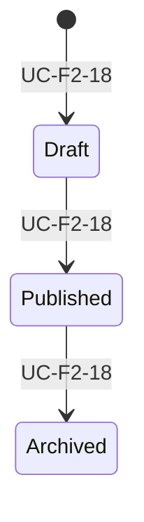

🏠 [Specs](../../../README.md) › 🧩 [Functional capabilities](../../README.md) ›
🔧 [F2 No-code configuration](../README.md) › 🗃️ [Data](README.md) › 🗃️ E-F2-17 Bookable resource setting

# 🗃️ E-F2-17 Bookable resource setting

**Status:** ✅ specified

## Purpose

What makes a record type bookable: hours, slots, capacity, buffer and booking rules.

## Fields

| Name | Type | Required | Validation | Default | Example | Personal data | Custom fields |
|---|---|---|---|---|---|---|---|
| record type | record type | yes | - | - | Consulting rooms | no | - |
| opening hours | per weekday | yes | opens at least once | - | Mon-Fri 8:00-20:00 | no | - |
| slot | minutes or nights | yes | over 0 | - | 15 min | no | - |
| capacity | number | yes | 1 or more | 1 | 1 | no | - |
| buffer | minutes | no | - | 0 | 5 | no | - |
| rules | lead time, cancel limit, longest, who books, approval | yes | possible together | - | 60 days, 24 h | no | - |

## Relations

One per bookable Record type; its records are the resources; Bookings point to them.

## Lifecycle

Draft, published, archived ([D97](../../../06-decisions/f02-no-code-configuration/d97-draft-preview-publish.md)).

## Indexes and search

None.

## Retention

As the configuration versions.

## Audit

Created and changed, before and after.

## Import and export

None.

## Used by

- [UC-F2-18 Make a record type bookable](../use-cases/08-views-and-bookings/uc-f02-18-make-a-record-type-bookable.md)
- [UC-F2-19 Book a resource](../use-cases/08-views-and-bookings/uc-f02-19-book-a-resource.md)

## Open questions

None.

---

⬅️ [E-F2-16 Visual view](e-f02-16-visual-view.md) · ⬆️ [Up](README.md) ·
➡️ [E-F2-18 Resource booking](e-f02-18-resource-booking.md)
