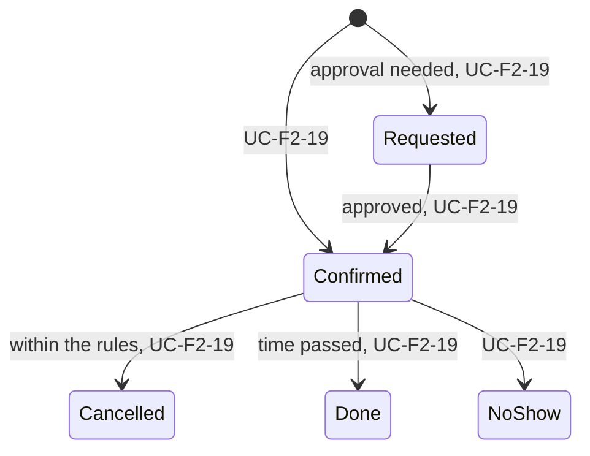

🏠 [Specs](../../../README.md) › 🧩 [Functional capabilities](../../README.md) ›
🔧 [F2 No-code configuration](../README.md) › 🗃️ [Data](README.md) › 🗃️ E-F2-18 Resource booking

# 🗃️ E-F2-18 Resource booking

**Status:** 🔄 waiting for the owner

## Purpose

One booking of one or more resources for a time, by someone, linked to a record.

## Fields

| Name | Type | Required | Validation | Default | Example | Personal data | Custom fields |
|---|---|---|---|---|---|---|---|
| resources | records of a bookable type | yes | free and allowed | - | Room 204 | no | - |
| from, to | date and time | yes | within the rules | - | 2026-12-18 15:00 to 12-20 11:00 | no | - |
| booked for | contact or user | yes | - | - | M. Garnier | yes | - |
| linked record | any record | no | - | - | Stay 3381 | no | - |
| status | list | yes | requested, confirmed, cancelled, done, no-show | confirmed | confirmed | no | - |

## Relations

Points to resources and to the record it serves; may create an invoice line or a task.

## Lifecycle

## Indexes and search

By resource, date, booker and status; the booking calendar.

## Retention

As the record it serves; otherwise 3 years (Proposed).

## Audit

As UC-F2-19's audit events.

## Import and export

Export as iCalendar and CSV.

## Used by

- [UC-F2-19 Book a resource](../use-cases/08-views-and-bookings/uc-f02-19-book-a-resource.md)
- [UC-F4-21 Book a meeting room and equipment](../../f04-meetings/use-cases/12-rooms-and-client-video/uc-f04-21-book-a-meeting-room-and-equipment.md)

## Open questions

None.

---

⬅️ [E-F2-17 Bookable resource setting](e-f02-17-bookable-resource-setting.md) · ⬆️ [Up](README.md) ·
➡️ [E-F2-19 Portal exposure](e-f02-19-portal-exposure.md)
