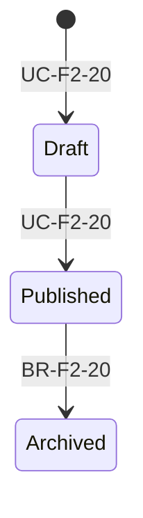

🏠 [Specs](../../../README.md) › 🧩 [Functional capabilities](../../README.md) ›
🔧 [F2 No-code configuration](../README.md) › 🗃️ [Data](README.md) › 🗃️ E-F2-19 Portal exposure

# 🗃️ E-F2-19 Portal exposure

**Status:** ✅ specified

## Purpose

How a record type shows on a portal: audience, fields, related lists and actions.

## Fields

| Name | Type | Required | Validation | Default | Example | Personal data | Custom fields |
|---|---|---|---|---|---|---|---|
| record type | record type | yes | - | - | Care log | no | - |
| audience | contact field | yes | links a person with an email | - | Family contact | no | - |
| fields | list | yes | no other person's sensitive data (BR-F2-20) | - | date, carer, tasks, comment | no | - |
| actions | list | no | comment, upload, confirm, pay | - | comment | no | - |

## Relations

One record type may have several exposures, one per audience; Portal accounts (E-F1-17) use them.

## Lifecycle

Draft, published, archived ([D97](../../../06-decisions/f02-no-code-configuration/d97-draft-preview-publish.md)).

## Indexes and search

None.

## Retention

As the configuration versions.

## Audit

Created and changed, before and after.

## Import and export

None.

## Used by

- [UC-F2-20 Expose a record type on a portal](../use-cases/09-portals-and-offline-forms/uc-f02-20-expose-a-record-type-on-a-portal.md)

## Open questions

None.

---

⬅️ [E-F2-18 Resource booking](e-f02-18-resource-booking.md) · ⬆️ [Up](README.md) ·
➡️ [E-F2-20 Offline form setting](e-f02-20-offline-form-setting.md)
