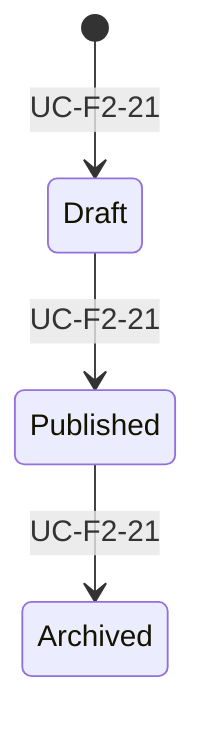

🏠 [Specs](../../../README.md) › 🧩 [Functional capabilities](../../README.md) ›
🔧 [F2 No-code configuration](../README.md) › 🗃️ [Data](README.md) › 🗃️ E-F2-20 Offline form setting

# 🗃️ E-F2-20 Offline form setting

**Status:** ✅ specified

## Purpose

What a phone keeps of a record type offline, and how it syncs.

## Fields

| Name | Type | Required | Validation | Default | Example | Personal data | Custom fields |
|---|---|---|---|---|---|---|---|
| record type | record type | yes | has a phone layout | - | Site diary | no | - |
| records kept | filter | yes | - | today's | my sites, next 7 days | no | - |
| conflict rule | list | yes | last change, merge, ask | merge | merge | no | - |
| roles | roles | yes | - | - | Site manager | no | - |

## Relations

One per record type; phones keep a local queue per user.

## Lifecycle

Draft, published, archived ([D97](../../../06-decisions/f02-no-code-configuration/d97-draft-preview-publish.md)).

## Indexes and search

None.

## Retention

As the configuration versions.

## Audit

Created and changed.

## Import and export

None.

## Used by

- [UC-F2-21 Make a phone form work offline](../use-cases/09-portals-and-offline-forms/uc-f02-21-make-a-phone-form-work-offline.md)
- [UC-F2-22 Fill a form offline on the phone](../use-cases/09-portals-and-offline-forms/uc-f02-22-fill-a-form-offline-on-the-phone.md)
- [UC-F6-21 Take orders offline on the road](../../f06-customers-and-sales/use-cases/09-sell-on-the-road-and-steer-sales/uc-f06-21-take-orders-offline-on-the-road.md)

## Open questions

None.

---

⬅️ [E-F2-19 Portal exposure](e-f02-19-portal-exposure.md) · ⬆️ [Up](README.md) ·
➡️ [E-F2-21 Test case](e-f02-21-test-case.md)
