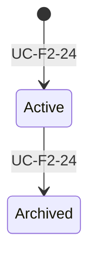

🏠 [Specs](../../../README.md) › 🧩 [Functional capabilities](../../README.md) ›
🔧 [F2 No-code configuration](../README.md) › 🗃️ [Data](README.md) › 🗃️ E-F2-21 Test case

# 🗃️ E-F2-21 Test case

**Status:** ✅ specified

## Purpose

A sample record and the outcome a rule or workflow must give.

## Fields

| Name | Type | Required | Validation | Default | Example | Personal data | Custom fields |
|---|---|---|---|---|---|---|---|
| rule or workflow | reference | yes | - | - | Purchase approval | no | - |
| sample record | record values | yes | anonymised when copied | - | purchase 6,000 EUR | no | - |
| expected | outcome | yes | - | - | approver: owner | no | - |
| last result | passed, failed, broken | no | - | - | passed | no | - |

## Relations

Belongs to one rule or workflow.

## Lifecycle

Created, run at each publish, archived with its rule.

## Indexes and search

Per rule.

## Retention

As its rule.

## Audit

Added, changed, run.

## Import and export

None.

## Used by

- [UC-F2-24 Test rules and workflows with test cases](../use-cases/10-change-safely/uc-f02-24-test-rules-and-workflows-with-test-cases.md)

## Open questions

None.

---

⬅️ [E-F2-20 Offline form setting](e-f02-20-offline-form-setting.md) · ⬆️ [Up](README.md) ·
➡️ [E-F2-22 Field rule](e-f02-22-field-rule.md)
