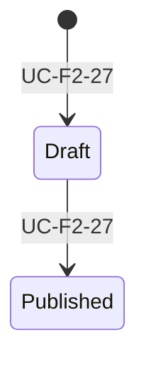

🏠 [Specs](../../../README.md) › 🧩 [Functional capabilities](../../README.md) ›
🔧 [F2 No-code configuration](../README.md) › 🗃️ [Data](README.md) › 🗃️ E-F2-22 Field rule

# 🗃️ E-F2-22 Field rule

**Status:** ✅ specified

## Purpose

A field's rights per role and its validation.

## Fields

| Name | Type | Required | Validation | Default | Example | Personal data | Custom fields |
|---|---|---|---|---|---|---|---|
| field | custom or core field | yes | - | - | IBAN | no | - |
| rights per role | hidden, masked, read, change | yes | - | as the role | Sales: masked | no | - |
| validation | format, range, required when, unique | no | - | - | format IBAN | no | - |
| message | text per language | no | - | - | Not a valid IBAN | no | - |

## Relations

One per field.

## Lifecycle

Draft, published ([D97](../../../06-decisions/f02-no-code-configuration/d97-draft-preview-publish.md)).

## Indexes and search

None.

## Retention

As the configuration versions.

## Audit

Changed, before and after.

## Import and export

None.

## Used by

- [UC-F2-27 Set field-level rights and validation rules](../use-cases/11-rights-translations-and-approvals/uc-f02-27-set-field-level-rights-and-validation-rules.md)

## Open questions

None.

---

⬅️ [E-F2-21 Test case](e-f02-21-test-case.md) · ⬆️ [Up](README.md) · ➡️ [E-F2-23 Translation](e-f02-23-translation.md)
