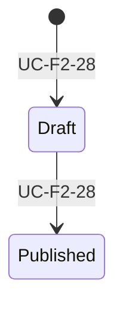

🏠 [Specs](../../../README.md) › 🧩 [Functional capabilities](../../README.md) ›
🔧 [F2 No-code configuration](../README.md) › 🗃️ [Data](README.md) › 🗃️ E-F2-23 Translation

# 🗃️ E-F2-23 Translation

**Status:** ✅ specified

## Purpose

A custom label, help text, status, value or message in one language.

## Fields

| Name | Type | Required | Validation | Default | Example | Personal data | Custom fields |
|---|---|---|---|---|---|---|---|
| item | label reference | yes | - | - | status À planifier | no | - |
| language | language | yes | a company language | - | en | no | - |
| text | text | yes | - | - | To plan | no | - |

## Relations

Many per configuration item.

## Lifecycle

Draft, published.

## Indexes and search

By language and item.

## Retention

As the configuration versions.

## Audit

Changed.

## Import and export

XLIFF and CSV.

## Used by

- [UC-F2-28 Translate custom labels and statuses](../use-cases/11-rights-translations-and-approvals/uc-f02-28-translate-custom-labels-and-statuses.md)

## Open questions

None.

---

⬅️ [E-F2-22 Field rule](e-f02-22-field-rule.md) · ⬆️ [Up](README.md) ·
➡️ [E-F2-24 Approval chain](e-f02-24-approval-chain.md)
