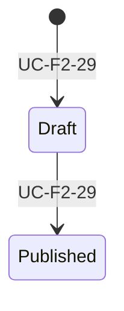

🏠 [Specs](../../../README.md) › 🧩 [Functional capabilities](../../README.md) ›
🔧 [F2 No-code configuration](../README.md) › 🗃️ [Data](README.md) › 🗃️ E-F2-24 Approval chain

# 🗃️ E-F2-24 Approval chain

**Status:** ✅ specified

## Purpose

The levels, approvers, conditions and time limits of a record type's approvals.

## Fields

| Name | Type | Required | Validation | Default | Example | Personal data | Custom fields |
|---|---|---|---|---|---|---|---|
| record type | record type | yes | - | - | Purchase request | no | - |
| levels | list of condition, approvers, one or all | yes | each has an approver | - | up to 5,000 EUR: manager; above: owner | no | - |
| time limit | hours | no | - | none | 48 | no | - |
| escalation | next level, approver's manager | no | - | next level | next level | no | - |

## Relations

One per record type that needs approval; decisions are kept on the record.

## Lifecycle

Draft, published ([D97](../../../06-decisions/f02-no-code-configuration/d97-draft-preview-publish.md)).

## Indexes and search

None.

## Retention

As the configuration versions.

## Audit

Changed; each decision on its record.

## Import and export

None.

## Used by

- [UC-F2-29 Set up an approval chain](../use-cases/11-rights-translations-and-approvals/uc-f02-29-set-up-an-approval-chain.md)

## Open questions

None.

---

⬅️ [E-F2-23 Translation](e-f02-23-translation.md) · ⬆️ [Up](README.md) ·
➡️ [E-F2-25 Request type](e-f02-25-request-type.md)
