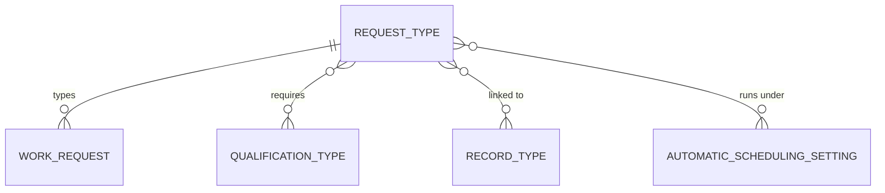
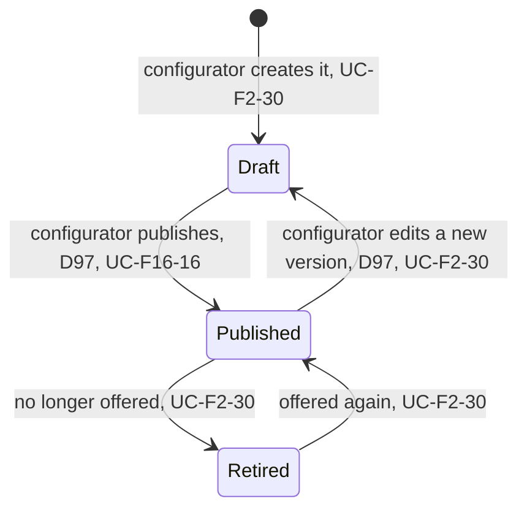

🏠 [Specs](../../../README.md) › 🧩 [Functional capabilities](../../README.md) ›
🔧 [F2 No-code configuration](../README.md) › 🗃️ [Data](README.md) › 🗃️ E-F2-25 Request type

# 🗃️ E-F2-25 Request type

**Status:** 🔄 draft (GH-2 step S4b, from VD-28, VD-29, VD-30, VD-32 / D510, D511, D512, D514)

## Purpose

The kind of work a customer may ask for, and how it is scheduled: the employees' attributes that count, each required or
preferred with a weight, the default duration, the weights of the scheduling objectives, and whether automatic mode is
allowed. A configurator sets it up; the planner may add or relax one attribute on a single request, logged (decided by
the owner on 2026-11-13, VD-28 and VD-29).

## Fields

| Name | Type | Required | Validation | Default | Example | Personal data | Custom fields |
|---|---|---|---|---|---|---|---|
| name | text | yes | unique in the company | - | Home help visit | no | - |
| kind | list | yes | see below | service | service | no | - |
| default duration | minutes | yes | more than 0 | 60 | 90 | no | - |
| attributes | list of rows, see below | no | one row per attribute | none | Carer qualification, required | no | - |
| objective weights | list of rows, see below | yes | each 0 to 100 | BR-F9-35 order | lateness 40, travel 30 | no | - |
| automatic mode allowed | yes or no | yes | - | no | yes | no | - |
| linked record types | record types | no | - | - | Care plan visit | no | - |
| place needed | yes or no | yes | - | yes | yes | no | - |
| status | list | yes | draft, published, retired | draft | published | no | - |

Kinds (VD-30): service or intervention; order to fulfil and deliver; project or engagement; booking or appointment.

Each attribute row:

| Part | Values |
|---|---|
| attribute | from one of the four families of VD-27 (listed below) |
| rule | required, or preferred with a weight from 1 to 5 (VD-29, D517) |
| level or value | a minimum level, a category, a language and its level, a maximum travel |
| legal | yes when a country pack ties it to the work; then required and locked (BR-F9-26) |

The four families (VD-27): degrees and qualifications; skills and languages; place and travel; person and contract.

Each objective row (VD-32): lateness, travel, customer preferences (continuity, preferred or refused people, language),
fair workload (working-time rules, rest, overtime), cost and margin. Default order (D517): lateness, travel,
customer preferences, fairness, cost
([BR-F9-35](../../f09-hr-and-projects/business-rules/br-f09-35-default-order-of-objectives.md)).

## Relations

- [E-F16-12 Work request](../../f16-customer-support-agents/data/e-f16-12-work-request.md): each work request has one
  type.
- [E-F9-30 Qualification type](../../f09-hr-and-projects/data/e-f09-30-qualification-type.md): the qualifications it
  requires or prefers.
- [E-F2-05 Record type](e-f02-05-record-type.md): the records a work request of this type serves.
- [E-F9-33 Automatic scheduling setting](../../f09-hr-and-projects/data/e-f09-33-automatic-scheduling-setting.md): runs
  automatically only for types that allow it.

The nine domain rules (BR-F12-17, BR-SC05-13, BR-F9-17, BR-F9-22, BR-SC03-13, BR-SC04-06, BR-SC07-05, BR-SC07-09,
BR-SC12-07) become attribute rows of the request types or operations they concern.

## Lifecycle

Draft, preview and publish as every configuration (D97). (Proposed) A retired type takes no new work requests; the open
ones keep it.

## Indexes and search

- Unique: name.
- Filters and facets: kind, status, automatic mode allowed, required qualification.

## Retention

As the configuration versions (E-F2-10).

## Audit

Every change, attribute by attribute and weight by weight; published, retired.

## Import and export

Part of a configuration pack (E-F2-11); (Proposed) the sector packs ship ready-made types.

## Used by

- [UC-F2-30 Set up a request type](../use-cases/12-set-up-request-types/uc-f02-30-set-up-a-request-type.md)
- [UC-F16-16](../../f16-customer-support-agents/use-cases/06-take-in-every-request/uc-f16-16-turn-any-request-into-a-work-request.md)
- [UC-F9-33](../../f09-hr-and-projects/use-cases/12-schedule-customer-requests/uc-f09-33-schedule-a-work-request.md)
- [UC-F9-34](../../f09-hr-and-projects/use-cases/12-schedule-customer-requests/uc-f09-34-run-the-automatic-scheduling.md)

## Open questions

None.

---

⬅️ [E-F2-24 Approval chain](e-f02-24-approval-chain.md) · ⬆️ [Up](README.md) ·
➡️ [E-F2-26 Configuration draft](e-f02-26-configuration-draft.md)
