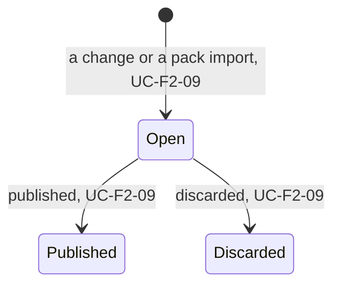

🏠 [Specs](../../../README.md) › 🧩 [Functional capabilities](../../README.md) ›
🔧 [F2 No-code configuration](../README.md) › 🗃️ [Data](README.md) › 🗃️ E-F2-26 Configuration draft

# 🗃️ E-F2-26 Configuration draft

**Status:** ✅ specified

## Purpose

The configuration draft the flow charts name with the words "Draft", "change", "draft"
([FL-F2-01](../flows/fl-f02-01-configure-a-record-type.md), [FL-F2-05](../flows/fl-f02-05-publish-and-roll-back.md),
[FL-F2-06](../flows/fl-f02-06-share-a-configuration.md), [FL-F2-10](../flows/fl-f02-10-change-safely.md)). The owner
decided to create it ([D516](../../../06-decisions/foundations/d516-naming-rules-and-the-seven-classes-of-names.md));
its fields are derived from the specifications and confirmed by the owner (D572).

## Fields

| Name | Type | Required | Validation | Default | Example | Personal data | Custom fields |
|---|---|---|---|---|---|---|---|
| title | text | yes | - | - | Add Vehicle field | no | - |
| author | user | yes | a configurator, for their own drafts | the creator | Marie Dupont | yes | - |
| origin | change, pack import | yes | - | change | pack import | no | - |
| areas | list of record types and configuration items | no | - | - | Quotes, Automations | no | - |
| changes | list in plain words | yes | - | - | Field Vehicle added to Quotes | no | - |
| problems | list in plain words | no | none left before publishing | - | Customer is required but missing from a layout | no | - |
| impact | list of what uses each changed item, renamed or broken | no | each broken item fixed or accepted, BR-F2-22 | - | 3 rules, 1 plugin | no | - |
| published as | configuration version | no | - | - | 17 | no | - |
| state | open, published, discarded | yes | the lifecycle below | open | published | no | - |

Derived from [UC-F2-09](../use-cases/05-publish-and-roll-back/uc-f02-09-draft-preview-and-publish-a-change.md) (the
changes in plain words, preview, publish, discard, problems refused at publishing, two configurators on the same record
type), [UC-F2-02](../use-cases/01-configure-a-record-type/uc-f02-02-change-the-statuses-of-a-record-type.md),
[UC-F2-11](../use-cases/06-share-a-configuration/uc-f02-11-export-or-import-a-configuration-as-a-pack.md) (an import
becomes a draft), [UC-F2-23](../use-cases/10-change-safely/uc-f02-23-see-the-impact-of-a-change-before-publishing.md)
and [BR-F2-22](../business-rules/br-f02-22-a-change-that-breaks-something-is-not-published-unread.md) (the impact list),
[S-F2-10 Publish and versions](../screens/05-publish-and-roll-back/s-f02-10-publish-and-versions.md) and the list
[S-F2-L26](../screens/00-lists/s-f02-l26-configuration-drafts.md).

## Relations

Changes configuration items such as [custom fields](e-f02-01-custom-field.md) and
[statuses and transitions](e-f02-02-status-and-transition.md); may come from a
[configuration pack](e-f02-11-configuration-pack.md); once published it becomes a
[configuration version](e-f02-10-configuration-version.md). A second draft on the same record type sees the first and
publishes on top of it.

## Lifecycle

No user sees a draft until it is published; publishing is refused while a problem or an unread broken item remains.

## Indexes and search

By title, author, area, state.

## Retention

As the other records of its capability.

## Audit

Every change, as the other records of its capability.

## Import and export

A pack import arrives as a draft (UC-F2-11); a published draft is exported through its version
([E-F2-10](e-f02-10-configuration-version.md)). CSV or XLSX of the visible rows and columns from
[S-F2-L26](../screens/00-lists/s-f02-l26-configuration-drafts.md).

## Used by

- [UC-F2-02 Change the statuses of a record type](../use-cases/01-configure-a-record-type/uc-f02-02-change-the-statuses-of-a-record-type.md)
- [UC-F2-09 Draft, preview and publish a change](../use-cases/05-publish-and-roll-back/uc-f02-09-draft-preview-and-publish-a-change.md)
- [UC-F2-11 Export or import a configuration as a pack](../use-cases/06-share-a-configuration/uc-f02-11-export-or-import-a-configuration-as-a-pack.md)
- [UC-F2-23 See the impact of a change before publishing](../use-cases/10-change-safely/uc-f02-23-see-the-impact-of-a-change-before-publishing.md)

## Open questions

None.

---

⬅️ [E-F2-25 Request type](e-f02-25-request-type.md) · ⬆️ [Up](README.md) ·
➡️ [E-F2-27 Legal mention](e-f02-27-legal-mention.md)
