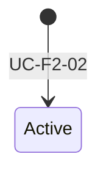

🏠 [Specs](../../../README.md) › 🧩 [Functional capabilities](../../README.md) ›
🔧 [F2 No-code configuration](../README.md) › 🗃️ [Data](README.md) › 🗃️ E-F2-26 Configuration draft

# 🗃️ E-F2-26 Configuration draft

**Status:** 🔄 waiting for the owner

## Purpose

(Proposed) The configuration draft the flow charts name with the words "Draft", "change", "draft"
([FL-F2-01](../flows/fl-f02-01-configure-a-record-type.md), [FL-F2-05](../flows/fl-f02-05-publish-and-roll-back.md),
[FL-F2-06](../flows/fl-f02-06-share-a-configuration.md), [FL-F2-10](../flows/fl-f02-10-change-safely.md)). The owner
decided to create it ([D516](../../../06-decisions/foundations/d516-naming-rules-and-the-seven-classes-of-names.md));
what it holds waits for the owner's confirmation.

## Fields

(Proposed) To define with the owner: the flow charts name the record, not its fields.

## Relations

(Proposed) To define with the owner, from the use cases below.

## Lifecycle

## Indexes and search

(Proposed) To define with the owner.

## Retention

(Proposed) As the other records of its capability, to confirm with the owner.

## Audit

(Proposed) Every change, as the other records of its capability.

## Import and export

(Proposed) To define with the owner.

## Used by

- [UC-F2-02 Change the statuses of a record type](../use-cases/01-configure-a-record-type/uc-f02-02-change-the-statuses-of-a-record-type.md)
- [UC-F2-09 Draft, preview and publish a change](../use-cases/05-publish-and-roll-back/uc-f02-09-draft-preview-and-publish-a-change.md)
- [UC-F2-11 Export or import a configuration as a pack](../use-cases/06-share-a-configuration/uc-f02-11-export-or-import-a-configuration-as-a-pack.md)
- [UC-F2-23 See the impact of a change before publishing](../use-cases/10-change-safely/uc-f02-23-see-the-impact-of-a-change-before-publishing.md)

## Open questions

(Proposed) Its fields, relations and states wait for the owner (waiting list, step 36e).

---

⬅️ [E-F2-25 Request type](e-f02-25-request-type.md) · ⬆️ [Up](README.md) ·
➡️ [E-F2-27 Legal mention](e-f02-27-legal-mention.md)
