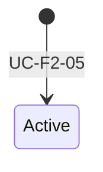

🏠 [Specs](../../../README.md) › 🧩 [Functional capabilities](../../README.md) ›
🔧 [F2 No-code configuration](../README.md) › 🗃️ [Data](README.md) › 🗃️ E-F2-27 Legal mention

# 🗃️ E-F2-27 Legal mention

**Status:** ✅ specified

## Purpose

The legal mention the flow charts name with the words "Legal mentions"
([FL-F2-02](../flows/fl-f02-02-customise-documents-and-emails.md)). The owner decided to create it
([D516](../../../06-decisions/foundations/d516-naming-rules-and-the-seven-classes-of-names.md)); its fields are derived
from the specifications and confirmed by the owner (D572).

## Fields

| Name | Type | Required | Validation | Default | Example | Personal data | Custom fields |
|---|---|---|---|---|---|---|---|
| name | text | yes | - | - | Invoice late payment terms | no | - |
| document types | list of document types | yes | - | - | invoice | no | - |
| wording | text | yes | the country pack's rule | from the country pack | SIREN 552 100 554 | no | - |
| language | language | no | a language of the company | - | en | no | - |
| source | country pack rule | yes | - | - | CR-FR-015 | no | - |
| locked | yes | yes | never removed or hidden, BR-F2-10 | yes | yes | no | - |
| place and style | position and type size | no | down to the minimum legible size, BR-F2-10 | - | footer, small type | no | - |
| state | active | yes | the lifecycle below | active | active | no | - |

Derived from [UC-F2-05](../use-cases/02-customise-documents-and-emails/uc-f02-05-edit-a-document-template.md) (locked
legal mentions on the page, placed and styled, texts per language),
[BR-F2-10](../business-rules/br-f02-10-legal-mentions-are-locked.md) (added by SimpleERP per document type, place and
style only), [FL-F2-02](../flows/fl-f02-02-customise-documents-and-emails.md), [S-F2-06 Document template
editor](../screens/02-customise-documents-and-emails/s-f02-06-document-template-editor.md) and the list
[S-F2-L27](../screens/00-lists/s-f02-l27-legal-mentions.md). Its wording and values come from the country pack, for
France [CR-FR-015 Mandatory invoice
mentions](../../../10-country-packs/france/invoicing/cr-fr-015-invoice-mandatory-mentions.md).

## Relations

Placed on every [document template](e-f02-06-document-template.md) of its document types, where it is a locked block;
written from a country pack rule, such as
[CR-FR-015](../../../10-country-packs/france/invoicing/cr-fr-015-invoice-mandatory-mentions.md) for invoices.

## Lifecycle

## Indexes and search

By name, document type, source, state.

## Retention

As the other records of its capability.

## Audit

Every change, as the other records of its capability.

## Import and export

Shipped and updated with the country pack (BR-F2-10), never imported by hand; CSV or XLSX of the visible rows and
columns from [S-F2-L27](../screens/00-lists/s-f02-l27-legal-mentions.md).

## Used by

- [UC-F2-05 Edit a document template](../use-cases/02-customise-documents-and-emails/uc-f02-05-edit-a-document-template.md)

## Open questions

None.

---

⬅️ [E-F2-26 Configuration draft](e-f02-26-configuration-draft.md) · ⬆️ [Up](README.md) ·
➡️ [E-F2-28 Offline change queue](e-f02-28-offline-change-queue.md)
