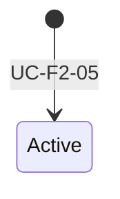

🏠 [Specs](../../../README.md) › 🧩 [Functional capabilities](../../README.md) ›
🔧 [F2 No-code configuration](../README.md) › 🗃️ [Data](README.md) › 🗃️ E-F2-27 Legal mention

# 🗃️ E-F2-27 Legal mention

**Status:** 🔄 waiting for the owner

## Purpose

(Proposed) The legal mention the flow charts name with the words "Legal mentions"
([FL-F2-02](../flows/fl-f02-02-customise-documents-and-emails.md)). The owner decided to create it
([D516](../../../06-decisions/foundations/d516-naming-rules-and-the-seven-classes-of-names.md)); what it holds waits for
the owner's confirmation.

## Fields

(Proposed) To define with the owner: the flow charts name the record, not its fields.

## Relations

(Proposed) To define with the owner, from the use cases below.

## Lifecycle

## Indexes and search

(Proposed) To define with the owner.

## Retention

(Proposed) As the other records of its capability, to confirm with the owner.

## Audit

(Proposed) Every change, as the other records of its capability.

## Import and export

(Proposed) To define with the owner.

## Used by

- [UC-F2-05 Edit a document template](../use-cases/02-customise-documents-and-emails/uc-f02-05-edit-a-document-template.md)

## Open questions

(Proposed) Its fields, relations and states wait for the owner (waiting list, step 36e).

---

⬅️ [E-F2-26 Configuration draft](e-f02-26-configuration-draft.md) · ⬆️ [Up](README.md) ·
➡️ [E-F2-28 Offline change queue](e-f02-28-offline-change-queue.md)
