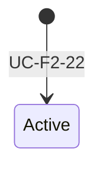

🏠 [Specs](../../../README.md) › 🧩 [Functional capabilities](../../README.md) ›
🔧 [F2 No-code configuration](../README.md) › 🗃️ [Data](README.md) › 🗃️ E-F2-28 Offline change queue

# 🗃️ E-F2-28 Offline change queue

**Status:** ✅ specified

## Purpose

The offline change queue the flow charts name with the words "Queued changes"
([FL-F2-09](../flows/fl-f02-09-portals-and-offline-forms.md)). The owner decided to create it
([D516](../../../06-decisions/foundations/d516-naming-rules-and-the-seven-classes-of-names.md)); its fields are derived
from the specifications and confirmed by the owner (D572).

## Fields

| Name | Type | Required | Validation | Default | Example | Personal data | Custom fields |
|---|---|---|---|---|---|---|---|
| title | text | yes | - | - | Marie Dupont, 3 changes | no | - |
| user | user | yes | - | - | Marie Dupont | yes | - |
| phone | device | yes | - | - | Marie Dupont's phone | no | - |
| changes | list of record, form, time made, status, reason | yes | sent in the order they were made, encrypted on the phone, BR-F2-21 | - | Care log Mme Roche, 10:42, waiting | yes | - |
| change status | waiting, sent, refused, to choose | yes | the record type's conflict rule, BR-F2-21 | waiting | sent | no | - |
| waiting | number | yes | - | 0 | 2 | no | - |
| last sync | date and time | no | - | - | 2026-11-27 11:15 | no | - |
| state | active | yes | the lifecycle below | active | active | no | - |

Derived from [UC-F2-22](../use-cases/09-portals-and-offline-forms/uc-f02-22-fill-a-form-offline-on-the-phone.md) (each
saved record joins the queue with its time, the count shows, the queue syncs in order, each record shows Sent, a
refused record stays queued with its reason, a conflict the user must choose shows both values, Sync now),
[BR-F2-21](../business-rules/br-f02-21-offline-forms-keep-only-what-is-needed-and-sync-in-order.md),
[FL-F2-09](../flows/fl-f02-09-portals-and-offline-forms.md),
[S-F2-21 Offline form](../screens/09-portals-and-offline-forms/s-f02-21-offline-form.md) and the list
[S-F2-L28](../screens/00-lists/s-f02-l28-offline-change-queues.md).

## Relations

One per [user](../../f01-administration/data/e-f01-03-user.md) and phone ([E-F2-20](e-f02-20-offline-form-setting.md):
"phones keep a local queue per user"); each change follows the [offline form setting](e-f02-20-offline-form-setting.md)
of its [record type](e-f02-05-record-type.md) and creates or updates one of its records, with its photos and signatures.

## Lifecycle

## Indexes and search

By user, phone, state; its changes by record and status.

## Retention

As the other records of its capability.

## Audit

Every change, as the other records of its capability.

## Import and export

No import: the queue is filled on the phone and sent by its sync (BR-F2-21). CSV or XLSX of the visible rows and columns
from [S-F2-L28](../screens/00-lists/s-f02-l28-offline-change-queues.md).

## Used by

- [UC-F2-22 Fill a form offline on the phone](../use-cases/09-portals-and-offline-forms/uc-f02-22-fill-a-form-offline-on-the-phone.md)

## Open questions

None.

---

⬅️ [E-F2-27 Legal mention](e-f02-27-legal-mention.md) · ⬆️ [Up](README.md) ·
➡️ [E-F2-29 Workflow template](e-f02-29-workflow-template.md)
