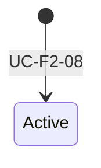

🏠 [Specs](../../../README.md) › 🧩 [Functional capabilities](../../README.md) ›
🔧 [F2 No-code configuration](../README.md) › 🗃️ [Data](README.md) › 🗃️ E-F2-29 Workflow template

# 🗃️ E-F2-29 Workflow template

**Status:** ✅ specified

## Purpose

The workflow template the flow charts name with the words "Template"
([FL-F2-04](../flows/fl-f02-04-design-a-visual-workflow.md)). The owner decided to create it
([D516](../../../06-decisions/foundations/d516-naming-rules-and-the-seven-classes-of-names.md)); its fields are derived
from the specifications and confirmed by the owner (D572).

## Fields

| Name | Type | Required | Validation | Default | Example | Personal data | Custom fields |
|---|---|---|---|---|---|---|---|
| name | text | yes | - | - | Supplier invoice by email | no | - |
| trigger | as rules (D125) | yes | - | - | an email arrives | no | - |
| blocks | ordered graph of blocks | yes | the blocks of D129 | - | AI, If, Ask, Call | no | - |
| state | active | yes | the lifecycle below | active | active | no | - |

Derived from [UC-F2-08](../use-cases/04-design-a-visual-workflow/uc-f02-08-design-a-visual-workflow.md) (a workflow
starts from a template or blank, then gets its trigger and blocks),
[FL-F2-04](../flows/fl-f02-04-design-a-visual-workflow.md), the fields of the [workflow](e-f02-09-workflow.md) it
starts, [S-F2-09 Workflow designer](../screens/04-design-a-visual-workflow/s-f02-09-workflow-designer.md) and the list
[S-F2-L29](../screens/00-lists/s-f02-l29-workflow-templates.md).

## Relations

Starts new [workflows](e-f02-09-workflow.md), which take its trigger and blocks; the account rights are chosen on each
workflow (BR-F2-12).

## Lifecycle

## Indexes and search

By name, trigger, state.

## Retention

As the other records of its capability.

## Audit

Every change, as the other records of its capability.

## Import and export

CSV or XLSX of the visible rows and columns from [S-F2-L29](../screens/00-lists/s-f02-l29-workflow-templates.md); no
import.

## Used by

- [UC-F2-08 Design a visual workflow](../use-cases/04-design-a-visual-workflow/uc-f02-08-design-a-visual-workflow.md)

## Open questions

None.

---

⬅️ [E-F2-28 Offline change queue](e-f02-28-offline-change-queue.md) · ⬆️ [Up](README.md) ·
➡️ [E-F2-30 Script step](e-f02-30-script-step.md)
