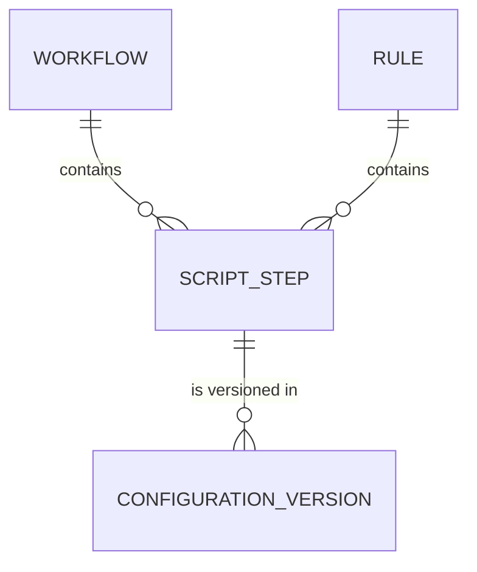
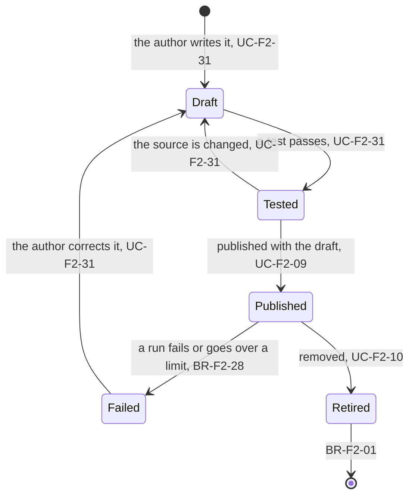

🏠 [Specs](../../../README.md) › 🧩 [Functional capabilities](../../README.md) ›
🔧 [F2 No-code configuration](../README.md) › 🗃️ [Data](README.md) › 🗃️ E-F2-30 Script step

# 🗃️ E-F2-30 Script step

**Status:** ✅ specified

## Purpose

A short script of a rule or workflow step: its source, inputs, outputs, limits and its runs
([D521](../../../06-decisions/f02-no-code-configuration/d521-benchmark-gaps-f02-no-code-configuration.md)).

## Fields

| Name | Type | Required | Validation | Default | Example | Personal data | Custom fields |
|---|---|---|---|---|---|---|---|
| name | text | yes | unique in the workflow | - | Delivery date | no | no |
| workflow or rule | workflow or rule | yes | - | - | Order to delivery | no | no |
| inputs | list of field and type | yes | fields the author may read | - | order date, lead time | no | no |
| source | code | yes | up to 200 lines, language version fixed per step | - | delivery = add_days(order_date, lead_time) | no | no |
| outputs | list of name and type | yes | - | - | delivery date | no | no |
| time limit | seconds | yes | within the platform maximum | 2 | 2 | no | no |
| memory limit | MB | yes | within the platform maximum | 64 | 64 | no | no |
| last test | outputs, time, memory | no | - | - | 12 ms, 3 MB | no | no |
| version | number | yes | - | 1 | 4 | no | no |
| state | draft, tested, published, failed, retired | yes | the lifecycle below | draft | published | no | no |
| runs, failures, over limit | numbers | no | - | 0 | 1,820, 3, 1 | no | no |
| author | user | yes | - | the creator | Marc D. | yes | no |

## Relations

- [E-F2-09 Workflow](e-f02-09-workflow.md)
- [E-F2-08 Automation rule](e-f02-08-automation-rule.md)
- [E-F2-10 Configuration version](e-f02-10-configuration-version.md)

## Lifecycle

## Indexes and search

By workflow, state and author; the scripts that failed in the last week.

## Retention

A retired script and its versions are archived, never deleted
([BR-F2-01](../business-rules/br-f02-01-archive-never-delete.md)); run logs 90 days.

## Audit

Each version with its author and test, each publication, each failed or stopped run.

## Import and export

Scripts travel in configuration packs
([UC-F2-11](../use-cases/06-share-a-configuration/uc-f02-11-export-or-import-a-configuration-as-a-pack.md)) with their
versions.

## Used by

- [UC-F2-31 Add a low-code script step](../use-cases/13-low-code-bulk-and-cleaning/uc-f02-31-add-a-low-code-script-step.md)

## Open questions

None.

---

⬅️ [E-F2-29 Workflow template](e-f02-29-workflow-template.md) · ⬆️ [Up](README.md) ·
➡️ [E-F2-31 Bulk operation](e-f02-31-bulk-operation.md)
