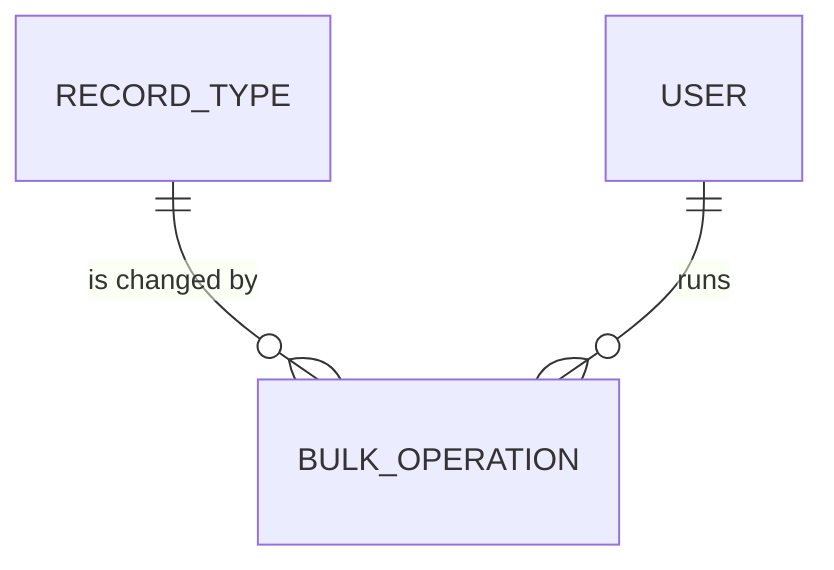
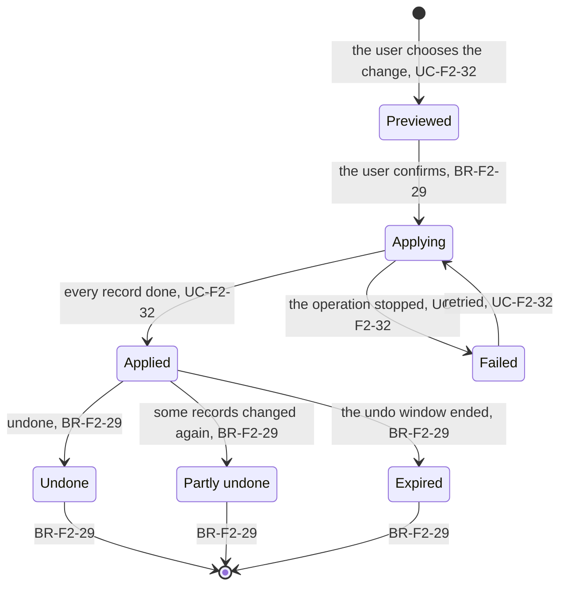

🏠 [Specs](../../../README.md) › 🧩 [Functional capabilities](../../README.md) ›
🔧 [F2 No-code configuration](../README.md) › 🗃️ [Data](README.md) › 🗃️ E-F2-31 Bulk operation

# 🗃️ E-F2-31 Bulk operation

**Status:** ✅ specified

## Purpose

One change or mass action applied to many records, with its preview, its result and its undo
([D521](../../../06-decisions/f02-no-code-configuration/d521-benchmark-gaps-f02-no-code-configuration.md)).

## Fields

| Name | Type | Required | Validation | Default | Example | Personal data | Custom fields |
|---|---|---|---|---|---|---|---|
| record type | record type | yes | - | - | Customer | no | no |
| selection | filter or list of records | yes | - | - | 212 customers, filter Lyon | no | no |
| changes | list of field and new value, or a mass action | yes | valid for the field | - | account manager: Claire P. | no | no |
| records selected, to change, skipped | numbers | yes | - | - | 212, 200, 12 | no | no |
| skipped reasons | list of reason and count | no | - | - | locked status 9, no right 3 | no | no |
| old values | per record and field | yes | kept until the undo window ends | - | account manager: Marc D. | yes | no |
| run by, at | user, date and time | yes | - | - | Marc D., 2026-11-14 11:20 | yes | no |
| undo until | date | yes | at most 30 days | 7 days after the run | 2026-11-21 | no | no |
| state | previewed, applying, applied, undone, partly undone, failed, expired | yes | the lifecycle below | previewed | applied | no | no |

## Relations

- [E-F2-05 Record type](e-f02-05-record-type.md)
- [E-F1-03 User](../../f01-administration/data/e-f01-03-user.md)

## Lifecycle

## Indexes and search

By user, record type, state and date.

## Retention

The old values are dropped when the undo window ends; the operation itself is kept 2 years.

## Audit

The operation, each record's change in its own history, each undo, with who and when.

## Import and export

The preview and the result are exported as a spreadsheet.

## Used by

- [UC-F2-32 Edit records in bulk](../use-cases/13-low-code-bulk-and-cleaning/uc-f02-32-edit-records-in-bulk.md)

## Open questions

None.

---

⬅️ [E-F2-30 Script step](e-f02-30-script-step.md) · ⬆️ [Up](README.md) ·
➡️ [E-F2-32 Scheduled trigger](e-f02-32-scheduled-trigger.md)
