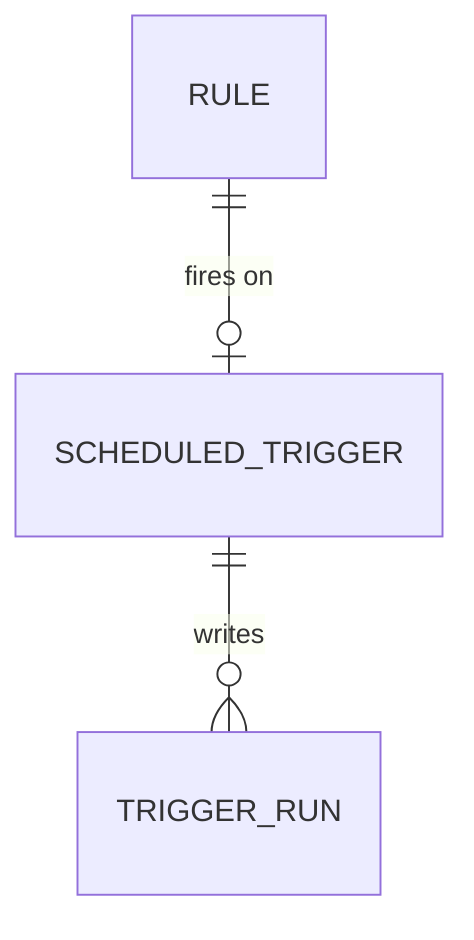
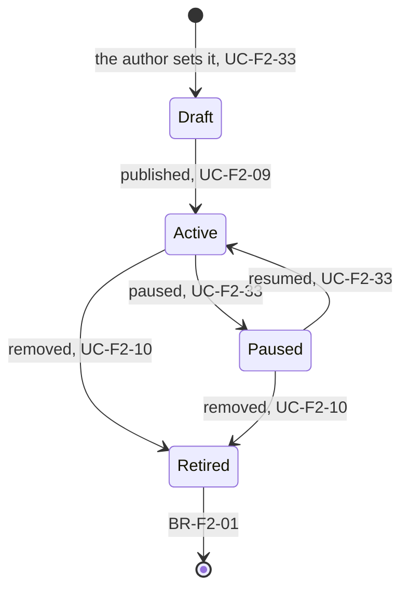

🏠 [Specs](../../../README.md) › 🧩 [Functional capabilities](../../README.md) ›
🔧 [F2 No-code configuration](../README.md) › 🗃️ [Data](README.md) › 🗃️ E-F2-32 Scheduled trigger

# 🗃️ E-F2-32 Scheduled trigger

**Status:** ✅ specified

## Purpose

The time part of a rule: an offset from a date field or a recurring schedule, with its window and its runs
([D521](../../../06-decisions/f02-no-code-configuration/d521-benchmark-gaps-f02-no-code-configuration.md)).

## Fields

| Name | Type | Required | Validation | Default | Example | Personal data | Custom fields |
|---|---|---|---|---|---|---|---|
| rule | rule | yes | - | - | Remind unsigned quotes | no | no |
| kind | offset or schedule | yes | - | - | offset | no | no |
| date field | field of the record type | for an offset | a date or date-time field | - | Quote: sent on | no | no |
| offset | number, unit, before or after | for an offset | 1 to 365 days or 1 to 72 hours | - | 3 days after | no | no |
| schedule | day or days and time | for a schedule | - | - | every Monday at 08:00 | no | no |
| time zone | time zone | yes | - | the company's time zone | Europe/Paris | no | no |
| window | hours | yes | 1 to 168 | 24 | 24 | no | no |
| state | draft, active, paused, retired | yes | the lifecycle below | draft | active | no | no |
| last run, next run | date and time | no | - | - | 2026-11-14 08:00 | no | no |
| last run counts | due, handled, skipped, failed | no | - | - | 14, 14, 0, 0 | no | no |

## Relations

- [E-F2-08 Automation rule](e-f02-08-automation-rule.md)

## Lifecycle

## Indexes and search

By rule, state and next run; the runs by date.

## Retention

A retired trigger is archived ([BR-F2-01](../business-rules/br-f02-01-archive-never-delete.md)); the run log is kept 1
year.

## Audit

Each change of the trigger, each publication, each run with its counts.

## Import and export

Triggers travel with their rule in configuration packs
([UC-F2-11](../use-cases/06-share-a-configuration/uc-f02-11-export-or-import-a-configuration-as-a-pack.md)).

## Used by

- [UC-F2-33 Set a time-based rule](../use-cases/13-low-code-bulk-and-cleaning/uc-f02-33-set-a-time-based-rule.md)

## Open questions

None.

---

⬅️ [E-F2-31 Bulk operation](e-f02-31-bulk-operation.md) · ⬆️ [Up](README.md) ·
➡️ [E-F2-33 Translation entry](e-f02-33-translation-entry.md)
