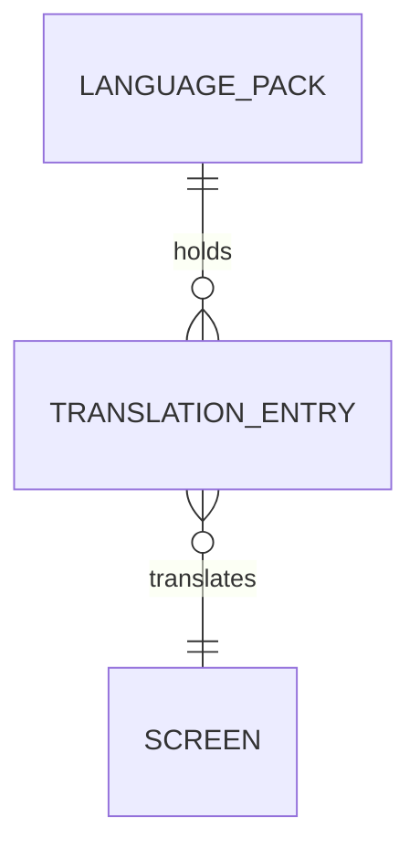
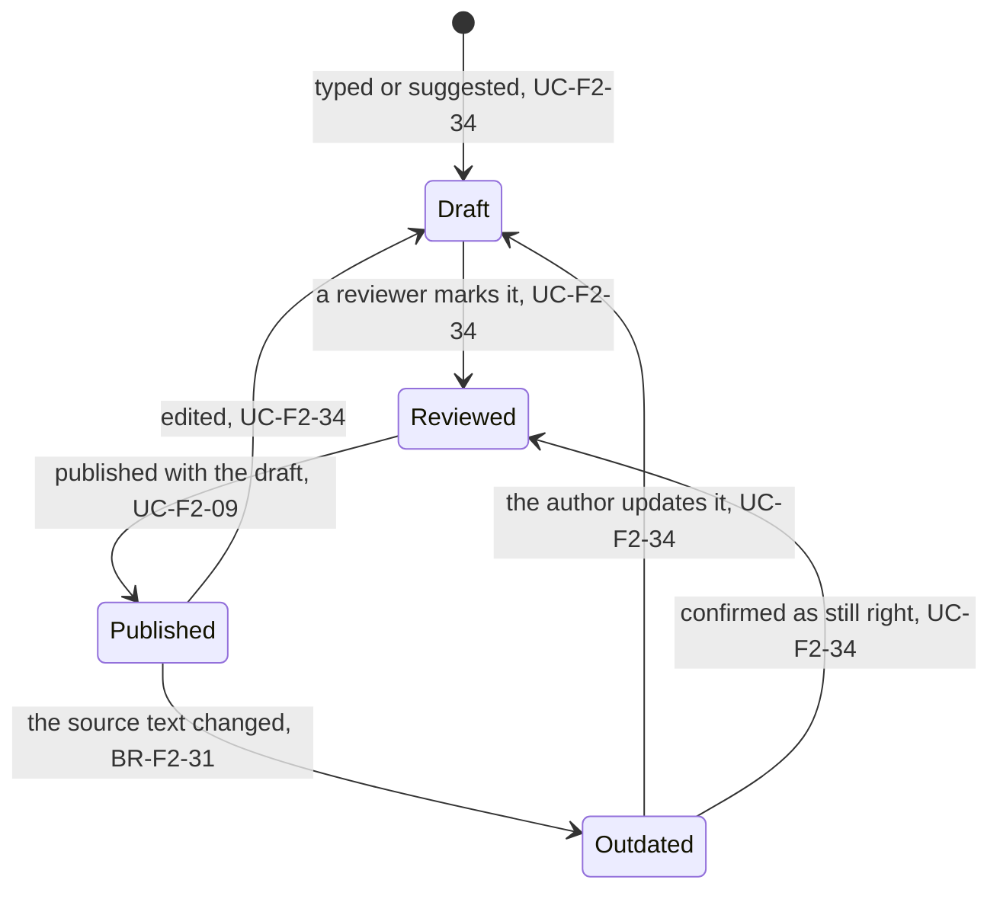

🏠 [Specs](../../../README.md) › 🧩 [Functional capabilities](../../README.md) ›
🔧 [F2 No-code configuration](../README.md) › 🗃️ [Data](README.md) › 🗃️ E-F2-33 Translation entry

# 🗃️ E-F2-33 Translation entry

**Status:** ✅ specified

## Purpose

One translated text of a screen in one language, with its review state and the pack it ships in
([D521](../../../06-decisions/f02-no-code-configuration/d521-benchmark-gaps-f02-no-code-configuration.md)).

## Fields

| Name | Type | Required | Validation | Default | Example | Personal data | Custom fields |
|---|---|---|---|---|---|---|---|
| screen and element | text key | yes | unique with the language | - | S-F6-04 button Send quote | no | no |
| language | language | yes | an active language of the company | - | German | no | no |
| source text | text | yes | - | - | Send quote | no | no |
| translated text | text | yes | keeps every placeholder of the source | - | Angebot senden | no | no |
| machine suggested | yes or no | yes | - | no | yes | no | no |
| state | draft, reviewed, published, outdated | yes | the lifecycle below | draft | published | no | no |
| written by, reviewed by | user | when set | - | - | Marc D. | yes | no |
| pack | language pack | yes | - | the company's pack of the language | German, company | no | no |
| source version | number | yes | - | - | 12 | no | no |

## Relations

- [E-F2-11 Configuration pack](e-f02-11-configuration-pack.md)
- [E-F2-23 Translation](e-f02-23-translation.md)

## Lifecycle

## Indexes and search

By language, screen, state and pack; the entries outdated.

## Retention

Kept as long as the pack; an entry of a removed screen is archived
([BR-F2-01](../business-rules/br-f02-01-archive-never-delete.md)).

## Audit

Each entry created, changed, reviewed, published or outdated, with who and when.

## Import and export

Language packs in an open format, exported and imported
([BR-F2-31](../business-rules/br-f02-31-in-place-translations-ship-as-packs.md)).

## Used by

- [UC-F2-34 Translate the screens in place](../use-cases/13-low-code-bulk-and-cleaning/uc-f02-34-translate-the-screens-in-place.md)

## Open questions

None.

---

⬅️ [E-F2-32 Scheduled trigger](e-f02-32-scheduled-trigger.md) · ⬆️ [Up](README.md) ·
➡️ [E-F2-34 Cleaning rule](e-f02-34-cleaning-rule.md)
