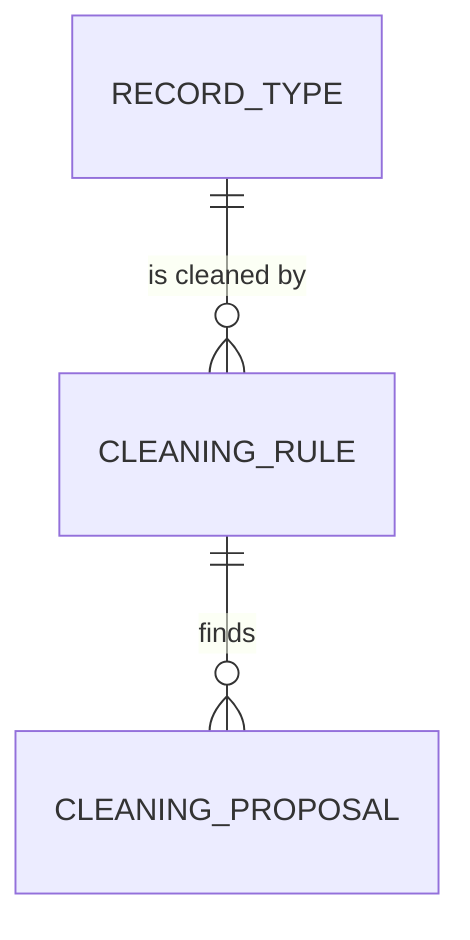
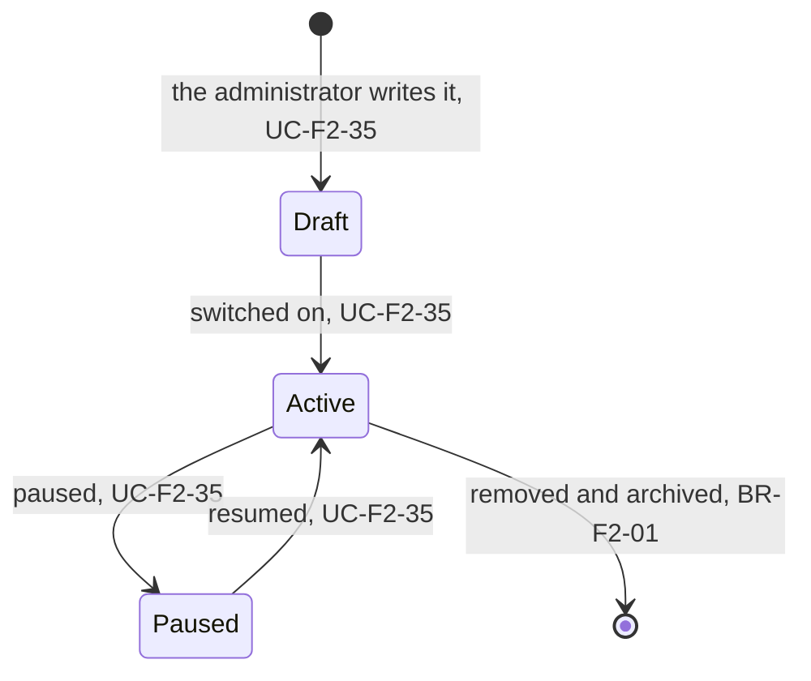

🏠 [Specs](../../../README.md) › 🧩 [Functional capabilities](../../README.md) ›
🔧 [F2 No-code configuration](../README.md) › 🗃️ [Data](README.md) › 🗃️ E-F2-34 Cleaning rule

# 🗃️ E-F2-34 Cleaning rule

**Status:** ✅ specified

## Purpose

A rule that finds duplicates or stale records of one record type and proposes merges or archivals
([D521](../../../06-decisions/f02-no-code-configuration/d521-benchmark-gaps-f02-no-code-configuration.md)).

## Fields

| Name | Type | Required | Validation | Default | Example | Personal data | Custom fields |
|---|---|---|---|---|---|---|---|
| name | text | yes | unique | - | Duplicate customers | no | no |
| record type | record type | yes | - | - | Customer | no | no |
| kind | duplicates or stale | yes | - | - | duplicates | no | no |
| matching fields | list of fields | for duplicates | - | - | tax number, name, address | no | no |
| similarity needed | percent | for duplicates | 50 to 100 | 90 | 90 | no | no |
| inactive for | months | for stale | 1 to 120 | 24 | 24 | no | no |
| action | propose merge, propose archive, merge by itself | yes | merge by itself only for exact matches | propose | propose | no | no |
| schedule | daily, weekly, monthly | yes | - | weekly | weekly | no | no |
| not duplicates | list of pairs | no | - | - | Martin / Martin | yes | no |
| state | draft, active, paused | yes | the lifecycle below | draft | active | no | no |
| last scan, proposals open | date and number | no | - | - | 2026-11-14, 17 | no | no |

## Relations

- [E-F2-05 Record type](e-f02-05-record-type.md)

## Lifecycle

## Indexes and search

By record type, kind, state and last scan.

## Retention

A rule is archived, never deleted ([BR-F2-01](../business-rules/br-f02-01-archive-never-delete.md)); the not-duplicate
pairs are kept as long as both records exist.

## Audit

Each rule change, each scan with its counts, each proposal's outcome, each merge and undo.

## Import and export

Rules travel in configuration packs
([UC-F2-11](../use-cases/06-share-a-configuration/uc-f02-11-export-or-import-a-configuration-as-a-pack.md)); the
proposals are exported as a spreadsheet.

## Used by

- [UC-F2-35 Clean duplicates and stale records](../use-cases/13-low-code-bulk-and-cleaning/uc-f02-35-clean-duplicates-and-stale-records.md)

## Open questions

None.

---

⬅️ [E-F2-33 Translation entry](e-f02-33-translation-entry.md) · ⬆️ [Up](README.md)
