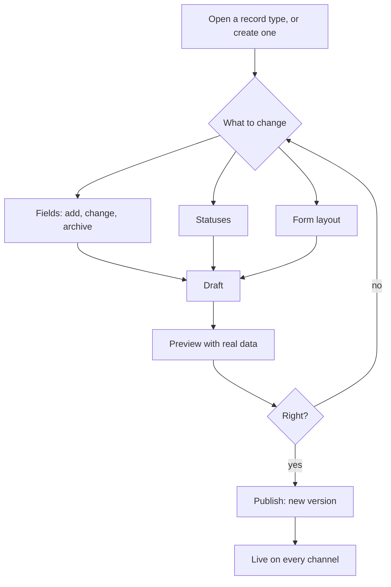

🏠 [Specs](../../../README.md) › 🧩 [Functional capabilities](../../README.md) ›
🔧 [F2 No-code configuration](../README.md) › 🔀 [Flows](README.md) › 🔀 FL-F2-01 Configure a record type

# 🔀 FL-F2-01 Configure a record type

**Status:** ✅ specified

## Summary

Changing a record type's fields, statuses and form, or creating a record type, through a draft that is previewed and
published.

## Personas

- [U07 Administrator](../../../01-users/personas/u07-administrator.md)
- Users with the Configurator role (D96): [U02 Manager](../../../01-users/personas/u02-manager.md),
  [U16 Office worker](../../../01-users/personas/u16-office-worker.md),
  [U13 Owner](../../../01-users/personas/u13-owner.md),
  [U12 Marketing and communication](../../../01-users/personas/u12-marketing.md)

## Flowchart

## Sequence diagram

See
[UC-F2-01](../use-cases/01-configure-a-record-type/uc-f02-01-add-a-custom-field-to-a-record-type.md#sequence-diagram).

## Steps

| Step | Persona | Screen | Use case | What happens |
|---|---|---|---|---|
| 1 | U07, Configurator | [S-F2-01](../screens/01-configure-a-record-type/s-f02-01-record-type-editor.md) | [UC-F2-01](../use-cases/01-configure-a-record-type/uc-f02-01-add-a-custom-field-to-a-record-type.md) | Add a custom field |
| 2 | U07, Configurator | [S-F2-02](../screens/01-configure-a-record-type/s-f02-02-status-designer.md) | [UC-F2-02](../use-cases/01-configure-a-record-type/uc-f02-02-change-the-statuses-of-a-record-type.md) | Change statuses and transitions |
| 3 | U07, Configurator | [S-F2-03](../screens/01-configure-a-record-type/s-f02-03-form-designer.md) | [UC-F2-03](../use-cases/01-configure-a-record-type/uc-f02-03-arrange-a-form.md) | Arrange the form per role and phone |
| 4 | Every user | [S-F2-04](../screens/01-configure-a-record-type/s-f02-04-list-view-settings.md) | [UC-F2-03](../use-cases/01-configure-a-record-type/uc-f02-03-arrange-a-form.md) | Save a personal list view, or share one (configurators) |
| 5 | U07, Configurator | [S-F2-05](../screens/01-configure-a-record-type/s-f02-05-record-type-gallery.md) | [UC-F2-04](../use-cases/01-configure-a-record-type/uc-f02-04-create-a-new-record-type.md) | Create a record type from a model or blank |

### Entities and screens

| Entity | States in this flow | Shown at step and screen | Aggregated view |
|---|---|---|---|
| [E-F2-05 Record type](../data/e-f02-05-record-type.md) | Draft, Live, Archived | 1 [S-F2-01](../screens/01-configure-a-record-type/s-f02-01-record-type-editor.md); 5 [S-F2-05](../screens/01-configure-a-record-type/s-f02-05-record-type-gallery.md) | Record types |
| [E-F2-01 Custom field](../data/e-f02-01-custom-field.md) | Draft, Live, Archived | 1 [S-F2-01](../screens/01-configure-a-record-type/s-f02-01-record-type-editor.md) | Custom fields |
| [E-F2-02 Status and transition](../data/e-f02-02-status-and-transition.md) | Draft, Published | 2 [S-F2-02](../screens/01-configure-a-record-type/s-f02-02-status-designer.md) | Status and transitions |
| [E-F2-03 Form layout](../data/e-f02-03-form-layout.md) | Draft, Published | 3 [S-F2-03](../screens/01-configure-a-record-type/s-f02-03-form-designer.md); 4 [S-F2-04](../screens/01-configure-a-record-type/s-f02-04-list-view-settings.md) | Form layouts |
| [E-F2-26 Configuration draft](../data/e-f02-26-configuration-draft.md) | Active | 2 [S-F2-02](../screens/01-configure-a-record-type/s-f02-02-status-designer.md) | Configuration drafts |
| [E-F2-10 Configuration version](../data/e-f02-10-configuration-version.md) | Published | Shown elsewhere: [S-F2-10 Publish and versions](../screens/05-publish-and-roll-back/s-f02-10-publish-and-versions.md) | Configuration versions |
| [E-F2-04 List view](../data/e-f02-04-list-view.md) | Draft, Published | 3 [S-F2-03](../screens/01-configure-a-record-type/s-f02-03-form-designer.md); 4 [S-F2-04](../screens/01-configure-a-record-type/s-f02-04-list-view-settings.md) | List views |

## Errors

A duplicate name, a broken formula, a type change on a field with data.

## Images

Every step and error, for each persona taking part, in light and dark mode (D120). Steps are numbered as in the Steps
table; E rows are the error cases.

| Step | Persona | Device | Light | Dark |
|---|---|---|---|---|
| 1 | U07 | desktop | [light](../images/01-configure-a-record-type/u07-administrator/1-add-a-custom-field-desktop-light.png) | [dark](../images/01-configure-a-record-type/u07-administrator/1-add-a-custom-field-desktop-dark.png) |
| 1 | U02 | desktop | [light](../images/01-configure-a-record-type/u02-manager/1-add-a-custom-field-desktop-light.png) | [dark](../images/01-configure-a-record-type/u02-manager/1-add-a-custom-field-desktop-dark.png) |
| 2 | U07 | desktop | [light](../images/01-configure-a-record-type/u07-administrator/2-statuses-and-transitions-desktop-light.png) | [dark](../images/01-configure-a-record-type/u07-administrator/2-statuses-and-transitions-desktop-dark.png) |
| 2 | U02 | desktop | [light](../images/01-configure-a-record-type/u02-manager/2-statuses-and-transitions-desktop-light.png) | [dark](../images/01-configure-a-record-type/u02-manager/2-statuses-and-transitions-desktop-dark.png) |
| 3 | U07 | desktop | [light](../images/01-configure-a-record-type/u07-administrator/3-arrange-the-form-desktop-light.png) | [dark](../images/01-configure-a-record-type/u07-administrator/3-arrange-the-form-desktop-dark.png) |
| 3 | U02 | desktop | [light](../images/01-configure-a-record-type/u02-manager/3-arrange-the-form-desktop-light.png) | [dark](../images/01-configure-a-record-type/u02-manager/3-arrange-the-form-desktop-dark.png) |
| 4 | U01 | desktop | [light](../images/01-configure-a-record-type/u01-employee/4-personal-list-view-desktop-light.png) | [dark](../images/01-configure-a-record-type/u01-employee/4-personal-list-view-desktop-dark.png) |
| 4 | U01 | phone | [light](../images/01-configure-a-record-type/u01-employee/4-personal-list-view-phone-light.png) | [dark](../images/01-configure-a-record-type/u01-employee/4-personal-list-view-phone-dark.png) |
| 5 | U07 | desktop | [light](../images/01-configure-a-record-type/u07-administrator/5-new-record-type-desktop-light.png) | [dark](../images/01-configure-a-record-type/u07-administrator/5-new-record-type-desktop-dark.png) |
| 5 | U02 | desktop | [light](../images/01-configure-a-record-type/u02-manager/5-new-record-type-desktop-light.png) | [dark](../images/01-configure-a-record-type/u02-manager/5-new-record-type-desktop-dark.png) |
| E1 | U07 | desktop | [light](../images/01-configure-a-record-type/u07-administrator/e1-duplicate-field-name-desktop-light.png) | [dark](../images/01-configure-a-record-type/u07-administrator/e1-duplicate-field-name-desktop-dark.png) |
| E2 | U07 | desktop | [light](../images/01-configure-a-record-type/u07-administrator/e2-formula-loops-desktop-light.png) | [dark](../images/01-configure-a-record-type/u07-administrator/e2-formula-loops-desktop-dark.png) |
| E3 | U07 | desktop | [light](../images/01-configure-a-record-type/u07-administrator/e3-field-holds-data-desktop-light.png) | [dark](../images/01-configure-a-record-type/u07-administrator/e3-field-holds-data-desktop-dark.png) |
| E4 | U07 | desktop | [light](../images/01-configure-a-record-type/u07-administrator/e4-core-status-locked-desktop-light.png) | [dark](../images/01-configure-a-record-type/u07-administrator/e4-core-status-locked-desktop-dark.png) |
| E5 | U07 | desktop | [light](../images/01-configure-a-record-type/u07-administrator/e5-status-in-use-desktop-light.png) | [dark](../images/01-configure-a-record-type/u07-administrator/e5-status-in-use-desktop-dark.png) |
| E6 | U07 | desktop | [light](../images/01-configure-a-record-type/u07-administrator/e6-required-field-missing-desktop-light.png) | [dark](../images/01-configure-a-record-type/u07-administrator/e6-required-field-missing-desktop-dark.png) |

## Open questions

None.

---

⬆️ [Up](README.md) · ➡️ [FL-F2-02 Customise documents and emails](fl-f02-02-customise-documents-and-emails.md)
