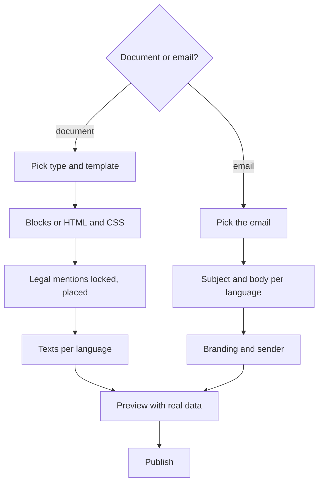

🏠 [Specs](../../../README.md) › 🧩 [Functional capabilities](../../README.md) ›
🔧 [F2 No-code configuration](../README.md) › 🔀 [Flows](README.md) › 🔀 FL-F2-02 Customise documents and emails

# 🔀 FL-F2-02 Customise documents and emails

**Status:** ✅ specified

## Summary

Giving the company's documents and emails their look and wording, per language.

## Personas

- [U07 Administrator](../../../01-users/personas/u07-administrator.md)
- Users with the Configurator role, typically [U16 Office worker](../../../01-users/personas/u16-office-worker.md) and
  [U12 Marketing and communication](../../../01-users/personas/u12-marketing.md) (D98)

## Flowchart

## Sequence diagram

See [UC-F2-05](../use-cases/02-customise-documents-and-emails/uc-f02-05-edit-a-document-template.md#sequence-diagram).

## Steps

| Step | Persona | Screen | Use case | What happens |
|---|---|---|---|---|
| 1 | U07, Configurator | [S-F2-06](../screens/02-customise-documents-and-emails/s-f02-06-document-template-editor.md) | [UC-F2-05](../use-cases/02-customise-documents-and-emails/uc-f02-05-edit-a-document-template.md) | Edit a document template |
| 2 | U07, Configurator | [S-F2-07](../screens/02-customise-documents-and-emails/s-f02-07-email-template-editor.md) | [UC-F2-06](../use-cases/02-customise-documents-and-emails/uc-f02-06-edit-an-email-template.md) | Edit an email template |

### Entities and screens

| Entity | States in this flow | Shown at step and screen | Aggregated view |
|---|---|---|---|
| [E-F2-06 Document template](../data/e-f02-06-document-template.md) | Draft, Published | 1 [S-F2-06](../screens/02-customise-documents-and-emails/s-f02-06-document-template-editor.md) | Document templates |
| [E-F2-07 Email template](../data/e-f02-07-email-template.md) | Draft, Published | 2 [S-F2-07](../screens/02-customise-documents-and-emails/s-f02-07-email-template-editor.md) | Email templates |
| [E-F2-27 Legal mention](../data/e-f02-27-legal-mention.md) | Active | 1 [S-F2-06](../screens/02-customise-documents-and-emails/s-f02-06-document-template-editor.md) | Legal mentions |

## Errors

A legal mention removed; broken HTML; a sender address that fails its test.

## Images

Every step and error, for each persona taking part, in light and dark mode (D120). Steps are numbered as in the Steps
table; E rows are the error cases.

| Step | Persona | Device | Light | Dark |
|---|---|---|---|---|
| 1 | U07 | desktop | [light](../images/02-customise-documents-and-emails/u07-administrator/1-document-template-desktop-light.png) | [dark](../images/02-customise-documents-and-emails/u07-administrator/1-document-template-desktop-dark.png) |
| 1 | U02 | desktop | [light](../images/02-customise-documents-and-emails/u02-manager/1-document-template-desktop-light.png) | [dark](../images/02-customise-documents-and-emails/u02-manager/1-document-template-desktop-dark.png) |
| 2 | U07 | desktop | [light](../images/02-customise-documents-and-emails/u07-administrator/2-email-template-desktop-light.png) | [dark](../images/02-customise-documents-and-emails/u07-administrator/2-email-template-desktop-dark.png) |
| 2 | U02 | desktop | [light](../images/02-customise-documents-and-emails/u02-manager/2-email-template-desktop-light.png) | [dark](../images/02-customise-documents-and-emails/u02-manager/2-email-template-desktop-dark.png) |
| E1 | U07 | desktop | [light](../images/02-customise-documents-and-emails/u07-administrator/e1-legal-mention-locked-desktop-light.png) | [dark](../images/02-customise-documents-and-emails/u07-administrator/e1-legal-mention-locked-desktop-dark.png) |
| E2 | U07 | desktop | [light](../images/02-customise-documents-and-emails/u07-administrator/e2-html-outside-address-desktop-light.png) | [dark](../images/02-customise-documents-and-emails/u07-administrator/e2-html-outside-address-desktop-dark.png) |
| E3 | U07 | desktop | [light](../images/02-customise-documents-and-emails/u07-administrator/e3-sender-test-failed-desktop-light.png) | [dark](../images/02-customise-documents-and-emails/u07-administrator/e3-sender-test-failed-desktop-dark.png) |

## Open questions

None.

---

⬅️ [FL-F2-01 Configure a record type](fl-f02-01-configure-a-record-type.md) · ⬆️ [Up](README.md) ·
➡️ [FL-F2-03 Automate with a rule](fl-f02-03-automate-with-a-rule.md)
