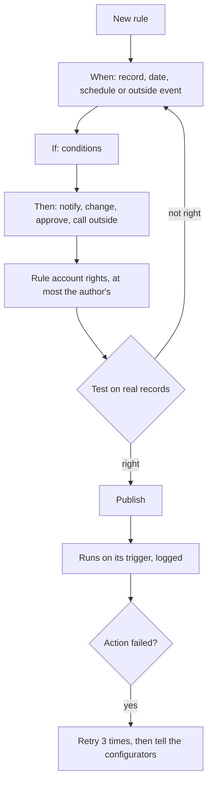

🏠 [Specs](../../../README.md) › 🧩 [Functional capabilities](../../README.md) ›
🔧 [F2 No-code configuration](../README.md) › 🔀 [Flows](README.md) › 🔀 FL-F2-03 Automate with a rule

# 🔀 FL-F2-03 Automate with a rule

**Status:** ✅ specified

## Summary

From a repetitive task to a rule that does it.

## Personas

- [U07 Administrator](../../../01-users/personas/u07-administrator.md)
- Users with the Configurator role (D96, D98)

## Flowchart

## Sequence diagram

See [UC-F2-07](../use-cases/03-automate-with-a-rule/uc-f02-07-create-a-simple-rule.md#sequence-diagram).

## Steps

| Step | Persona | Screen | Use case | What happens |
|---|---|---|---|---|
| 1 | U07, Configurator | [S-F2-08](../screens/03-automate-with-a-rule/s-f02-08-rule-editor.md) | [UC-F2-07](../use-cases/03-automate-with-a-rule/uc-f02-07-create-a-simple-rule.md) | When, if, then |
| 2 | U07, Configurator | [S-F2-08](../screens/03-automate-with-a-rule/s-f02-08-rule-editor.md) | [UC-F2-07](../use-cases/03-automate-with-a-rule/uc-f02-07-create-a-simple-rule.md) | Rule account rights |
| 3 | U07, Configurator | [S-F2-08](../screens/03-automate-with-a-rule/s-f02-08-rule-editor.md) | [UC-F2-07](../use-cases/03-automate-with-a-rule/uc-f02-07-create-a-simple-rule.md) | Test, then publish |

### Entities and screens

| Entity | States in this flow | Shown at step and screen | Aggregated view |
|---|---|---|---|
| [E-F2-08 Automation rule](../data/e-f02-08-automation-rule.md) | Draft, Published, Paused | 1, 2, 3 [S-F2-08](../screens/03-automate-with-a-rule/s-f02-08-rule-editor.md) | Automation rules |
| [E-T02-03 Service account](../../../03-technical/t02-identity-and-access/data/e-t02-03-service-account.md) | Active | Shown elsewhere: [S-T02-03 Service account](../../../03-technical/t02-identity-and-access/screens/s-t02-03-service-account.md), from the admin list [S-T02-L03](../../../03-technical/t02-identity-and-access/screens/00-lists/s-t02-l03-service-accounts.md) | Service accounts |

## Errors

Rights above the author's; a failing action at run time; a loop.

## Images

Every step and error, for each persona taking part, in light and dark mode (D120). Steps are numbered as in the Steps
table; E rows are the error cases.

| Step | Persona | Device | Light | Dark |
|---|---|---|---|---|
| 1 | U07 | desktop | [light](../images/03-automate-with-a-rule/u07-administrator/1-when-if-then-desktop-light.png) | [dark](../images/03-automate-with-a-rule/u07-administrator/1-when-if-then-desktop-dark.png) |
| 1 | U02 | desktop | [light](../images/03-automate-with-a-rule/u02-manager/1-when-if-then-desktop-light.png) | [dark](../images/03-automate-with-a-rule/u02-manager/1-when-if-then-desktop-dark.png) |
| 2 | U07 | desktop | [light](../images/03-automate-with-a-rule/u07-administrator/2-rule-account-rights-desktop-light.png) | [dark](../images/03-automate-with-a-rule/u07-administrator/2-rule-account-rights-desktop-dark.png) |
| 2 | U02 | desktop | [light](../images/03-automate-with-a-rule/u02-manager/2-rule-account-rights-desktop-light.png) | [dark](../images/03-automate-with-a-rule/u02-manager/2-rule-account-rights-desktop-dark.png) |
| 3 | U07 | desktop | [light](../images/03-automate-with-a-rule/u07-administrator/3-test-then-publish-desktop-light.png) | [dark](../images/03-automate-with-a-rule/u07-administrator/3-test-then-publish-desktop-dark.png) |
| 3 | U02 | desktop | [light](../images/03-automate-with-a-rule/u02-manager/3-test-then-publish-desktop-light.png) | [dark](../images/03-automate-with-a-rule/u02-manager/3-test-then-publish-desktop-dark.png) |
| E1 | U02 | desktop | [light](../images/03-automate-with-a-rule/u02-manager/e1-rights-above-author-desktop-light.png) | [dark](../images/03-automate-with-a-rule/u02-manager/e1-rights-above-author-desktop-dark.png) |
| E1 | U02 | phone | [light](../images/03-automate-with-a-rule/u02-manager/e1-rights-above-author-phone-light.png) | [dark](../images/03-automate-with-a-rule/u02-manager/e1-rights-above-author-phone-dark.png) |
| E2 | U07 | desktop | [light](../images/03-automate-with-a-rule/u07-administrator/e2-run-failed-desktop-light.png) | [dark](../images/03-automate-with-a-rule/u07-administrator/e2-run-failed-desktop-dark.png) |
| E3 | U07 | desktop | [light](../images/03-automate-with-a-rule/u07-administrator/e3-loop-stopped-desktop-light.png) | [dark](../images/03-automate-with-a-rule/u07-administrator/e3-loop-stopped-desktop-dark.png) |

## Open questions

None.

---

⬅️ [FL-F2-02 Customise documents and emails](fl-f02-02-customise-documents-and-emails.md) · ⬆️ [Up](README.md) ·
➡️ [FL-F2-04 Design a visual workflow](fl-f02-04-design-a-visual-workflow.md)
