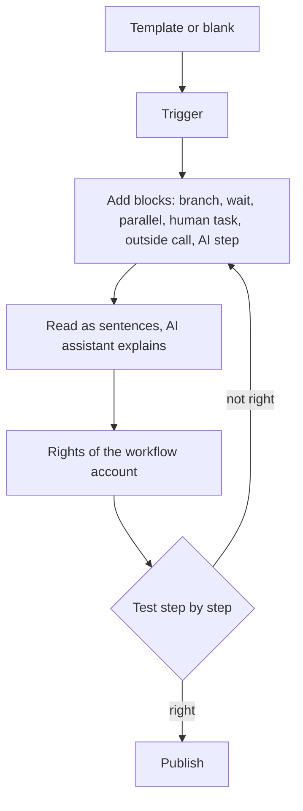

🏠 [Specs](../../../README.md) › 🧩 [Functional capabilities](../../README.md) ›
🔧 [F2 No-code configuration](../README.md) › 🔀 [Flows](README.md) › 🔀 FL-F2-04 Design a visual workflow

# 🔀 FL-F2-04 Design a visual workflow

**Status:** ✅ specified

## Summary

From a multi-step process to a published workflow that anyone can read.

## Personas

- [U07 Administrator](../../../01-users/personas/u07-administrator.md)
- Users with the Configurator role (D96, D98)

## Flowchart

## Sequence diagram

See [UC-F2-08](../use-cases/04-design-a-visual-workflow/uc-f02-08-design-a-visual-workflow.md#sequence-diagram).

## Steps

| Step | Persona | Screen | Use case | What happens |
|---|---|---|---|---|
| 1 | U07, Configurator | [S-F2-09](../screens/04-design-a-visual-workflow/s-f02-09-workflow-designer.md) | [UC-F2-08](../use-cases/04-design-a-visual-workflow/uc-f02-08-design-a-visual-workflow.md) | Trigger and blocks |
| 2 | U07, Configurator | [S-F2-09](../screens/04-design-a-visual-workflow/s-f02-09-workflow-designer.md) | [UC-F2-08](../use-cases/04-design-a-visual-workflow/uc-f02-08-design-a-visual-workflow.md) | AI step with prompt and output fields |
| 3 | U07, Configurator | [S-F2-09](../screens/04-design-a-visual-workflow/s-f02-09-workflow-designer.md) | [UC-F2-08](../use-cases/04-design-a-visual-workflow/uc-f02-08-design-a-visual-workflow.md) | Test step by step, publish |

### Entities and screens

| Entity | States in this flow | Shown at step and screen | Aggregated view |
|---|---|---|---|
| [E-F2-29 Workflow template](../data/e-f02-29-workflow-template.md) | Active | 1, 2, 3 [S-F2-09](../screens/04-design-a-visual-workflow/s-f02-09-workflow-designer.md) | Workflow templates |
| [E-F3-08 Outside call](../../f03-assistant/data/e-f03-08-outside-call.md) | Done, Refused, Failed, Capped | Shown elsewhere: [S-F3-13 Assistant usage dashboard](../../f03-assistant/screens/01-ask-the-assistant/s-f03-13-assistant-usage-dashboard.md) | Outside calls |
| [E-T02-03 Service account](../../../03-technical/t02-identity-and-access/data/e-t02-03-service-account.md) | Active | Shown elsewhere: [S-T02-03 Service account](../../../03-technical/t02-identity-and-access/screens/s-t02-03-service-account.md), from the admin list [S-T02-L03](../../../03-technical/t02-identity-and-access/screens/00-lists/s-t02-l03-service-accounts.md) | Service accounts |

## Errors

An incomplete block; an AI answer outside its format; an outside call failing; a loop.

## Images

Every step and error, for each persona taking part, in light and dark mode (D120). Steps are numbered as in the Steps
table; E rows are the error cases.

| Step | Persona | Device | Light | Dark |
|---|---|---|---|---|
| 1 | U07 | desktop | [light](../images/04-design-a-visual-workflow/u07-administrator/1-trigger-and-blocks-desktop-light.png) | [dark](../images/04-design-a-visual-workflow/u07-administrator/1-trigger-and-blocks-desktop-dark.png) |
| 1 | U02 | desktop | [light](../images/04-design-a-visual-workflow/u02-manager/1-trigger-and-blocks-desktop-light.png) | [dark](../images/04-design-a-visual-workflow/u02-manager/1-trigger-and-blocks-desktop-dark.png) |
| 2 | U07 | desktop | [light](../images/04-design-a-visual-workflow/u07-administrator/2-ai-step-desktop-light.png) | [dark](../images/04-design-a-visual-workflow/u07-administrator/2-ai-step-desktop-dark.png) |
| 2 | U02 | desktop | [light](../images/04-design-a-visual-workflow/u02-manager/2-ai-step-desktop-light.png) | [dark](../images/04-design-a-visual-workflow/u02-manager/2-ai-step-desktop-dark.png) |
| 3 | U07 | desktop | [light](../images/04-design-a-visual-workflow/u07-administrator/3-test-and-publish-desktop-light.png) | [dark](../images/04-design-a-visual-workflow/u07-administrator/3-test-and-publish-desktop-dark.png) |
| 3 | U02 | desktop | [light](../images/04-design-a-visual-workflow/u02-manager/3-test-and-publish-desktop-light.png) | [dark](../images/04-design-a-visual-workflow/u02-manager/3-test-and-publish-desktop-dark.png) |
| E1 | U07 | desktop | [light](../images/04-design-a-visual-workflow/u07-administrator/e1-incomplete-block-desktop-light.png) | [dark](../images/04-design-a-visual-workflow/u07-administrator/e1-incomplete-block-desktop-dark.png) |
| E2 | U07 | desktop | [light](../images/04-design-a-visual-workflow/u07-administrator/e2-ai-answer-out-of-format-desktop-light.png) | [dark](../images/04-design-a-visual-workflow/u07-administrator/e2-ai-answer-out-of-format-desktop-dark.png) |

## Open questions

None.

---

⬅️ [FL-F2-03 Automate with a rule](fl-f02-03-automate-with-a-rule.md) · ⬆️ [Up](README.md) ·
➡️ [FL-F2-05 Publish and roll back](fl-f02-05-publish-and-roll-back.md)
