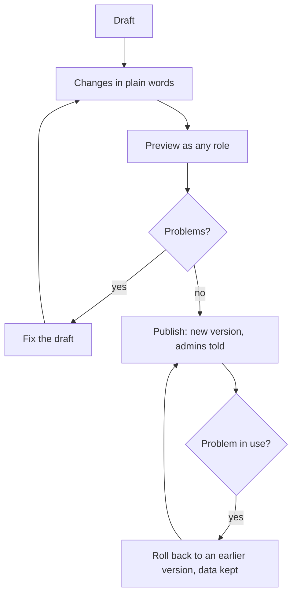

🏠 [Specs](../../../README.md) › 🧩 [Functional capabilities](../../README.md) ›
🔧 [F2 No-code configuration](../README.md) › 🔀 [Flows](README.md) › 🔀 FL-F2-05 Publish and roll back

# 🔀 FL-F2-05 Publish and roll back

**Status:** ✅ specified

## Summary

How a draft becomes live, and how an earlier version comes back.

## Personas

- [U07 Administrator](../../../01-users/personas/u07-administrator.md)
- Users with the Configurator role (D96, D98)

## Flowchart

## Sequence diagram

See [UC-F2-10](../use-cases/05-publish-and-roll-back/uc-f02-10-roll-a-configuration-back.md#sequence-diagram).

## Steps

| Step | Persona | Screen | Use case | What happens |
|---|---|---|---|---|
| 1 | U07, Configurator | [S-F2-10](../screens/05-publish-and-roll-back/s-f02-10-publish-and-versions.md) | [UC-F2-09](../use-cases/05-publish-and-roll-back/uc-f02-09-draft-preview-and-publish-a-change.md) | Review and publish a draft |
| 2 | U07 | [S-F2-10](../screens/05-publish-and-roll-back/s-f02-10-publish-and-versions.md) | [UC-F2-10](../use-cases/05-publish-and-roll-back/uc-f02-10-roll-a-configuration-back.md) | Roll back to an earlier version |

### Entities and screens

| Entity | States in this flow | Shown at step and screen | Aggregated view |
|---|---|---|---|
| [E-F2-26 Configuration draft](../data/e-f02-26-configuration-draft.md) | Active | 1, 2 [S-F2-10](../screens/05-publish-and-roll-back/s-f02-10-publish-and-versions.md) | Configuration drafts |
| [E-F1-06 Role](../../f01-administration/data/e-f01-06-role.md) | Active | Shown elsewhere: [S-F1-06 Role editor](../../f01-administration/screens/04-edit-a-role/s-f01-06-role-editor.md) | Roles |
| [E-F2-10 Configuration version](../data/e-f02-10-configuration-version.md) | Published, Superseded | 1, 2 [S-F2-10](../screens/05-publish-and-roll-back/s-f02-10-publish-and-versions.md) | Configuration versions |

## Errors

A draft with problems; records left in a removed status at roll-back.

## Images

Every step and error, for each persona taking part, in light and dark mode (D120). Steps are numbered as in the Steps
table; E rows are the error cases.

| Step | Persona | Device | Light | Dark |
|---|---|---|---|---|
| 1 | U07 | desktop | [light](../images/05-publish-and-roll-back/u07-administrator/1-review-and-publish-desktop-light.png) | [dark](../images/05-publish-and-roll-back/u07-administrator/1-review-and-publish-desktop-dark.png) |
| 1 | U02 | desktop | [light](../images/05-publish-and-roll-back/u02-manager/1-review-and-publish-desktop-light.png) | [dark](../images/05-publish-and-roll-back/u02-manager/1-review-and-publish-desktop-dark.png) |
| 2 | U07 | desktop | [light](../images/05-publish-and-roll-back/u07-administrator/2-roll-back-desktop-light.png) | [dark](../images/05-publish-and-roll-back/u07-administrator/2-roll-back-desktop-dark.png) |
| E1 | U02 | desktop | [light](../images/05-publish-and-roll-back/u02-manager/e1-draft-has-problems-desktop-light.png) | [dark](../images/05-publish-and-roll-back/u02-manager/e1-draft-has-problems-desktop-dark.png) |
| E1 | U02 | phone | [light](../images/05-publish-and-roll-back/u02-manager/e1-draft-has-problems-phone-light.png) | [dark](../images/05-publish-and-roll-back/u02-manager/e1-draft-has-problems-phone-dark.png) |
| E2 | U07 | desktop | [light](../images/05-publish-and-roll-back/u07-administrator/e2-records-in-removed-status-desktop-light.png) | [dark](../images/05-publish-and-roll-back/u07-administrator/e2-records-in-removed-status-desktop-dark.png) |

## Open questions

None.

---

⬅️ [FL-F2-04 Design a visual workflow](fl-f02-04-design-a-visual-workflow.md) · ⬆️ [Up](README.md) ·
➡️ [FL-F2-06 Share a configuration](fl-f02-06-share-a-configuration.md)
