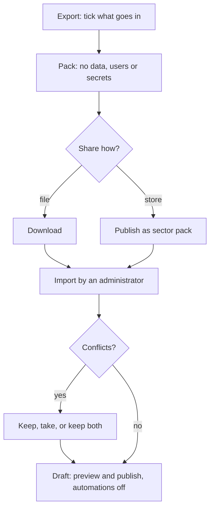

🏠 [Specs](../../../README.md) › 🧩 [Functional capabilities](../../README.md) ›
🔧 [F2 No-code configuration](../README.md) › 🔀 [Flows](README.md) › 🔀 FL-F2-06 Share a configuration

# 🔀 FL-F2-06 Share a configuration

**Status:** ✅ specified

## Summary

Exporting a configuration as a pack, sharing it, and importing it elsewhere.

## Personas

- [U07 Administrator](../../../01-users/personas/u07-administrator.md)
- Users with the Configurator role

## Flowchart

## Sequence diagram

See
[UC-F2-11](../use-cases/06-share-a-configuration/uc-f02-11-export-or-import-a-configuration-as-a-pack.md#sequence-diagram).

## Steps

| Step | Persona | Screen | Use case | What happens |
|---|---|---|---|---|
| 1 | U07, Configurator | [S-F2-11](../screens/06-share-a-configuration/s-f02-11-packs.md) | [UC-F2-11](../use-cases/06-share-a-configuration/uc-f02-11-export-or-import-a-configuration-as-a-pack.md) | Export a pack |
| 2 | U07 | [S-F2-11](../screens/06-share-a-configuration/s-f02-11-packs.md) | [UC-F2-11](../use-cases/06-share-a-configuration/uc-f02-11-export-or-import-a-configuration-as-a-pack.md) | Import a pack, resolve conflicts |

### Entities and screens

| Entity | States in this flow | Shown at step and screen | Aggregated view |
|---|---|---|---|
| [E-F2-11 Configuration pack](../data/e-f02-11-configuration-pack.md) | Published | 1, 2 [S-F2-11](../screens/06-share-a-configuration/s-f02-11-packs.md) | Configuration packs |
| [E-F1-03 User](../../f01-administration/data/e-f01-03-user.md) | Invited, Active, Deactivated | Shown elsewhere: [S-F1-03 Users](../../f01-administration/screens/03-user-lifecycle/s-f01-03-users.md) | Users |
| [E-T12-02 Credential](../../../03-technical/t12-connectors-and-scrapers/data/e-t12-02-credential.md) | Active | Shown elsewhere: [S-T12-02 Credential](../../../03-technical/t12-connectors-and-scrapers/screens/s-t12-02-credential.md), from the admin list [S-T12-L02](../../../03-technical/t12-connectors-and-scrapers/screens/00-lists/s-t12-l02-credentials.md) | Credentials |
| [E-F2-26 Configuration draft](../data/e-f02-26-configuration-draft.md) | Active | 1, 2 [S-F2-11](../screens/06-share-a-configuration/s-f02-11-packs.md) | Configuration drafts |
| [E-F2-08 Automation rule](../data/e-f02-08-automation-rule.md) | Draft | Shown elsewhere: [S-F2-08 Rule editor](../screens/03-automate-with-a-rule/s-f02-08-rule-editor.md) | Automation rules |

## Errors

A pack from a newer version; a missing plugin.

## Images

Every step and error, for each persona taking part, in light and dark mode (D120). Steps are numbered as in the Steps
table; E rows are the error cases.

| Step | Persona | Device | Light | Dark |
|---|---|---|---|---|
| 1 | U07 | desktop | [light](../images/06-share-a-configuration/u07-administrator/1-export-a-pack-desktop-light.png) | [dark](../images/06-share-a-configuration/u07-administrator/1-export-a-pack-desktop-dark.png) |
| 1 | U02 | desktop | [light](../images/06-share-a-configuration/u02-manager/1-export-a-pack-desktop-light.png) | [dark](../images/06-share-a-configuration/u02-manager/1-export-a-pack-desktop-dark.png) |
| 2 | U07 | desktop | [light](../images/06-share-a-configuration/u07-administrator/2-import-and-resolve-desktop-light.png) | [dark](../images/06-share-a-configuration/u07-administrator/2-import-and-resolve-desktop-dark.png) |
| E1 | U07 | desktop | [light](../images/06-share-a-configuration/u07-administrator/e1-pack-from-newer-version-desktop-light.png) | [dark](../images/06-share-a-configuration/u07-administrator/e1-pack-from-newer-version-desktop-dark.png) |
| E2 | U07 | desktop | [light](../images/06-share-a-configuration/u07-administrator/e2-pack-needs-a-plugin-desktop-light.png) | [dark](../images/06-share-a-configuration/u07-administrator/e2-pack-needs-a-plugin-desktop-dark.png) |

## Open questions

None.

---

⬅️ [FL-F2-05 Publish and roll back](fl-f02-05-publish-and-roll-back.md) · ⬆️ [Up](README.md) ·
➡️ [FL-F2-07 Benchmark additions](fl-f02-07-benchmark-additions.md)
