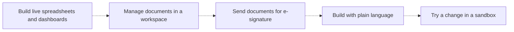

🏠 [Specs](../../../README.md) › 🧩 [Functional capabilities](../../README.md) ›
🔧 [F2 No-code configuration](../README.md) › 🔀 [Flows](README.md) › 🔀 FL-F2-07 Benchmark additions

# 🔀 FL-F2-07 Benchmark additions

**Status:** ✅ specified

## Summary

The benchmark additions of D300: UC-F2-12, UC-F2-13, UC-F2-14, UC-F2-15, UC-F2-16. Each step stands on its own.

## Personas

- [U02 Manager](../../../01-users/personas/u02-manager.md)
- [U03 Sales](../../../01-users/personas/u03-sales.md)
- [U05 Accounting](../../../01-users/personas/u05-accounting.md)
- [U06 HR](../../../01-users/personas/u06-hr.md)
- [U07 Administrator](../../../01-users/personas/u07-administrator.md)
- [U13 Owner](../../../01-users/personas/u13-owner.md)
- [U16 Office worker](../../../01-users/personas/u16-office-worker.md)

## Flowchart

## Sequence diagram

See each use case.

## Steps

| Step | Persona | Screen | Use case | What happens |
|---|---|---|---|---|
| 1 | U02, U13, U05 | [S-F2-12](../screens/07-benchmark-additions/s-f02-12-spreadsheet.md) | [UC-F2-12](../use-cases/07-benchmark-additions/uc-f02-12-build-live-spreadsheets-and-dashboards.md) | Build live spreadsheets and dashboards |
| 2 | U16, U05, U07 | [S-F2-13](../screens/07-benchmark-additions/s-f02-13-documents-workspace.md) | [UC-F2-13](../use-cases/07-benchmark-additions/uc-f02-13-manage-documents-in-a-workspace.md) | Manage documents in a workspace |
| 3 | U16, U03, U06 | [S-F2-14](../screens/07-benchmark-additions/s-f02-14-signature-requests.md) | [UC-F2-14](../use-cases/07-benchmark-additions/uc-f02-14-send-documents-for-e-signature.md) | Send documents for e-signature |
| 4 | U07, U02 | [S-F2-15](../screens/07-benchmark-additions/s-f02-15-build-assistant.md) | [UC-F2-15](../use-cases/07-benchmark-additions/uc-f02-15-build-with-plain-language.md) | Build with plain language |
| 5 | U07, U02 | [S-F2-16](../screens/07-benchmark-additions/s-f02-16-sandbox.md) | [UC-F2-16](../use-cases/07-benchmark-additions/uc-f02-16-try-a-change-in-a-sandbox.md) | Try a change in a sandbox |

### Entities and screens

| Entity | States in this flow | Shown at step and screen | Aggregated view |
|---|---|---|---|
| [E-F2-12 Spreadsheet](../data/e-f02-12-spreadsheet.md) | Active | 1 [S-F2-12](../screens/07-benchmark-additions/s-f02-12-spreadsheet.md) | Spreadsheets |
| [E-F2-13 Document](../data/e-f02-13-document.md) | To sort, To validate, Done | 2 [S-F2-13](../screens/07-benchmark-additions/s-f02-13-documents-workspace.md) | Documents |
| [E-F2-14 Signature request](../data/e-f02-14-signature-request.md) | Sent, Signed, Refused, Expired | 3 [S-F2-14](../screens/07-benchmark-additions/s-f02-14-signature-requests.md) | Signature requests |
| [E-F2-15 Sandbox](../data/e-f02-15-sandbox.md) | Active | 4 [S-F2-15](../screens/07-benchmark-additions/s-f02-15-build-assistant.md); 5 [S-F2-16](../screens/07-benchmark-additions/s-f02-16-sandbox.md) | Sandboxes |

## Errors

As each use case; E1 shows one of them.

## Images

Every step and error, for each persona taking part, in light and dark mode (D120). Steps are numbered as in the Steps
table; E rows are the error cases.

| Step | Persona | Device | Light | Dark |
|---|---|---|---|---|
| 1 | U02 | desktop | [light](../images/07-benchmark-additions/u02-manager/1-spreadsheet-desktop-light.png) | [dark](../images/07-benchmark-additions/u02-manager/1-spreadsheet-desktop-dark.png) |
| 1 | U02 | phone | [light](../images/07-benchmark-additions/u02-manager/1-spreadsheet-phone-light.png) | [dark](../images/07-benchmark-additions/u02-manager/1-spreadsheet-phone-dark.png) |
| 1 | U05 | desktop | [light](../images/07-benchmark-additions/u05-accounting/1-spreadsheet-desktop-light.png) | [dark](../images/07-benchmark-additions/u05-accounting/1-spreadsheet-desktop-dark.png) |
| 1 | U13 | desktop | [light](../images/07-benchmark-additions/u13-owner/1-spreadsheet-desktop-light.png) | [dark](../images/07-benchmark-additions/u13-owner/1-spreadsheet-desktop-dark.png) |
| 1 | U13 | phone | [light](../images/07-benchmark-additions/u13-owner/1-spreadsheet-phone-light.png) | [dark](../images/07-benchmark-additions/u13-owner/1-spreadsheet-phone-dark.png) |
| 2 | U16 | desktop | [light](../images/07-benchmark-additions/u16-office-worker/2-documents-desktop-light.png) | [dark](../images/07-benchmark-additions/u16-office-worker/2-documents-desktop-dark.png) |
| 2 | U16 | phone | [light](../images/07-benchmark-additions/u16-office-worker/2-documents-phone-light.png) | [dark](../images/07-benchmark-additions/u16-office-worker/2-documents-phone-dark.png) |
| 2 | U05 | desktop | [light](../images/07-benchmark-additions/u05-accounting/2-documents-desktop-light.png) | [dark](../images/07-benchmark-additions/u05-accounting/2-documents-desktop-dark.png) |
| 2 | U07 | desktop | [light](../images/07-benchmark-additions/u07-administrator/2-documents-desktop-light.png) | [dark](../images/07-benchmark-additions/u07-administrator/2-documents-desktop-dark.png) |
| 3 | U16 | desktop | [light](../images/07-benchmark-additions/u16-office-worker/3-e-signature-desktop-light.png) | [dark](../images/07-benchmark-additions/u16-office-worker/3-e-signature-desktop-dark.png) |
| 3 | U16 | phone | [light](../images/07-benchmark-additions/u16-office-worker/3-e-signature-phone-light.png) | [dark](../images/07-benchmark-additions/u16-office-worker/3-e-signature-phone-dark.png) |
| 3 | U03 | desktop | [light](../images/07-benchmark-additions/u03-sales/3-e-signature-desktop-light.png) | [dark](../images/07-benchmark-additions/u03-sales/3-e-signature-desktop-dark.png) |
| 3 | U03 | phone | [light](../images/07-benchmark-additions/u03-sales/3-e-signature-phone-light.png) | [dark](../images/07-benchmark-additions/u03-sales/3-e-signature-phone-dark.png) |
| 3 | U03 | tablet | [light](../images/07-benchmark-additions/u03-sales/3-e-signature-tablet-light.png) | [dark](../images/07-benchmark-additions/u03-sales/3-e-signature-tablet-dark.png) |
| 3 | U06 | desktop | [light](../images/07-benchmark-additions/u06-hr/3-e-signature-desktop-light.png) | [dark](../images/07-benchmark-additions/u06-hr/3-e-signature-desktop-dark.png) |
| 4 | U07 | desktop | [light](../images/07-benchmark-additions/u07-administrator/4-build-with-words-desktop-light.png) | [dark](../images/07-benchmark-additions/u07-administrator/4-build-with-words-desktop-dark.png) |
| 4 | U02 | desktop | [light](../images/07-benchmark-additions/u02-manager/4-build-with-words-desktop-light.png) | [dark](../images/07-benchmark-additions/u02-manager/4-build-with-words-desktop-dark.png) |
| 4 | U02 | phone | [light](../images/07-benchmark-additions/u02-manager/4-build-with-words-phone-light.png) | [dark](../images/07-benchmark-additions/u02-manager/4-build-with-words-phone-dark.png) |
| 5 | U07 | desktop | [light](../images/07-benchmark-additions/u07-administrator/5-sandbox-desktop-light.png) | [dark](../images/07-benchmark-additions/u07-administrator/5-sandbox-desktop-dark.png) |
| 5 | U02 | desktop | [light](../images/07-benchmark-additions/u02-manager/5-sandbox-desktop-light.png) | [dark](../images/07-benchmark-additions/u02-manager/5-sandbox-desktop-dark.png) |
| 5 | U02 | phone | [light](../images/07-benchmark-additions/u02-manager/5-sandbox-phone-light.png) | [dark](../images/07-benchmark-additions/u02-manager/5-sandbox-phone-dark.png) |
| E1 | U07 | desktop | [light](../images/07-benchmark-additions/u07-administrator/e1-sandbox-send-desktop-light.png) | [dark](../images/07-benchmark-additions/u07-administrator/e1-sandbox-send-desktop-dark.png) |

## Open questions

None.

---

⬅️ [FL-F2-06 Share a configuration](fl-f02-06-share-a-configuration.md) · ⬆️ [Up](README.md) ·
➡️ [FL-F2-08 Views and bookings](fl-f02-08-views-and-bookings.md)
