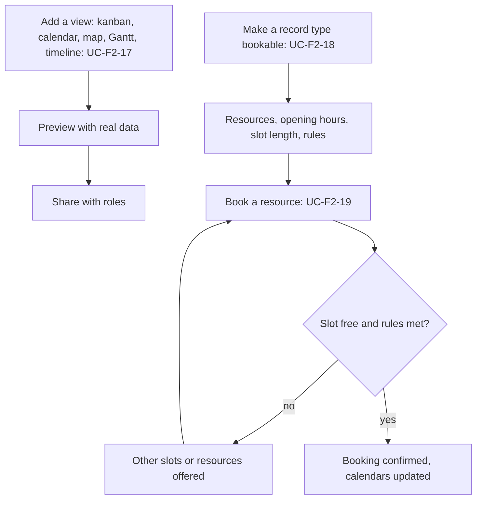

🏠 [Specs](../../../README.md) › 🧩 [Functional capabilities](../../README.md) ›
🔧 [F2 No-code configuration](../README.md) › 🔀 [Flows](README.md) › 🔀 FL-F2-08 Views and bookings

# 🔀 FL-F2-08 Views and bookings

**Status:** ✅ specified

## Summary

A record type shown as a kanban board, a calendar, a map, a Gantt chart or a timeline, and any record type made bookable
through the shared booking engine (D457): rooms, equipment, venues, appointments.

## Personas

- [U07 Administrator](../../../01-users/personas/u07-administrator.md)
- [U28 Hotel receptionist](../../../01-users/personas/u28-hotel-receptionist.md)
- [U33 Medical secretary](../../../01-users/personas/u33-medical-secretary.md)

## Flowchart

## Sequence diagram

- [UC-F2-19 Book a resource](../use-cases/08-views-and-bookings/uc-f02-19-book-a-resource.md#sequence-diagram)

## Steps

| Step | Persona | Screen | Use case | What happens |
|---|---|---|---|---|
| 1 | [U07](../../../01-users/personas/u07-administrator.md) | [S-F2-17](../screens/08-views-and-bookings/s-f02-17-view-designer.md) | [UC-F2-17](../use-cases/08-views-and-bookings/uc-f02-17-add-a-kanban-calendar-map-gantt-or-timeline-view.md) | Add a calendar view to a record type and share it |
| 2 | [U07](../../../01-users/personas/u07-administrator.md) | [S-F2-18](../screens/08-views-and-bookings/s-f02-18-booking-settings.md) | [UC-F2-18](../use-cases/08-views-and-bookings/uc-f02-18-make-a-record-type-bookable.md) | Make a record type bookable with its rules |
| 3 | [U28](../../../01-users/personas/u28-hotel-receptionist.md) | [S-F2-19](../screens/08-views-and-bookings/s-f02-19-booking-calendar.md) | [UC-F2-19](../use-cases/08-views-and-bookings/uc-f02-19-book-a-resource.md) | Book a room for a guest |
| 4 | [U33](../../../01-users/personas/u33-medical-secretary.md) | [S-F2-19](../screens/08-views-and-bookings/s-f02-19-booking-calendar.md) | [UC-F2-19](../use-cases/08-views-and-bookings/uc-f02-19-book-a-resource.md) | Book an appointment and a consulting room |

### Entities and screens

| Entity | States in this flow | Shown at step and screen | Aggregated view |
|---|---|---|---|
| [E-F2-16 Visual view](../data/e-f02-16-visual-view.md) | Draft, Published, Archived | 1 [S-F2-17](../screens/08-views-and-bookings/s-f02-17-view-designer.md) | Visual views |
| [E-F1-06 Role](../../f01-administration/data/e-f01-06-role.md) | Active | Shown elsewhere: [S-F1-06 Role editor](../../f01-administration/screens/04-edit-a-role/s-f01-06-role-editor.md) | Roles |
| [E-F2-05 Record type](../data/e-f02-05-record-type.md) | Draft, Live, Archived | 2 [S-F2-18](../screens/08-views-and-bookings/s-f02-18-booking-settings.md) | Record types |
| [E-F2-17 Bookable resource setting](../data/e-f02-17-bookable-resource-setting.md) | Draft, Published, Archived | 2 [S-F2-18](../screens/08-views-and-bookings/s-f02-18-booking-settings.md); 3, 4 [S-F2-19](../screens/08-views-and-bookings/s-f02-19-booking-calendar.md) | Bookable resource settings |
| [E-F2-18 Resource booking](../data/e-f02-18-resource-booking.md) | Requested, Confirmed | 3, 4 [S-F2-19](../screens/08-views-and-bookings/s-f02-19-booking-calendar.md) | Resource bookings |
| [E-F4-05 Calendar sync](../../f04-meetings/data/e-f04-05-calendar-sync.md) | In sync, To reconnect, Failing | Shown elsewhere: [S-F4-07 Meeting settings](../../f04-meetings/screens/06-set-up-meetings-and-calendars/s-f04-07-meeting-settings.md) | Calendar syncs |
| [E-SC09-09 Consulting room](../../../08-sectors/sc09-health-practices/data/e-sc09-09-consulting-room.md) | Active | Shown elsewhere: [S-SC09-12 Schedules](../../../08-sectors/sc09-health-practices/screens/05-practice-organisation/s-sc09-12-schedules.md) | Consulting rooms |

## Errors

A view without the field it needs (no date for a calendar, no address for a map), a slot already booked, a booking
outside the rules (BR-F2-18, BR-F2-19).

## Images

Every step and error, for each persona taking part, in light and dark mode (D120). Steps are numbered as in the Steps
table; E rows are the error cases.

| Step | Persona | Device | Light | Dark |
|---|---|---|---|---|
| 1 | U07 | desktop | [light](../images/08-views-and-bookings/u07-administrator/1-view-designer-desktop-light.png) | [dark](../images/08-views-and-bookings/u07-administrator/1-view-designer-desktop-dark.png) |
| 2 | U07 | desktop | [light](../images/08-views-and-bookings/u07-administrator/2-booking-settings-desktop-light.png) | [dark](../images/08-views-and-bookings/u07-administrator/2-booking-settings-desktop-dark.png) |
| 3 | U28 | desktop | [light](../images/08-views-and-bookings/u28-hotel-receptionist/3-booking-calendar-desktop-light.png) | [dark](../images/08-views-and-bookings/u28-hotel-receptionist/3-booking-calendar-desktop-dark.png) |
| 3 | U28 | tablet | [light](../images/08-views-and-bookings/u28-hotel-receptionist/3-booking-calendar-tablet-light.png) | [dark](../images/08-views-and-bookings/u28-hotel-receptionist/3-booking-calendar-tablet-dark.png) |
| 4 | U33 | desktop | [light](../images/08-views-and-bookings/u33-medical-secretary/4-booking-calendar-desktop-light.png) | [dark](../images/08-views-and-bookings/u33-medical-secretary/4-booking-calendar-desktop-dark.png) |
| E1 | U07 | desktop | [light](../images/08-views-and-bookings/u07-administrator/e1-view-designer-refused-desktop-light.png) | [dark](../images/08-views-and-bookings/u07-administrator/e1-view-designer-refused-desktop-dark.png) |

## Open questions

None.

---

⬅️ [FL-F2-07 Benchmark additions](fl-f02-07-benchmark-additions.md) · ⬆️ [Up](README.md) ·
➡️ [FL-F2-09 Portals and offline forms](fl-f02-09-portals-and-offline-forms.md)
