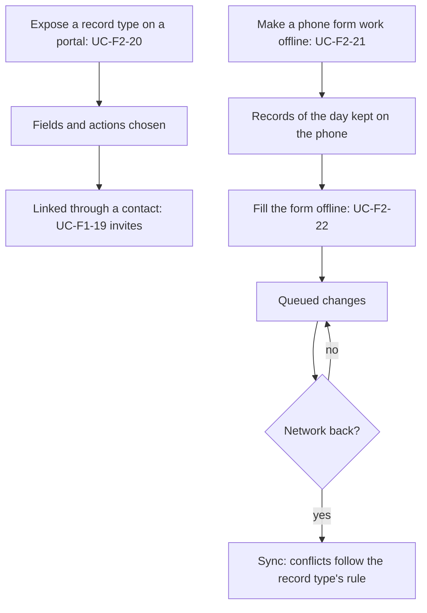

🏠 [Specs](../../../README.md) › 🧩 [Functional capabilities](../../README.md) ›
🔧 [F2 No-code configuration](../README.md) › 🔀 [Flows](README.md) › 🔀 FL-F2-09 Portals and offline forms

# 🔀 FL-F2-09 Portals and offline forms

**Status:** ✅ specified

## Summary

A record type shown to outside people on a portal (families, tenants, learners), and phone forms that keep working
without the network (site diary, care log, driver forms).

## Personas

- [U07 Administrator](../../../01-users/personas/u07-administrator.md)
- [U09 Customer](../../../01-users/personas/u09-customer.md)
- [U14 Field worker](../../../01-users/personas/u14-field-worker.md)
- [U26 Carer](../../../01-users/personas/u26-carer.md)

## Flowchart

## Sequence diagram

- [UC-F2-22 Fill a form offline on the phone](../use-cases/09-portals-and-offline-forms/uc-f02-22-fill-a-form-offline-on-the-phone.md#sequence-diagram)

## Steps

| Step | Persona | Screen | Use case | What happens |
|---|---|---|---|---|
| 1 | [U07](../../../01-users/personas/u07-administrator.md) | [S-F2-20](../screens/09-portals-and-offline-forms/s-f02-20-portal-settings.md) | [UC-F2-20](../use-cases/09-portals-and-offline-forms/uc-f02-20-expose-a-record-type-on-a-portal.md) | Expose the care log on the family portal |
| 2 | [U09](../../../01-users/personas/u09-customer.md) | [S-F2-20](../screens/09-portals-and-offline-forms/s-f02-20-portal-settings.md) | [UC-F2-20](../use-cases/09-portals-and-offline-forms/uc-f02-20-expose-a-record-type-on-a-portal.md) | A family member reads the visits on the portal |
| 3 | [U07](../../../01-users/personas/u07-administrator.md) | [S-F2-21](../screens/09-portals-and-offline-forms/s-f02-21-offline-form.md) | [UC-F2-21](../use-cases/09-portals-and-offline-forms/uc-f02-21-make-a-phone-form-work-offline.md) | Make the site diary form work offline |
| 4 | [U14](../../../01-users/personas/u14-field-worker.md) | [S-F2-21](../screens/09-portals-and-offline-forms/s-f02-21-offline-form.md) | [UC-F2-22](../use-cases/09-portals-and-offline-forms/uc-f02-22-fill-a-form-offline-on-the-phone.md) | Fill the site diary with no network |
| 5 | [U26](../../../01-users/personas/u26-carer.md) | [S-F2-21](../screens/09-portals-and-offline-forms/s-f02-21-offline-form.md) | [UC-F2-22](../use-cases/09-portals-and-offline-forms/uc-f02-22-fill-a-form-offline-on-the-phone.md) | Fill the care log offline at a recipient's home |

### Entities and screens

| Entity | States in this flow | Shown at step and screen | Aggregated view |
|---|---|---|---|
| [E-F2-05 Record type](../data/e-f02-05-record-type.md) | Draft, Live, Archived | 1, 2 [S-F2-20](../screens/09-portals-and-offline-forms/s-f02-20-portal-settings.md) | Record types |
| [E-F2-19 Portal exposure](../data/e-f02-19-portal-exposure.md) | Draft, Published, Archived | 1, 2 [S-F2-20](../screens/09-portals-and-offline-forms/s-f02-20-portal-settings.md) | Portal exposures |
| [E-F2-03 Form layout](../data/e-f02-03-form-layout.md) | Draft, Published | 3, 4, 5 [S-F2-21](../screens/09-portals-and-offline-forms/s-f02-21-offline-form.md) | Form layouts |
| [E-F2-28 Offline change queue](../data/e-f02-28-offline-change-queue.md) | Active | 3, 4, 5 [S-F2-21](../screens/09-portals-and-offline-forms/s-f02-21-offline-form.md) | Offline change queues |
| [E-F2-20 Offline form setting](../data/e-f02-20-offline-form-setting.md) | Draft, Published, Archived | 3, 4, 5 [S-F2-21](../screens/09-portals-and-offline-forms/s-f02-21-offline-form.md) | Offline form settings |

## Errors

A portal field holding personal data of someone else, a sync conflict, a phone out of space (BR-F2-20, BR-F2-21).

## Images

Every step and error, for each persona taking part, in light and dark mode (D120). Steps are numbered as in the Steps
table; E rows are the error cases.

| Step | Persona | Device | Light | Dark |
|---|---|---|---|---|
| 1 | U07 | desktop | [light](../images/09-portals-and-offline-forms/u07-administrator/1-portal-settings-desktop-light.png) | [dark](../images/09-portals-and-offline-forms/u07-administrator/1-portal-settings-desktop-dark.png) |
| 2 | U09 | phone | [light](../images/09-portals-and-offline-forms/u09-customer/2-portal-settings-phone-light.png) | [dark](../images/09-portals-and-offline-forms/u09-customer/2-portal-settings-phone-dark.png) |
| 3 | U07 | desktop | [light](../images/09-portals-and-offline-forms/u07-administrator/3-offline-form-desktop-light.png) | [dark](../images/09-portals-and-offline-forms/u07-administrator/3-offline-form-desktop-dark.png) |
| 4 | U14 | phone | [light](../images/09-portals-and-offline-forms/u14-field-worker/4-offline-form-phone-light.png) | [dark](../images/09-portals-and-offline-forms/u14-field-worker/4-offline-form-phone-dark.png) |
| 5 | U26 | phone | [light](../images/09-portals-and-offline-forms/u26-carer/5-offline-form-phone-light.png) | [dark](../images/09-portals-and-offline-forms/u26-carer/5-offline-form-phone-dark.png) |
| E1 | U07 | desktop | [light](../images/09-portals-and-offline-forms/u07-administrator/e1-portal-settings-refused-desktop-light.png) | [dark](../images/09-portals-and-offline-forms/u07-administrator/e1-portal-settings-refused-desktop-dark.png) |

## Open questions

None.

---

⬅️ [FL-F2-08 Views and bookings](fl-f02-08-views-and-bookings.md) · ⬆️ [Up](README.md) ·
➡️ [FL-F2-10 Change safely](fl-f02-10-change-safely.md)
