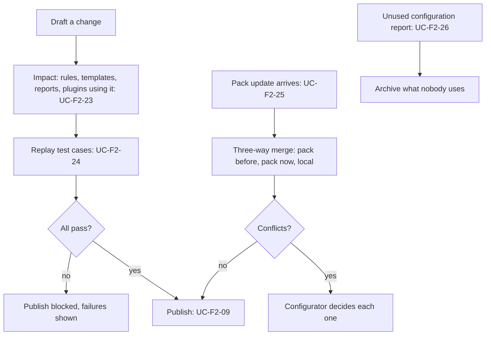

🏠 [Specs](../../../README.md) › 🧩 [Functional capabilities](../../README.md) ›
🔧 [F2 No-code configuration](../README.md) › 🔀 [Flows](README.md) › 🔀 FL-F2-10 Change safely

# 🔀 FL-F2-10 Change safely

**Status:** ✅ specified

## Summary

Before a change is published, its impact is listed and its test cases replayed; a sector pack update is merged with
local changes; unused configuration is found and archived.

## Personas

- [U07 Administrator](../../../01-users/personas/u07-administrator.md)

## Flowchart

## Sequence diagram

- [UC-F2-24 Test rules and workflows with test cases](../use-cases/10-change-safely/uc-f02-24-test-rules-and-workflows-with-test-cases.md#sequence-diagram)

## Steps

| Step | Persona | Screen | Use case | What happens |
|---|---|---|---|---|
| 1 | [U07](../../../01-users/personas/u07-administrator.md) | [S-F2-22](../screens/10-change-safely/s-f02-22-impact-analysis.md) | [UC-F2-23](../use-cases/10-change-safely/uc-f02-23-see-the-impact-of-a-change-before-publishing.md) | Read the impact of renaming a field |
| 2 | [U07](../../../01-users/personas/u07-administrator.md) | [S-F2-23](../screens/10-change-safely/s-f02-23-test-cases.md) | [UC-F2-24](../use-cases/10-change-safely/uc-f02-24-test-rules-and-workflows-with-test-cases.md) | Write test cases and replay them |
| 3 | [U07](../../../01-users/personas/u07-administrator.md) | [S-F2-24](../screens/10-change-safely/s-f02-24-pack-upgrade-merge.md) | [UC-F2-25](../use-cases/10-change-safely/uc-f02-25-merge-a-sector-pack-upgrade-with-local-changes.md) | Merge a sector pack update |
| 4 | [U07](../../../01-users/personas/u07-administrator.md) | [S-F2-25](../screens/10-change-safely/s-f02-25-unused-configuration-report.md) | [UC-F2-26](../use-cases/10-change-safely/uc-f02-26-find-unused-configuration.md) | Archive configuration nobody uses |
| 5 | [U07](../../../01-users/personas/u07-administrator.md) | [S-F2-30](../screens/10-change-safely/s-f02-30-custom-report.md) | [UC-F2-23](../use-cases/10-change-safely/uc-f02-23-see-the-impact-of-a-change-before-publishing.md) | Open a custom report the change touches |

### Entities and screens

| Entity | States in this flow | Shown at step and screen | Aggregated view |
|---|---|---|---|
| [E-F2-26 Configuration draft](../data/e-f02-26-configuration-draft.md) | Active | 1 [S-F2-22](../screens/10-change-safely/s-f02-22-impact-analysis.md); 5 [S-F2-30](../screens/10-change-safely/s-f02-30-custom-report.md) | Configuration drafts |
| [E-F2-08 Automation rule](../data/e-f02-08-automation-rule.md) | Draft, Published, Paused | 2 [S-F2-23](../screens/10-change-safely/s-f02-23-test-cases.md) | Automation rules |
| [E-F2-06 Document template](../data/e-f02-06-document-template.md) | Draft, Published | Shown elsewhere: [S-F2-06 Document template editor](../screens/02-customise-documents-and-emails/s-f02-06-document-template-editor.md) | Document templates |
| [E-T04-02 Plugin package](../../../03-technical/t04-plugin-runtime/data/e-t04-02-plugin-package.md) | Active | Shown elsewhere: [S-T04-02 Plugin package](../../../03-technical/t04-plugin-runtime/screens/s-t04-02-plugin-package.md), from the admin list [S-T04-L02](../../../03-technical/t04-plugin-runtime/screens/00-lists/s-t04-l02-plugin-packages.md) | Plugin packages |
| [E-F2-21 Test case](../data/e-f02-21-test-case.md) | Active, Archived | 2 [S-F2-23](../screens/10-change-safely/s-f02-23-test-cases.md) | Test cases |
| [E-F2-11 Configuration pack](../data/e-f02-11-configuration-pack.md) | Published | 3 [S-F2-24](../screens/10-change-safely/s-f02-24-pack-upgrade-merge.md) | Configuration packs |
| [E-F2-10 Configuration version](../data/e-f02-10-configuration-version.md) | Published | 1 [S-F2-22](../screens/10-change-safely/s-f02-22-impact-analysis.md); 3 [S-F2-24](../screens/10-change-safely/s-f02-24-pack-upgrade-merge.md); 4 [S-F2-25](../screens/10-change-safely/s-f02-25-unused-configuration-report.md); 5 [S-F2-30](../screens/10-change-safely/s-f02-30-custom-report.md) | Configuration versions |

## Errors

A failing test case, a merge conflict on a locked legal block, archiving something used by a plugin (BR-F2-22 to
BR-F2-24).

## Images

Every step and error, for each persona taking part, in light and dark mode (D120). Steps are numbered as in the Steps
table; E rows are the error cases.

| Step | Persona | Device | Light | Dark |
|---|---|---|---|---|
| 1 | U07 | desktop | [light](../images/10-change-safely/u07-administrator/1-impact-analysis-desktop-light.png) | [dark](../images/10-change-safely/u07-administrator/1-impact-analysis-desktop-dark.png) |
| 2 | U07 | desktop | [light](../images/10-change-safely/u07-administrator/2-test-cases-desktop-light.png) | [dark](../images/10-change-safely/u07-administrator/2-test-cases-desktop-dark.png) |
| 3 | U07 | desktop | [light](../images/10-change-safely/u07-administrator/3-pack-upgrade-merge-desktop-light.png) | [dark](../images/10-change-safely/u07-administrator/3-pack-upgrade-merge-desktop-dark.png) |
| 4 | U07 | desktop | [light](../images/10-change-safely/u07-administrator/4-unused-configuration-report-desktop-light.png) | [dark](../images/10-change-safely/u07-administrator/4-unused-configuration-report-desktop-dark.png) |
| 5 | U07 | desktop | [light](../images/10-change-safely/u07-administrator/5-custom-report-desktop-light.png) | [dark](../images/10-change-safely/u07-administrator/5-custom-report-desktop-dark.png) |
| E1 | U07 | desktop | [light](../images/10-change-safely/u07-administrator/e1-impact-analysis-refused-desktop-light.png) | [dark](../images/10-change-safely/u07-administrator/e1-impact-analysis-refused-desktop-dark.png) |

## Open questions

None.

---

⬅️ [FL-F2-09 Portals and offline forms](fl-f02-09-portals-and-offline-forms.md) · ⬆️ [Up](README.md) ·
➡️ [FL-F2-11 Rights, translations and approvals](fl-f02-11-rights-translations-and-approvals.md)
