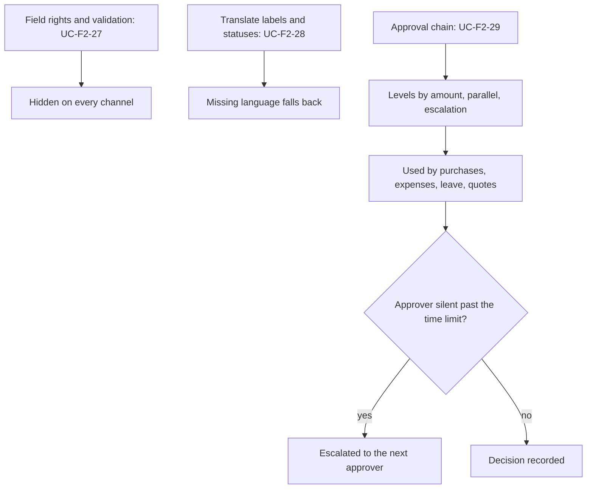

🏠 [Specs](../../../README.md) › 🧩 [Functional capabilities](../../README.md) ›
🔧 [F2 No-code configuration](../README.md) › 🔀 [Flows](README.md) › 🔀 FL-F2-11 Rights, translations and approvals

# 🔀 FL-F2-11 Rights, translations and approvals

**Status:** ✅ specified

## Summary

Who sees and changes each field and which values are valid; labels and statuses in every language; and one approval
engine that every block uses.

## Personas

- [U02 Manager](../../../01-users/personas/u02-manager.md)
- [U07 Administrator](../../../01-users/personas/u07-administrator.md)

## Flowchart

## Sequence diagram

- [UC-F2-29 Set up an approval chain](../use-cases/11-rights-translations-and-approvals/uc-f02-29-set-up-an-approval-chain.md#sequence-diagram)

## Steps

| Step | Persona | Screen | Use case | What happens |
|---|---|---|---|---|
| 1 | [U07](../../../01-users/personas/u07-administrator.md) | [S-F2-26](../screens/11-rights-translations-and-approvals/s-f02-26-field-rights-and-validation.md) | [UC-F2-27](../use-cases/11-rights-translations-and-approvals/uc-f02-27-set-field-level-rights-and-validation-rules.md) | Hide the salary field from managers and validate an IBAN |
| 2 | [U07](../../../01-users/personas/u07-administrator.md) | [S-F2-27](../screens/11-rights-translations-and-approvals/s-f02-27-translations.md) | [UC-F2-28](../use-cases/11-rights-translations-and-approvals/uc-f02-28-translate-custom-labels-and-statuses.md) | Translate a record type's labels and statuses |
| 3 | [U07](../../../01-users/personas/u07-administrator.md) | [S-F2-28](../screens/11-rights-translations-and-approvals/s-f02-28-approval-chain-designer.md) | [UC-F2-29](../use-cases/11-rights-translations-and-approvals/uc-f02-29-set-up-an-approval-chain.md) | Set the purchase approval chain |
| 4 | [U02](../../../01-users/personas/u02-manager.md) | [S-F1-17](../../f01-administration/screens/11-team-delegation-and-access-review/s-f01-17-my-team.md) | [UC-F2-29](../use-cases/11-rights-translations-and-approvals/uc-f02-29-set-up-an-approval-chain.md) | Approve within one's level |

### Entities and screens

| Entity | States in this flow | Shown at step and screen | Aggregated view |
|---|---|---|---|
| [E-F2-22 Field rule](../data/e-f02-22-field-rule.md) | Draft, Published | 1 [S-F2-26](../screens/11-rights-translations-and-approvals/s-f02-26-field-rights-and-validation.md) | Field rules |
| [E-F2-23 Translation](../data/e-f02-23-translation.md) | Draft, Published | 2 [S-F2-27](../screens/11-rights-translations-and-approvals/s-f02-27-translations.md) | Translations |
| [E-F2-02 Status and transition](../data/e-f02-02-status-and-transition.md) | Draft, Published | Shown elsewhere: [S-F2-02 Status designer](../screens/01-configure-a-record-type/s-f02-02-status-designer.md) | Status and transitions |
| [E-F2-24 Approval chain](../data/e-f02-24-approval-chain.md) | Draft, Published | 3 [S-F2-28](../screens/11-rights-translations-and-approvals/s-f02-28-approval-chain-designer.md); 4 [S-F1-17](../../f01-administration/screens/11-team-delegation-and-access-review/s-f01-17-my-team.md) | Approval chains |
| [E-F7-02 Purchase request](../../f07-purchasing-and-stock/data/e-f07-02-purchase-request.md) | Draft, To approve, Refused, Approved, Ordered | Shown elsewhere: [S-F7-01 Purchase request](../../f07-purchasing-and-stock/screens/01-procure/s-f07-01-purchase-request.md) | Purchase requests |
| [E-F8-09 Expense claim](../../f08-accounting/data/e-f08-09-expense-claim.md) | Draft, Submitted, Refused, Approved, Reimbursed | Shown elsewhere: [S-F8-12 Expenses](../../f08-accounting/screens/02-purchase-to-pay/s-f08-12-expenses.md) | Expense claims |
| [E-F9-09 Time-off request](../../f09-hr-and-projects/data/e-f09-09-time-off-request.md) | To approve, Approved, Refused, Cancelled | Shown elsewhere: [S-F9-09 Time off](../../f09-hr-and-projects/screens/03-time/s-f09-09-time-off.md) | Time-off requests |
| [E-F6-03 Quote](../../f06-customers-and-sales/data/e-f06-03-quote.md) | Draft, To approve, Refused, Sent, Expired, Accepted | Shown elsewhere: [S-F6-03 Quote editor](../../f06-customers-and-sales/screens/01-lead-to-quote/s-f06-03-quote-editor.md) | Quotes |
| [E-F2-05 Record type](../data/e-f02-05-record-type.md) | Draft, Live, Archived | Shown elsewhere: [S-F2-01 Record type editor](../screens/01-configure-a-record-type/s-f02-01-record-type-editor.md) | Record types |

## Errors

A rule refusing a valid value, a missing translation, a chain with no approver at a level (BR-F2-25 to BR-F2-27).

## Images

Every step and error, for each persona taking part, in light and dark mode (D120). Steps are numbered as in the Steps
table; E rows are the error cases.

| Step | Persona | Device | Light | Dark |
|---|---|---|---|---|
| 1 | U07 | desktop | [light](../images/11-rights-translations-and-approvals/u07-administrator/1-field-rights-and-validation-desktop-light.png) | [dark](../images/11-rights-translations-and-approvals/u07-administrator/1-field-rights-and-validation-desktop-dark.png) |
| 2 | U07 | desktop | [light](../images/11-rights-translations-and-approvals/u07-administrator/2-translations-desktop-light.png) | [dark](../images/11-rights-translations-and-approvals/u07-administrator/2-translations-desktop-dark.png) |
| 3 | U07 | desktop | [light](../images/11-rights-translations-and-approvals/u07-administrator/3-approval-chain-designer-desktop-light.png) | [dark](../images/11-rights-translations-and-approvals/u07-administrator/3-approval-chain-designer-desktop-dark.png) |
| 4 | U02 | desktop | [light](../images/11-rights-translations-and-approvals/u02-manager/4-my-team-desktop-light.png) | [dark](../images/11-rights-translations-and-approvals/u02-manager/4-my-team-desktop-dark.png) |
| 4 | U02 | phone | [light](../images/11-rights-translations-and-approvals/u02-manager/4-my-team-phone-light.png) | [dark](../images/11-rights-translations-and-approvals/u02-manager/4-my-team-phone-dark.png) |
| E1 | U07 | desktop | [light](../images/11-rights-translations-and-approvals/u07-administrator/e1-field-rights-and-validation-refused-desktop-light.png) | [dark](../images/11-rights-translations-and-approvals/u07-administrator/e1-field-rights-and-validation-refused-desktop-dark.png) |

## Open questions

None.

---

⬅️ [FL-F2-10 Change safely](fl-f02-10-change-safely.md) · ⬆️ [Up](README.md) ·
➡️ [FL-F2-12 Set up request types](fl-f02-12-set-up-request-types.md)
