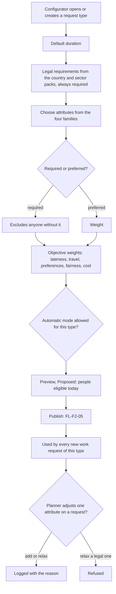
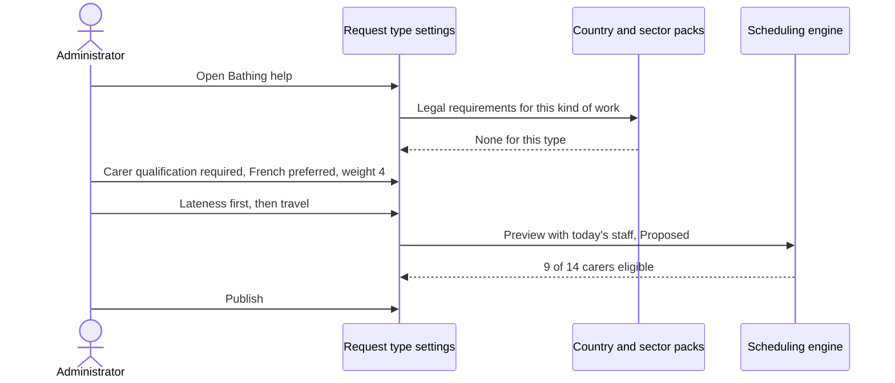

🏠 [Specs](../../../README.md) › 🧩 [Functional capabilities](../../README.md) ›
🔧 [F2 No-code configuration](../README.md) › 🔀 [Flows](README.md) › 🔀 FL-F2-12 Set up request types

# 🔀 FL-F2-12 Set up request types

**Status:** 🔄 draft (GH-2 step S4b, from VD-27 to VD-29, VD-32, VD-33 / D509 to D511, D514, D515)

## Summary

A configurator sets, for each type of customer request, what scheduling needs: the default duration, the attributes
taken into account (required, or preferred with a weight), the weights of the objectives, and whether the automatic
mode is allowed. Legal requirements come from the country and sector packs and are always required. A planner may
then add or relax one attribute on a single request, and the change is logged.

## Personas

- [U07 Administrator](../../../01-users/personas/u07-administrator.md), and the configurators of
  [D96](../../../06-decisions/f02-no-code-configuration/d96-configurator-role.md)
- [U25 Care coordinator](../../../01-users/personas/u25-care-coordinator.md), as a planner (D517)

## Flowchart

## Sequence diagram

## Steps

| Step | Persona | Screen | Use case | What happens |
|---|---|---|---|---|
| 1 | [U07](../../../01-users/personas/u07-administrator.md) | [S-F2-29](../screens/12-set-up-request-types/s-f02-29-request-type-settings.md) | [UC-F2-30](../use-cases/12-set-up-request-types/uc-f02-30-set-up-a-request-type.md) | Set duration, attributes, weights, objectives and the automatic-mode switch |
| 2 | [U07](../../../01-users/personas/u07-administrator.md) | [S-F2-10](../screens/05-publish-and-roll-back/s-f02-10-publish-and-versions.md) | [UC-F2-09](../use-cases/05-publish-and-roll-back/uc-f02-09-draft-preview-and-publish-a-change.md) | Publish the request type as any configuration change |
| 3 | [U25](../../../01-users/personas/u25-care-coordinator.md) | [S-F9-31](../../f09-hr-and-projects/screens/12-schedule-customer-requests/s-f09-31-proposal-review.md) | [UC-F9-33](../../f09-hr-and-projects/use-cases/12-schedule-customer-requests/uc-f09-33-schedule-a-work-request.md) | The planner adds or relaxes one attribute on a single request, logged |

### Entities and screens

| Entity | States in this flow | Shown at step and screen | Aggregated view |
|---|---|---|---|
| [E-F2-25 Request type](../data/e-f02-25-request-type.md) | Draft, Published, Retired | 1 [S-F2-29](../screens/12-set-up-request-types/s-f02-29-request-type-settings.md); 2 [S-F2-10](../screens/05-publish-and-roll-back/s-f02-10-publish-and-versions.md); 3 [S-F9-31](../../f09-hr-and-projects/screens/12-schedule-customer-requests/s-f09-31-proposal-review.md) | Request types |
| [E-F9-30 Qualification type](../../f09-hr-and-projects/data/e-f09-30-qualification-type.md) | Active (read only here) | 1 [S-F2-29](../screens/12-set-up-request-types/s-f02-29-request-type-settings.md) | Qualification types |
| [E-F2-10 Configuration version](../data/e-f02-10-configuration-version.md) | Published, Superseded | 2 [S-F2-10](../screens/05-publish-and-roll-back/s-f02-10-publish-and-versions.md) | Configuration versions |
| [E-F16-12 Work request](../../f16-customer-support-agents/data/e-f16-12-work-request.md) | Drafted, To confirm, Ready, Proposed, Blocked, Cancelled, Scheduled, In progress, Done | 3 [S-F9-31](../../f09-hr-and-projects/screens/12-schedule-customer-requests/s-f09-31-proposal-review.md) | Work requests |

The states are those of the entity draft.

## Errors

- **E1 A legal requirement cannot be removed.** The configurator tries to make a pack's requirement preferred or to
  remove it: refused with the text it comes from
  ([BR-F9-26](../../f09-hr-and-projects/business-rules/br-f09-26-legal-requirements-never-relaxed.md)), step 1.
- **E2 Nobody is eligible.** The preview finds no one with every required attribute: a warning, and publishing asks
  for a confirmation (Proposed), step 1.
- **E3 A planner relaxes a legal attribute on a request.** Refused, the request keeps it (step 3).

## Images

Every step and error, for each persona taking part, in light and dark mode (D120). Steps are numbered as in the Steps
table; E rows are the error cases.

| Step | Persona | Device | Light | Dark |
|---|---|---|---|---|
| 1 | U07 | desktop | [light](../images/12-set-up-request-types/u07-administrator/1-request-type-settings-desktop-light.png) | [dark](../images/12-set-up-request-types/u07-administrator/1-request-type-settings-desktop-dark.png) |
| 2 | U07 | desktop | [light](../images/12-set-up-request-types/u07-administrator/2-publish-and-versions-desktop-light.png) | [dark](../images/12-set-up-request-types/u07-administrator/2-publish-and-versions-desktop-dark.png) |
| 3 | U25 | desktop | [light](../images/12-set-up-request-types/u25-care-coordinator/3-proposal-review-desktop-light.png) | [dark](../images/12-set-up-request-types/u25-care-coordinator/3-proposal-review-desktop-dark.png) |
| 3 | U25 | phone | [light](../images/12-set-up-request-types/u25-care-coordinator/3-proposal-review-phone-light.png) | [dark](../images/12-set-up-request-types/u25-care-coordinator/3-proposal-review-phone-dark.png) |
| E1 | U07 | desktop | [light](../images/12-set-up-request-types/u07-administrator/e1-a-legal-requirement-cannot-be-removed-desktop-light.png) | [dark](../images/12-set-up-request-types/u07-administrator/e1-a-legal-requirement-cannot-be-removed-desktop-dark.png) |
| E2 | U07 | desktop | [light](../images/12-set-up-request-types/u07-administrator/e2-nobody-is-eligible-desktop-light.png) | [dark](../images/12-set-up-request-types/u07-administrator/e2-nobody-is-eligible-desktop-dark.png) |
| E3 | U25 | desktop | [light](../images/12-set-up-request-types/u25-care-coordinator/e3-a-planner-relaxes-a-legal-attribute-on-a-desktop-light.png) | [dark](../images/12-set-up-request-types/u25-care-coordinator/e3-a-planner-relaxes-a-legal-attribute-on-a-desktop-dark.png) |
| E3 | U25 | phone | [light](../images/12-set-up-request-types/u25-care-coordinator/e3-a-planner-relaxes-a-legal-attribute-on-a-phone-light.png) | [dark](../images/12-set-up-request-types/u25-care-coordinator/e3-a-planner-relaxes-a-legal-attribute-on-a-phone-dark.png) |

## Open questions

None.

---

⬅️ [FL-F2-11 Rights, translations and approvals](fl-f02-11-rights-translations-and-approvals.md) · ⬆️ [Up](README.md) ·
➡️ [FL-F2-13 Low code, bulk work and data cleaning](fl-f02-13-low-code-bulk-and-cleaning.md)
