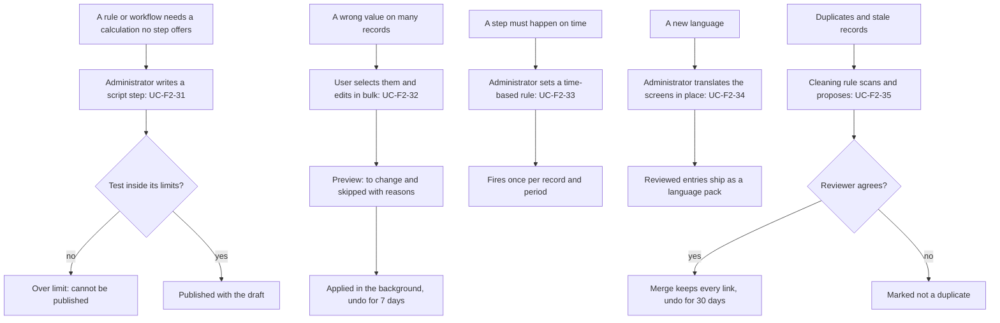
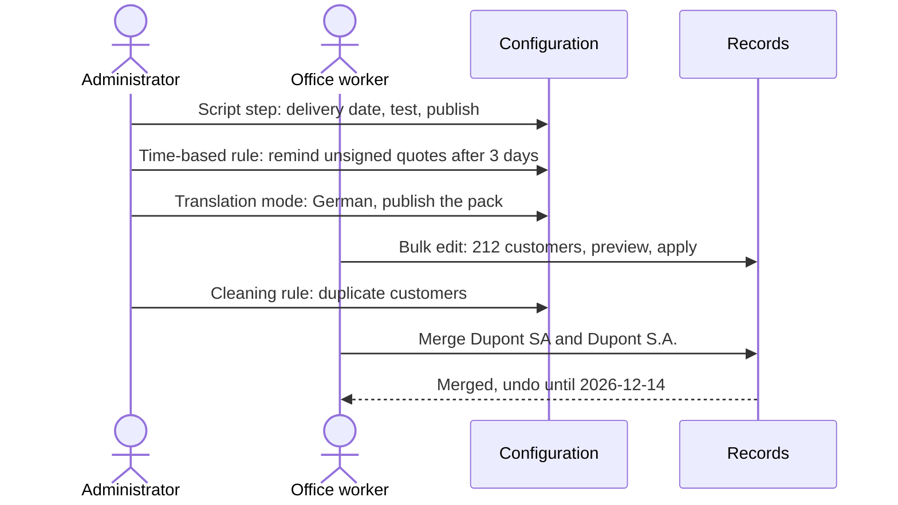

🏠 [Specs](../../../README.md) › 🧩 [Functional capabilities](../../README.md) ›
🔧 [F2 No-code configuration](../README.md) › 🔀 [Flows](README.md) › 🔀 FL-F2-13 Low code, bulk work and data cleaning

# 🔀 FL-F2-13 Low code, bulk work and data cleaning

**Status:** ✅ specified

## Summary

Five tools for the people who configure and tidy the company's data: a sandboxed script step for what no ready-made step
does ([UC-F2-31](../use-cases/13-low-code-bulk-and-cleaning/uc-f02-31-add-a-low-code-script-step.md)), bulk edits with a
preview and an undo ([UC-F2-32](../use-cases/13-low-code-bulk-and-cleaning/uc-f02-32-edit-records-in-bulk.md)), rules
that fire on time ([UC-F2-33](../use-cases/13-low-code-bulk-and-cleaning/uc-f02-33-set-a-time-based-rule.md)),
translation made on the real screens
([UC-F2-34](../use-cases/13-low-code-bulk-and-cleaning/uc-f02-34-translate-the-screens-in-place.md)) and the cleaning of
duplicates and stale records
([UC-F2-35](../use-cases/13-low-code-bulk-and-cleaning/uc-f02-35-clean-duplicates-and-stale-records.md)). The owner
chose each in the 2026-11-14 interview
([D521](../../../06-decisions/f02-no-code-configuration/d521-benchmark-gaps-f02-no-code-configuration.md)).

## Personas

- [U07 Administrator](../../../01-users/personas/u07-administrator.md)
- [U11 IT provider administrator](../../../01-users/personas/u11-provider-admin.md)
- [U16 Office worker](../../../01-users/personas/u16-office-worker.md)
- [U05 Accounting](../../../01-users/personas/u05-accounting.md)

## Flowchart

## Sequence diagram

## Steps

| Step | Persona | Screen | Use case | What happens |
|---|---|---|---|---|
| 1 | [U07](../../../01-users/personas/u07-administrator.md), [U11](../../../01-users/personas/u11-provider-admin.md) | [S-F2-31](../screens/13-low-code-bulk-and-cleaning/s-f02-31-script-step-editor.md) | [UC-F2-31](../use-cases/13-low-code-bulk-and-cleaning/uc-f02-31-add-a-low-code-script-step.md) | The administrator, or the IT provider administrator for a client company, writes, tests and publishes a script step |
| 2 | [U16](../../../01-users/personas/u16-office-worker.md), [U05](../../../01-users/personas/u05-accounting.md) | [S-F2-32](../screens/13-low-code-bulk-and-cleaning/s-f02-32-bulk-edit.md) | [UC-F2-32](../use-cases/13-low-code-bulk-and-cleaning/uc-f02-32-edit-records-in-bulk.md) | An office worker or accounting selects records, previews and applies a bulk change, or undoes it |
| 3 | [U07](../../../01-users/personas/u07-administrator.md) | [S-F2-33](../screens/13-low-code-bulk-and-cleaning/s-f02-33-time-based-rule.md) | [UC-F2-33](../use-cases/13-low-code-bulk-and-cleaning/uc-f02-33-set-a-time-based-rule.md) | The administrator sets a rule that fires a number of days after a date |
| 4 | [U07](../../../01-users/personas/u07-administrator.md) | [S-F2-34](../screens/13-low-code-bulk-and-cleaning/s-f02-34-translation-mode.md) | [UC-F2-34](../use-cases/13-low-code-bulk-and-cleaning/uc-f02-34-translate-the-screens-in-place.md) | The administrator translates the screens in place and publishes the pack |
| 5 | [U07](../../../01-users/personas/u07-administrator.md), [U16](../../../01-users/personas/u16-office-worker.md) | [S-F2-35](../screens/13-low-code-bulk-and-cleaning/s-f02-35-data-cleaning.md) | [UC-F2-35](../use-cases/13-low-code-bulk-and-cleaning/uc-f02-35-clean-duplicates-and-stale-records.md) | The administrator sets a cleaning rule and the office worker reviews the proposals and merges |

### Entities and screens

| Entity | States in this flow | Shown at step and screen | Aggregated view |
|---|---|---|---|
| [E-F2-30 Script step](../data/e-f02-30-script-step.md) | Draft, Tested, Published, Failed, Retired | 1 [S-F2-31](../screens/13-low-code-bulk-and-cleaning/s-f02-31-script-step-editor.md) | Script steps |
| [E-F2-31 Bulk operation](../data/e-f02-31-bulk-operation.md) | Previewed, Applying, Applied, Undone, Partly undone, Failed, Expired | 2 [S-F2-32](../screens/13-low-code-bulk-and-cleaning/s-f02-32-bulk-edit.md) | Bulk operations |
| [E-F2-32 Scheduled trigger](../data/e-f02-32-scheduled-trigger.md) | Draft, Active, Paused, Retired | 3 [S-F2-33](../screens/13-low-code-bulk-and-cleaning/s-f02-33-time-based-rule.md) | Scheduled triggers |
| [E-F2-33 Translation entry](../data/e-f02-33-translation-entry.md) | Draft, Reviewed, Published, Outdated | 4 [S-F2-34](../screens/13-low-code-bulk-and-cleaning/s-f02-34-translation-mode.md) | Translation entries |
| [E-F2-34 Cleaning rule](../data/e-f02-34-cleaning-rule.md) | Draft, Active, Paused | 5 [S-F2-35](../screens/13-low-code-bulk-and-cleaning/s-f02-35-data-cleaning.md) | Cleaning rules |

## Errors

- **E1 A script goes over its limit.** It is stopped at the time or memory limit, shown as Over limit, and cannot be
  published ([BR-F2-28](../business-rules/br-f02-28-scripts-run-sandboxed-within-time-and-memory-limits.md)), step 1.
- **E2 A bulk change meets locked records.** They are skipped with the reason in the preview
  ([BR-F2-29](../business-rules/br-f02-29-bulk-changes-are-previewed-and-can-be-undone.md)), step 2.
- **E3 The system was down at a due time.** The run fires within its window, once per record
  ([BR-F2-30](../business-rules/br-f02-30-time-based-rules-run-once-per-record-and-period.md)), step 3.
- **E4 A translation drops a placeholder.** It is refused
  ([BR-F2-31](../business-rules/br-f02-31-in-place-translations-ship-as-packs.md)), step 4.
- **E5 Two records have conflicting values.** The reviewer must choose before the merge
  ([BR-F2-32](../business-rules/br-f02-32-merges-keep-every-link-and-an-undo-window.md)), step 5.

## Images

Every step and error, for each persona taking part, in light and dark mode (D120). Steps are numbered as in the Steps
table; E rows are the error cases.

| Step | Persona | Device | Light | Dark |
|---|---|---|---|---|
| 1 | U07 | desktop | [light](../images/13-low-code-bulk-and-cleaning/u07-administrator/1-script-step-editor-desktop-light.png) | [dark](../images/13-low-code-bulk-and-cleaning/u07-administrator/1-script-step-editor-desktop-dark.png) |
| 1 | U11 | desktop | [light](../images/13-low-code-bulk-and-cleaning/u11-provider-admin/1-script-step-editor-desktop-light.png) | [dark](../images/13-low-code-bulk-and-cleaning/u11-provider-admin/1-script-step-editor-desktop-dark.png) |
| 1 | U07 | desktop | [light](../images/13-low-code-bulk-and-cleaning/u07-administrator/1-script-step-editor-desktop-light.png) | [dark](../images/13-low-code-bulk-and-cleaning/u07-administrator/1-script-step-editor-desktop-dark.png) |
| 1 | U11 | desktop | [light](../images/13-low-code-bulk-and-cleaning/u11-provider-admin/1-script-step-editor-desktop-light.png) | [dark](../images/13-low-code-bulk-and-cleaning/u11-provider-admin/1-script-step-editor-desktop-dark.png) |
| 2 | U05 | desktop | [light](../images/13-low-code-bulk-and-cleaning/u05-accounting/2-bulk-edit-desktop-light.png) | [dark](../images/13-low-code-bulk-and-cleaning/u05-accounting/2-bulk-edit-desktop-dark.png) |
| 2 | U16 | desktop | [light](../images/13-low-code-bulk-and-cleaning/u16-office-worker/2-bulk-edit-desktop-light.png) | [dark](../images/13-low-code-bulk-and-cleaning/u16-office-worker/2-bulk-edit-desktop-dark.png) |
| 2 | U05 | desktop | [light](../images/13-low-code-bulk-and-cleaning/u05-accounting/2-bulk-edit-desktop-light.png) | [dark](../images/13-low-code-bulk-and-cleaning/u05-accounting/2-bulk-edit-desktop-dark.png) |
| 2 | U16 | desktop | [light](../images/13-low-code-bulk-and-cleaning/u16-office-worker/2-bulk-edit-desktop-light.png) | [dark](../images/13-low-code-bulk-and-cleaning/u16-office-worker/2-bulk-edit-desktop-dark.png) |
| 2 | U16 | phone | [light](../images/13-low-code-bulk-and-cleaning/u16-office-worker/2-bulk-edit-phone-light.png) | [dark](../images/13-low-code-bulk-and-cleaning/u16-office-worker/2-bulk-edit-phone-dark.png) |
| 3 | U07 | desktop | [light](../images/13-low-code-bulk-and-cleaning/u07-administrator/3-time-based-rule-desktop-light.png) | [dark](../images/13-low-code-bulk-and-cleaning/u07-administrator/3-time-based-rule-desktop-dark.png) |
| 3 | U07 | desktop | [light](../images/13-low-code-bulk-and-cleaning/u07-administrator/3-time-based-rule-desktop-light.png) | [dark](../images/13-low-code-bulk-and-cleaning/u07-administrator/3-time-based-rule-desktop-dark.png) |
| 4 | U07 | desktop | [light](../images/13-low-code-bulk-and-cleaning/u07-administrator/4-translation-mode-desktop-light.png) | [dark](../images/13-low-code-bulk-and-cleaning/u07-administrator/4-translation-mode-desktop-dark.png) |
| 4 | U07 | desktop | [light](../images/13-low-code-bulk-and-cleaning/u07-administrator/4-translation-mode-desktop-light.png) | [dark](../images/13-low-code-bulk-and-cleaning/u07-administrator/4-translation-mode-desktop-dark.png) |
| 5 | U07 | desktop | [light](../images/13-low-code-bulk-and-cleaning/u07-administrator/5-data-cleaning-desktop-light.png) | [dark](../images/13-low-code-bulk-and-cleaning/u07-administrator/5-data-cleaning-desktop-dark.png) |
| 5 | U16 | desktop | [light](../images/13-low-code-bulk-and-cleaning/u16-office-worker/5-data-cleaning-desktop-light.png) | [dark](../images/13-low-code-bulk-and-cleaning/u16-office-worker/5-data-cleaning-desktop-dark.png) |
| 5 | U07 | desktop | [light](../images/13-low-code-bulk-and-cleaning/u07-administrator/5-data-cleaning-desktop-light.png) | [dark](../images/13-low-code-bulk-and-cleaning/u07-administrator/5-data-cleaning-desktop-dark.png) |
| 5 | U16 | desktop | [light](../images/13-low-code-bulk-and-cleaning/u16-office-worker/5-data-cleaning-desktop-light.png) | [dark](../images/13-low-code-bulk-and-cleaning/u16-office-worker/5-data-cleaning-desktop-dark.png) |
| 5 | U16 | phone | [light](../images/13-low-code-bulk-and-cleaning/u16-office-worker/5-data-cleaning-phone-light.png) | [dark](../images/13-low-code-bulk-and-cleaning/u16-office-worker/5-data-cleaning-phone-dark.png) |
| E1 | U07 | desktop | [light](../images/13-low-code-bulk-and-cleaning/u07-administrator/e1-a-script-goes-over-its-limit-desktop-light.png) | [dark](../images/13-low-code-bulk-and-cleaning/u07-administrator/e1-a-script-goes-over-its-limit-desktop-dark.png) |

## Open questions

None.

---

⬅️ [FL-F2-12 Set up request types](fl-f02-12-set-up-request-types.md) · ⬆️ [Up](README.md)
