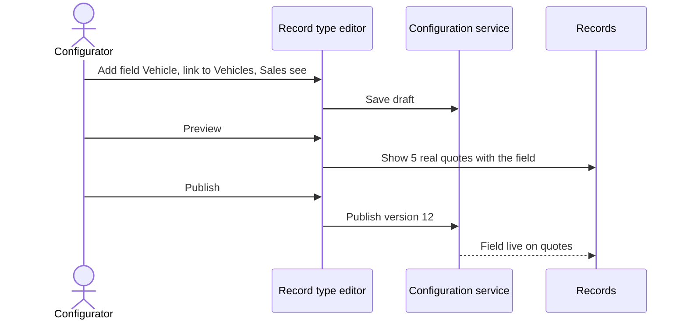

🏠 [Specs](../../../../README.md) › 🧩 [Functional capabilities](../../../README.md) ›
🔧 [F2 No-code configuration](../../README.md) › 📝 [Use cases](../README.md) ›
📝 [Use cases: FL-F2-01 Configure a record type](README.md) › 📝 UC-F2-01 Add a custom field to a record type

# 📝 UC-F2-01 Add a custom field to a record type

**Status:** ✅ specified

## Summary

A configurator adds a field to a record type (such as quotes, employees, or a new "Vehicles" type), sets its type,
rules, visibility and labels, and publishes it.

## Personas

- [U07 Administrator](../../../../01-users/personas/u07-administrator.md)
- Users with the Configurator role (D96): [U02 Manager](../../../../01-users/personas/u02-manager.md),
  [U16 Office worker](../../../../01-users/personas/u16-office-worker.md),
  [U13 Owner](../../../../01-users/personas/u13-owner.md),
  [U12 Marketing and communication](../../../../01-users/personas/u12-marketing.md)

## Goal

Records hold the information the company's field needs.

## Trigger

Information the company needs has no field.

## Frequency

Often at the start, then a few times a month.

## Preconditions

The record type is open to custom fields (D103); the user may see it (D96).

## Postconditions

Once published (D97), the field is in the record type's form, list, filters, API, webhooks, AI assistant, MCP and A2A,
under its visibility (BR-F2-02, BR-F2-03).

## Main flow

1. The configurator opens the record type in the record type editor.
2. They add a field, name it, and pick its type among the fourteen
   ([D101](../../../../06-decisions/f02-no-code-configuration/d101-custom-field-types.md)).
3. They set its rules: required, default value, minimum and maximum, unique, format.
4. They limit it to some roles if needed
   ([D102](../../../../06-decisions/f02-no-code-configuration/d102-field-visibility-per-role.md)).
5. They write its label and help text per language
   ([D104](../../../../06-decisions/f02-no-code-configuration/d104-labels-per-language.md)).
6. The change is saved as a draft; they preview it with real data, then publish it (UC-F2-09).

## Alternative flows

- 2a. **Computed:** they write a formula; SimpleERP shows its value on a few real records (BR-F2-04).
- 2b. **Link to a record:** they pick the record type it links to.
- 2c. **List:** they type its values, each with a label per language.
- **Archive:** an existing field is archived (BR-F2-01).

## Error flows

- 2e. A field with the same name exists on the record type: refused.
- 2f. A formula refers to a missing field or makes a loop: refused, with the reason.
- Changing the type of a field that holds data: refused; a new field is created instead.

## Business rules

- [BR-F2-01 Archive, never delete](../../business-rules/br-f02-01-archive-never-delete.md)
- [BR-F2-02 Custom data follows permissions](../../business-rules/br-f02-02-custom-data-follows-permissions.md)
- [BR-F2-03 Field visibility per role](../../business-rules/br-f02-03-field-visibility-per-role.md)
- [BR-F2-04 Computed fields are read-only](../../business-rules/br-f02-04-computed-fields-are-read-only.md)

## Entities

- [E-F2-01 Custom field](../../data/e-f02-01-custom-field.md)

## Permissions

The administrator; the Configurator role, on the record types their roles can see (D96).

## Notifications

None to users; the published change shows in the configuration history.

## Audit events

Field drafted, published, archived, restored; old and new definitions.

## AI involvement

The AI assistant suggests fields from a plain description ("we need to track the vehicle used") and writes
formulas, as a draft for the configurator to check.

## API, MCP and A2A exposure

The field's values, once published (D100); the field definitions are readable through the API.

## Screens

- [S-F2-01 Record type editor](../../screens/01-configure-a-record-type/s-f02-01-record-type-editor.md)

## Flowchart

See [FL-F2-01 Configure a record type](../../flows/fl-f02-01-configure-a-record-type.md#flowchart).

## Sequence diagram

## Acceptance criteria

1. **Given** a draft field **when** it is not published **then** no user sees it, on any channel.
2. **Given** a published field limited to HR **when** a sales person reads the record through the screen, the API or the
   AI assistant **then** the field is absent.
3. **Given** a computed field **when** an input changes **then** its value is recalculated and cannot be typed.
4. **Given** a field with data **when** the configurator deletes it **then** it is refused and archiving is offered.
5. **Given** a label only in French **when** an English-speaking user opens the form **then** the French label is shown.

## Non-functional notes

A published field is live within 5 seconds on every channel.

## Regulatory references

GDPR: a custom field holding personal data is listed in the GDPR register (UC-F1-12).

Legal values from the France country pack:
[CR-FR-048 Record of processing activities](../../../../10-country-packs/france/data-protection/cr-fr-048-record-of-processing.md).

## Related use cases

UC-F2-02 to UC-F2-04; UC-F2-09 Draft, preview and publish a change; UC-F1-12.

- [UC-F2-27 Set field-level rights and validation rules](../11-rights-translations-and-approvals/uc-f02-27-set-field-level-rights-and-validation-rules.md)

- [UC-F2-28 Translate custom labels and statuses](../11-rights-translations-and-approvals/uc-f02-28-translate-custom-labels-and-statuses.md)

## Open questions

None.

---

⬆️ [Up](README.md) ·
➡️ [UC-F2-02 Change the statuses of a record type](uc-f02-02-change-the-statuses-of-a-record-type.md)
