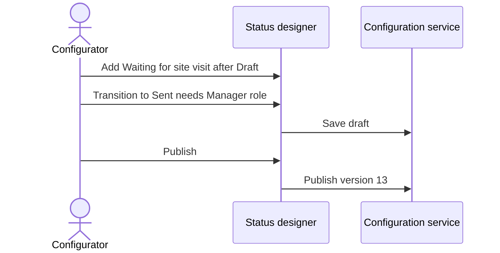

🏠 [Specs](../../../../README.md) › 🧩 [Functional capabilities](../../../README.md) ›
🔧 [F2 No-code configuration](../../README.md) › 📝 [Use cases](../README.md) ›
📝 [Use cases: FL-F2-01 Configure a record type](README.md) › 📝 UC-F2-02 Change the statuses of a record type

# 📝 UC-F2-02 Change the statuses of a record type

**Status:** ✅ specified

## Summary

A configurator adds, renames or reorders a record type's statuses, sets which can follow which and on what conditions,
and their colours and icons.

## Personas

- [U07 Administrator](../../../../01-users/personas/u07-administrator.md)
- Users with the Configurator role (D96, D98)

## Goal

Records move through the steps the company really follows.

## Trigger

A step of the company's process is missing or wrong.

## Frequency

At the start, then rarely.

## Preconditions

The user may see the record type (D96).

## Postconditions

Once published (D97), records follow the new statuses and transitions.

## Main flow

1. The configurator opens the record type's statuses in the status designer.
2. They add, rename or reorder statuses
   ([D105](../../../../06-decisions/f02-no-code-configuration/d105-status-configuration.md)).
3. They draw the allowed transitions.
4. On a transition, they set conditions: required fields, a role needed.
5. They choose each status's colour and icon.
6. They preview with real records and publish (UC-F2-09).

## Alternative flows

- 2a. Add a status around a locked core status (BR-F2-05).
- 2b. Remove or archive a status: its records are moved first (BR-F2-06).

## Error flows

- 2e. Removing a core status: refused (BR-F2-05).
- 2f. Removing a used status: refused until its records move (BR-F2-06).
- 3e. A status no transition reaches: shown as a warning before publishing.

## Business rules

- [BR-F2-05 Core statuses are locked](../../business-rules/br-f02-05-core-statuses-are-locked.md)
- [BR-F2-06 Move records before removing a status](../../business-rules/br-f02-06-move-records-before-removing-a-status.md)

## Entities

- [E-F2-02 Status and transition](../../data/e-f02-02-status-and-transition.md)
- [E-F2-26 Configuration draft](../../data/e-f02-26-configuration-draft.md)

## Permissions

The administrator; the Configurator role, on the record types their roles can see.

## Notifications

None to users.

## Audit events

Statuses and transitions drafted, published; records moved in bulk (how many, from, to).

## AI involvement

The AI assistant drafts statuses and transitions from a plain description of the process.

## API, MCP and A2A exposure

A record's status and its allowed next statuses are in the API; moving a record through the API obeys the
same conditions.

## Screens

- [S-F2-02 Status designer](../../screens/01-configure-a-record-type/s-f02-02-status-designer.md)

## Flowchart

See [FL-F2-01 Configure a record type](../../flows/fl-f02-01-configure-a-record-type.md#flowchart).

## Sequence diagram

## Acceptance criteria

1. **Given** a new status between Draft and Sent **when** published **then** quotes can move into it.
2. **Given** a transition that needs the Manager role **when** a sales person tries it **then** it is refused on every
   channel.
3. **Given** a transition that needs a field **when** the field is empty **then** the move is refused and the field is
   named.
4. **Given** a used status **when** removed **then** it is refused and moving its records is offered.
5. **Given** a core status **when** removed **then** it is refused.

## Non-functional notes

Status colours always come with the status's name or icon (D46: never colour alone).

## Regulatory references

None.

## Related use cases

UC-F2-01; UC-F2-03 Arrange a form; UC-F2-07 Create a simple rule (planned).

- [UC-F2-28 Translate custom labels and statuses](../11-rights-translations-and-approvals/uc-f02-28-translate-custom-labels-and-statuses.md)

## Open questions

None.

---

⬅️ [UC-F2-01 Add a custom field to a record type](uc-f02-01-add-a-custom-field-to-a-record-type.md) ·
⬆️ [Up](README.md) · ➡️ [UC-F2-03 Arrange a form](uc-f02-03-arrange-a-form.md)
