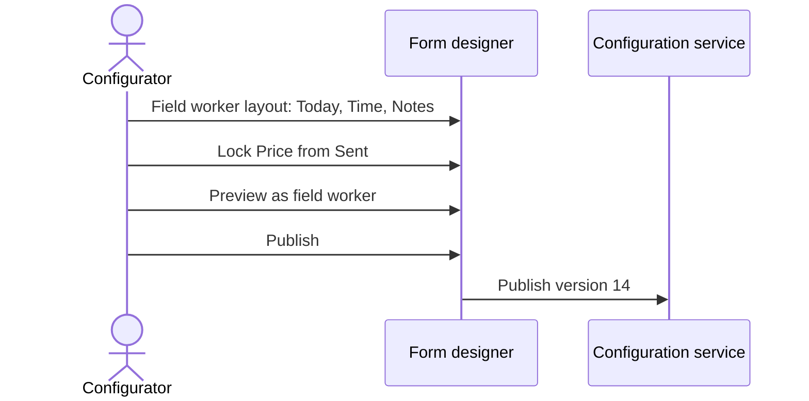

🏠 [Specs](../../../../README.md) › 🧩 [Functional capabilities](../../../README.md) ›
🔧 [F2 No-code configuration](../../README.md) › 📝 [Use cases](../README.md) ›
📝 [Use cases: FL-F2-01 Configure a record type](README.md) › 📝 UC-F2-03 Arrange a form

# 📝 UC-F2-03 Arrange a form

**Status:** ✅ specified

## Summary

A configurator arranges a record type's form (sections, order, conditions, read-only per status, a layout per role and
for phones) and its shared list views; every user can save personal list views.

## Personas

- [U07 Administrator](../../../../01-users/personas/u07-administrator.md)
- Users with the Configurator role (D96, D98)
- Every user, for their personal list views (D109)

## Goal

Each role sees the fields it needs, in the order it works, on desktop and phone.

## Trigger

A form is too long, in the wrong order, or shows fields a role does not need.

## Frequency

At the start, then a few times a year; personal views any time.

## Preconditions

The user may see the record type (D96).

## Postconditions

Once published (D97), each role gets its layout and shared views.

## Main flow

1. The configurator opens the record type's form in the form designer.
2. They group fields in sections and tabs, and order them
   ([D108](../../../../06-decisions/f02-no-code-configuration/d108-form-layout-options.md)).
3. They set conditions: show a field or section only when another field has a value.
4. They lock fields from a status on (BR-F2-08).
5. They make a layout per role if needed, and optionally a shorter phone layout
   ([D110](../../../../06-decisions/f02-no-code-configuration/d110-phone-forms.md)).
6. They arrange shared list views per role
   ([D109](../../../../06-decisions/f02-no-code-configuration/d109-list-views.md)).
7. They preview as each role, then publish (UC-F2-09).

## Alternative flows

- **Personal view:** any user arranges a list (columns, filters, sort, grouping) and saves it as their own view.
- **Share a personal view:** a configurator turns a user's personal view into a shared one.

## Error flows

- 3e. A condition refers to a field that is not on the form: warning before publishing.
- 5e. A required field missing from a role's layout: refused, since that role could never save the record.

## Business rules

- [BR-F2-07 Layout is not security](../../business-rules/br-f02-07-layout-is-not-security.md)
- [BR-F2-08 Read-only per status on every channel](../../business-rules/br-f02-08-read-only-per-status-on-every-channel.md)

## Entities

- [E-F2-03 Form layout](../../data/e-f02-03-form-layout.md)
- [E-F2-04 List view](../../data/e-f02-04-list-view.md)

## Permissions

Layouts and shared views: the administrator and the Configurator role. Personal views: every user, on lists they may
see.

## Notifications

None.

## Audit events

Layouts and shared views drafted and published.

## AI involvement

The AI assistant proposes a layout per role from how the role uses the form (the fields it fills most), as a draft.

## API, MCP and A2A exposure

None for layouts; read-only rules apply on every channel (BR-F2-08).

## Screens

- [S-F2-03 Form designer](../../screens/01-configure-a-record-type/s-f02-03-form-designer.md)
- [S-F2-04 List view settings](../../screens/01-configure-a-record-type/s-f02-04-list-view-settings.md)

## Flowchart

See [FL-F2-01 Configure a record type](../../flows/fl-f02-01-configure-a-record-type.md#flowchart).

## Sequence diagram

## Acceptance criteria

1. **Given** a layout per role **when** a field worker opens the form **then** they see their layout, and a sales person
   sees theirs.
2. **Given** a condition on Vehicle **when** the delivery field is empty **then** Vehicle is hidden, and shown once it
   is filled.
3. **Given** Price locked from Sent **when** a sent quote's price is changed through the API **then** it is refused.
4. **Given** a desktop form with no phone layout **when** opened on a phone **then** it shows in one column with
   sections folded.
5. **Given** a user's personal list view **when** they come back **then** it is still there, and other users do not see
   it.

## Non-functional notes

Phone layouts are always comfortable density (D42).

## Regulatory references

None.

## Related use cases

UC-F2-01; UC-F2-02; UC-F2-09 Draft, preview and publish a change.

- [UC-F2-17 Add a kanban, calendar, map, Gantt or timeline view](../08-views-and-bookings/uc-f02-17-add-a-kanban-calendar-map-gantt-or-timeline-view.md)

- [UC-F2-21 Make a phone form work offline](../09-portals-and-offline-forms/uc-f02-21-make-a-phone-form-work-offline.md)

## Open questions

None.

---

⬅️ [UC-F2-02 Change the statuses of a record type](uc-f02-02-change-the-statuses-of-a-record-type.md) ·
⬆️ [Up](README.md) · ➡️ [UC-F2-04 Create a new record type](uc-f02-04-create-a-new-record-type.md)
