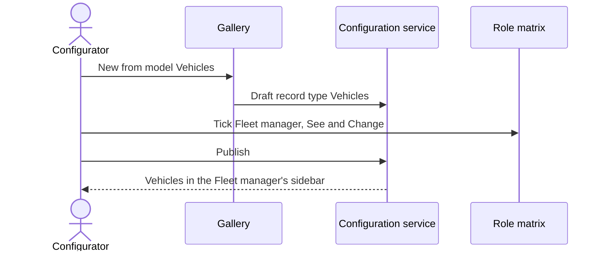

🏠 [Specs](../../../../README.md) › 🧩 [Functional capabilities](../../../README.md) ›
🔧 [F2 No-code configuration](../../README.md) › 📝 [Use cases](../README.md) ›
📝 [Use cases: FL-F2-01 Configure a record type](README.md) › 📝 UC-F2-04 Create a new record type

# 📝 UC-F2-04 Create a new record type

**Status:** ✅ specified

## Summary

A configurator creates a new kind of record (such as "Vehicles" or "Interventions"), from a model of the gallery or
blank, with its fields, statuses, form, list, links, and the roles that may use it.

## Personas

- [U07 Administrator](../../../../01-users/personas/u07-administrator.md)
- Users with the Configurator role (D96, D98)

## Goal

The company keeps in SimpleERP what its field needs, without a developer.

## Trigger

Information the company manages has no record type.

## Frequency

A few at the start, then rarely.

## Preconditions

The user holds the administrator or Configurator role.

## Postconditions

Once published (D97) and once roles are ticked (BR-F2-09), the record type has its list, form, statuses, sidebar entry,
links, attachments and comments (D111).

## Main flow

1. The configurator opens Record types and chooses "New".
2. They pick a model in the gallery (Vehicles, Equipment, Interventions, Members, Donations, Contracts...) or start
   blank ([D113](../../../../06-decisions/f02-no-code-configuration/d113-record-type-gallery.md)).
3. They name it (per language, D104) and pick its icon.
4. They add fields (UC-F2-01), including links to core records, statuses (UC-F2-02) and arrange its form and lists
   (UC-F2-03).
5. They tick the roles that may see and change it in the role matrix (BR-F2-09).
6. They preview and publish (UC-F2-09); it appears in the sidebar of those roles
   ([D111](../../../../06-decisions/f02-no-code-configuration/d111-what-a-record-type-gets.md)).

## Alternative flows

- 2a. Blank: only a name field to start.
- Archive a record type: it leaves the sidebar; its records are kept (BR-F2-01).

## Error flows

- 3e. A record type with the same name exists: refused.
- A link to a core record type the configurator may not see: refused.

## Business rules

- [BR-F2-09 New record types start closed](../../business-rules/br-f02-09-new-record-types-start-closed.md)
- [BR-F2-01 Archive, never delete](../../business-rules/br-f02-01-archive-never-delete.md)
- [BR-F2-02 Custom data follows permissions](../../business-rules/br-f02-02-custom-data-follows-permissions.md)

## Entities

- [E-F2-05 Record type](../../data/e-f02-05-record-type.md)

## Permissions

The administrator; the Configurator role.

## Notifications

The users of the roles ticked are told a new record type is available.

## Audit events

Record type created, published, archived; roles ticked.

## AI involvement

The AI assistant drafts a record type from a description ("we rent equipment to customers"), for the
configurator to check.

## API, MCP and A2A exposure

Its records, once published and allowed, like any record type (D100).

## Screens

- [S-F2-05 Record type gallery](../../screens/01-configure-a-record-type/s-f02-05-record-type-gallery.md)
- [S-F2-01 Record type editor](../../screens/01-configure-a-record-type/s-f02-01-record-type-editor.md)

## Flowchart

See [FL-F2-01 Configure a record type](../../flows/fl-f02-01-configure-a-record-type.md#flowchart).

## Sequence diagram

## Acceptance criteria

1. **Given** a new record type published with no role ticked **when** any user looks for it **then** it is nowhere, on
   any channel.
2. **Given** a role ticked **when** its users sign in **then** the record type is in their sidebar with its list and
   form.
3. **Given** a link field to Deliveries **when** a vehicle is opened **then** its deliveries are listed.
4. **Given** a vehicle **when** a user attaches a file or comments **then** it is kept on the record.
5. **Given** the model Vehicles **when** chosen **then** its fields and statuses are copied and editable.

## Non-functional notes

A new record type meets the same response targets as core ones (D25).

## Regulatory references

GDPR: a record type holding personal data is listed in the GDPR register (UC-F1-12).

## Related use cases

UC-F2-01 to UC-F2-03; UC-F2-11 Export or import a configuration as a pack.

## Open questions

None.

---

⬅️ [UC-F2-03 Arrange a form](uc-f02-03-arrange-a-form.md) · ⬆️ [Up](README.md) ·
➡️ [UC-F2-05 Edit a document template](../02-customise-documents-and-emails/uc-f02-05-edit-a-document-template.md)
