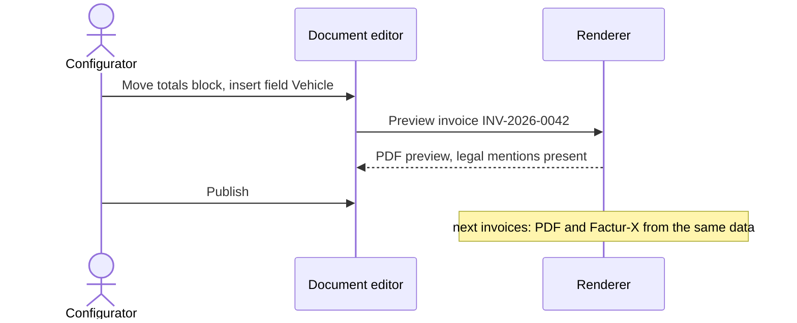

🏠 [Specs](../../../../README.md) › 🧩 [Functional capabilities](../../../README.md) ›
🔧 [F2 No-code configuration](../../README.md) › 📝 [Use cases](../README.md) ›
📝 [Use cases: FL-F2-02 Customise documents and emails](README.md) › 📝 UC-F2-05 Edit a document template

# 📝 UC-F2-05 Edit a document template

**Status:** ✅ specified

## Summary

A configurator edits how quotes, invoices, delivery notes and other documents look, per language, with several templates
per type; legal mentions stay locked and invoices also come out in e-invoicing formats.

## Personas

- [U07 Administrator](../../../../01-users/personas/u07-administrator.md)
- Users with the Configurator role, typically [U16 Office worker](../../../../01-users/personas/u16-office-worker.md)
  and [U12 Marketing and communication](../../../../01-users/personas/u12-marketing.md) (D98)

## Goal

Documents that look like the company and meet the law.

## Trigger

A new company, a new look, a new language, a customer wanting a different layout.

## Frequency

At the start, then a few times a year.

## Preconditions

The company's identity and logo are set (UC-F1-01).

## Postconditions

Once published (D97), new documents use the template; documents already issued keep the look they were issued with.

## Main flow

1. The configurator opens Documents and picks a document type and a template.
2. In the visual editor, they place blocks on the A4 page: header, addresses, lines table, totals, conditions,
   signature, free text ([D117](../../../../06-decisions/f02-no-code-configuration/d117-document-template-editors.md)).
3. They insert fields from a picker, custom fields included.
4. Locked legal mentions are on the page; they place and style them (BR-F2-10).
5. They write the template's texts per language (D104).
6. They preview with a real document, then publish (UC-F2-09).

## Alternative flows

- 2a. **HTML and CSS mode:** a technical user edits the template's code; the preview updates.
- 1a. **Another template of the same type:** they copy one ("short quote") and choose when it applies: per document or
  per customer ([D118](../../../../06-decisions/f02-no-code-configuration/d118-document-template-features.md)).

## Error flows

- 4e. Removing a legal mention: refused (BR-F2-10).
- 2e. HTML that breaks the page or calls an outside address: refused, with the line; templates can only use
  files of the company.

## Business rules

- [BR-F2-10 Legal mentions are locked](../../business-rules/br-f02-10-legal-mentions-are-locked.md)
- [BR-F2-11 Electronic formats with the PDF](../../business-rules/br-f02-11-electronic-formats-with-the-pdf.md)

## Entities

- [E-F2-06 Document template](../../data/e-f02-06-document-template.md)
- [E-F2-27 Legal mention](../../data/e-f02-27-legal-mention.md)

## Permissions

The administrator; the Configurator role.

## Notifications

None.

## Audit events

Template drafted, published; which template each document used.

## AI involvement

The AI assistant builds a first template from the company's logo and an example document the user uploads, as a draft.

## API, MCP and A2A exposure

Documents are rendered with their template through the API; templates themselves are edited in the screens only.

## Screens

- [S-F2-06 Document template editor](../../screens/02-customise-documents-and-emails/s-f02-06-document-template-editor.md)

## Flowchart

See [FL-F2-02 Customise documents and emails](../../flows/fl-f02-02-customise-documents-and-emails.md#flowchart).

## Sequence diagram

## Acceptance criteria

1. **Given** a template **when** a legal mention block is deleted **then** it is refused.
2. **Given** a customer whose language is English **when** an invoice is issued **then** it uses the English template.
3. **Given** two quote templates **when** a quote is issued for a customer set to "short" **then** the short template is
   used.
4. **Given** an invoice **when** it is issued **then** its structured e-invoicing file has the same amounts as its PDF.
5. **Given** a published change **when** an old invoice is reprinted **then** it keeps the look it was issued with.

## Non-functional notes

A document renders in under 2 seconds; PDFs are PDF/A for archiving.

## Regulatory references

- Invoice mentions: Code général des impôts, annex II, article 242 nonies A; Code de commerce, article L441-9, in its
  version of Ordonnance n° 2026-671 from 2027-01-01 with the same mentions
  ([CR-FR-015 Mandatory invoice mentions](../../../../10-country-packs/france/invoicing/cr-fr-015-invoice-mandatory-mentions.md)).
- E-invoicing: [Q13](../../../../07-questions/q13-e-invoicing-platforms.md),
  [Q8](../../../../07-questions/q08-e-invoicing-dates.md).

Legal values from the France country pack:
[CR-FR-015 Mandatory invoice mentions](../../../../10-country-packs/france/invoicing/cr-fr-015-invoice-mandatory-mentions.md).

## Related use cases

UC-F2-06 Edit an email template; UC-F2-09; F6 and F8.

- [UC-F5-21 Keep the brand kit and asset library](../../../f05-social-media/use-cases/09-brand-tests-and-return-on-investment/uc-f05-21-keep-the-brand-kit-and-asset-library.md)

## Open questions

- [Q13 E-invoicing platforms](../../../../07-questions/q13-e-invoicing-platforms.md)

---

⬅️ [UC-F2-04 Create a new record type](../01-configure-a-record-type/uc-f02-04-create-a-new-record-type.md) ·
⬆️ [Up](README.md) · ➡️ [UC-F2-06 Edit an email template](uc-f02-06-edit-an-email-template.md)
