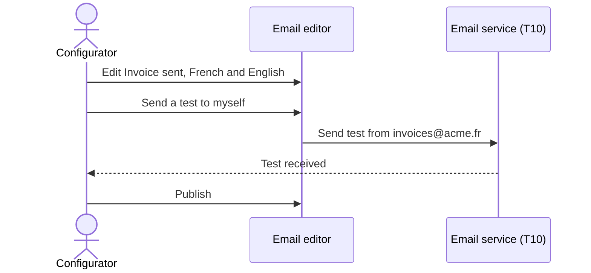

🏠 [Specs](../../../../README.md) › 🧩 [Functional capabilities](../../../README.md) ›
🔧 [F2 No-code configuration](../../README.md) › 📝 [Use cases](../README.md) ›
📝 [Use cases: FL-F2-02 Customise documents and emails](README.md) › 📝 UC-F2-06 Edit an email template

# 📝 UC-F2-06 Edit an email template

**Status:** ✅ specified

## Summary

A configurator edits the subject and body of every outgoing email per language, with the company's branding and its own
sender address.

## Personas

- [U07 Administrator](../../../../01-users/personas/u07-administrator.md)
- Users with the Configurator role, typically [U16 Office worker](../../../../01-users/personas/u16-office-worker.md)
  and [U12 Marketing and communication](../../../../01-users/personas/u12-marketing.md) (D98)

## Goal

Every email SimpleERP sends looks and reads like the company.

## Trigger

A new company, a new tone, a new language, a new sender address.

## Frequency

At the start, then rarely.

## Preconditions

For a custom sender address, the company's email server is set in F1's connections.

## Postconditions

Once published, emails use the new templates and branding.

## Main flow

1. The configurator opens Emails and picks an email (invitation, document sent, reminder, notification...)
   ([D119](../../../../06-decisions/f02-no-code-configuration/d119-email-templates.md)).
2. They edit its subject and body per language, inserting fields from a picker.
3. They set the branding once: logo, colours, signature.
4. They preview it as received, then publish.

## Alternative flows

- **Sender address:** the administrator sets the company's sender address and its email server; SimpleERP
  checks the domain's SPF and DKIM records before using it.

## Error flows

- The email server refuses the test message: the address is not used, the reason is shown.
- A required field of an email (such as the invitation link) is removed: refused.

## Business rules

None specific.

## Entities

- [E-F2-07 Email template](../../data/e-f02-07-email-template.md)

## Permissions

Templates: the administrator and the Configurator role. Sender address: the administrator.

## Notifications

None.

## Audit events

Template and branding changes; sender address changes.

## AI involvement

The AI assistant rewrites an email in the company's tone (D40), as a draft.

## API, MCP and A2A exposure

None.

## Screens

- [S-F2-07 Email template editor](../../screens/02-customise-documents-and-emails/s-f02-07-email-template-editor.md)

## Flowchart

See [FL-F2-02 Customise documents and emails](../../flows/fl-f02-02-customise-documents-and-emails.md#flowchart).

## Sequence diagram

## Acceptance criteria

1. **Given** an edited template **when** an invoice is emailed to an English-speaking customer **then** the English
   subject and body are used.
2. **Given** branding set **when** any email is sent **then** it carries the logo, colours and signature.
3. **Given** a sender address that fails the test **when** saved **then** emails keep the previous sender.

## Non-functional notes

Emails meet accessibility rules for text alternatives and contrast (D46).

## Regulatory references

None.

## Related use cases

UC-F2-05; UC-F1-03 (the invitation email).

## Open questions

None.

---

⬅️ [UC-F2-05 Edit a document template](uc-f02-05-edit-a-document-template.md) · ⬆️ [Up](README.md) ·
➡️ [UC-F2-07 Create a simple rule](../03-automate-with-a-rule/uc-f02-07-create-a-simple-rule.md)
