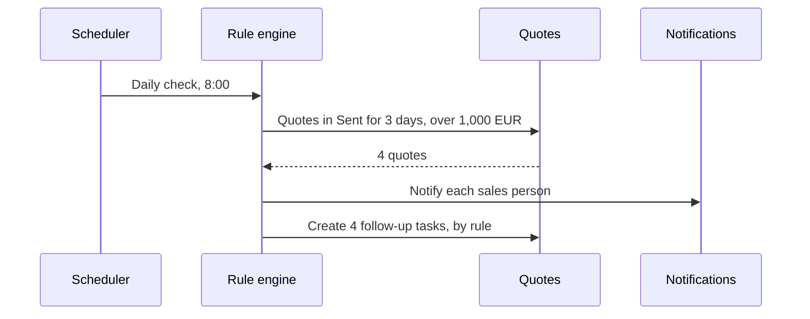

🏠 [Specs](../../../../README.md) › 🧩 [Functional capabilities](../../../README.md) ›
🔧 [F2 No-code configuration](../../README.md) › 📝 [Use cases](../README.md) ›
📝 [Use cases: FL-F2-03 Automate with a rule](README.md) › 📝 UC-F2-07 Create a simple rule

# 📝 UC-F2-07 Create a simple rule

**Status:** ✅ specified

## Summary

A configurator creates a "when, if, then" rule: a trigger, conditions and actions, run under a rule account.

## Personas

- [U07 Administrator](../../../../01-users/personas/u07-administrator.md)
- Users with the Configurator role (D96, D98)

## Goal

Repetitive work happens by itself: reminders, assignments, approvals, updates.

## Trigger

A task people do by hand every time.

## Frequency

A few rules a month.

## Preconditions

The user may see the record types the rule uses (D96).

## Postconditions

Once published (D97), the rule runs on its trigger; every run is logged.

## Main flow

1. The configurator opens Automations and chooses "New rule".
2. **When:** they pick a trigger ([D125](../../../../06-decisions/f02-no-code-configuration/d125-rule-triggers.md)), for
   example "a quote has been in Sent for 3 days".
3. **If:** they add conditions on fields (amount over 1,000 EUR, customer in Lyon).
4. **Then:** they add actions ([D126](../../../../06-decisions/f02-no-code-configuration/d126-rule-actions.md)): notify
   the sales person, create a follow-up task.
5. They choose the rule account's rights, no more than their own
   ([D127](../../../../06-decisions/f02-no-code-configuration/d127-rule-accounts.md)).
6. They test it on real records (it shows what it would do, without doing it), then publish (UC-F2-09).

## Alternative flows

- 4a. **Approval:** the action starts an approval chain (one or more people, in order or all at once).
- 4b. **Outside call:** a webhook, or the AI assistant using an outside tool, with the connection's confirmation setting
  (D81).
- Pause a rule: it stops until resumed; its log stays.

## Error flows

- 5e. Rights above the configurator's own: refused (BR-F2-12).
- At run time, an action fails (outside service down): the run is marked failed, retried 3 times over an
  hour, then the configurators are told.
- At run time, a loop: stopped (BR-F2-13).

## Business rules

- [BR-F2-12 Rule accounts never exceed their author](../../business-rules/br-f02-12-rule-accounts-never-exceed-their-author.md)
- [BR-F2-13 Rules cannot loop](../../business-rules/br-f02-13-rules-cannot-loop.md)

## Entities

- [E-F2-08 Automation rule](../../data/e-f02-08-automation-rule.md)

## Permissions

The administrator; the Configurator role.

## Notifications

What the rule's actions send; failures go to the rule's author and the administrators.

## Audit events

Every run: trigger, conditions met, actions done or failed; every change "by rule".

## AI involvement

The AI assistant drafts a rule from a sentence ("remind the sales person 3 days after a quote is sent"), as a
draft to test.

## API, MCP and A2A exposure

Outside events reach rules through the API's incoming webhooks; rules themselves are set in the screens only.

## Screens

- [S-F2-08 Rule editor](../../screens/03-automate-with-a-rule/s-f02-08-rule-editor.md)

## Flowchart

See [FL-F2-03 Automate with a rule](../../flows/fl-f02-03-automate-with-a-rule.md#flowchart).

## Sequence diagram

## Acceptance criteria

1. **Given** a published rule "quote in Sent for 3 days" **when** a quote reaches its third day **then** its sales
   person is notified and a task is created, signed by the rule.
2. **Given** a rule tested **when** the test runs **then** it lists what it would do and changes nothing.
3. **Given** a configurator **when** they give the rule account more rights than their own **then** it is refused.
4. **Given** two rules feeding each other **when** they run **then** the chain stops when a rule would run a second time
   in it, and the configurators are told (D128, BR-F2-13).
5. **Given** an outside call through a connection set to "always ask" **when** the rule runs **then** the call waits for
   a person's confirmation.

## Non-functional notes

Rules on record changes run within 10 seconds; date rules run daily at 6:00 in the company's time zone.

## Regulatory references

None.

## Related use cases

UC-F2-08 Design a visual workflow; UC-F2-09; UC-F1-07 (connections).

- [UC-F2-24 Test rules and workflows with test cases](../10-change-safely/uc-f02-24-test-rules-and-workflows-with-test-cases.md)

## Open questions

None.

---

⬅️ [UC-F2-06 Edit an email template](../02-customise-documents-and-emails/uc-f02-06-edit-an-email-template.md) ·
⬆️ [Up](README.md) ·
➡️ [UC-F2-08 Design a visual workflow](../04-design-a-visual-workflow/uc-f02-08-design-a-visual-workflow.md)
