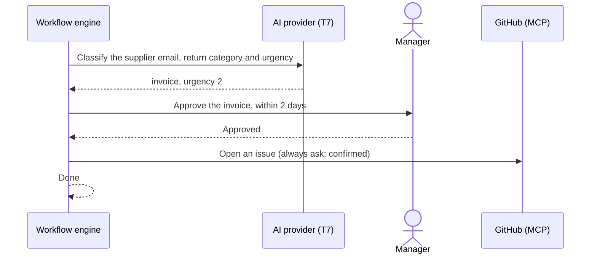

🏠 [Specs](../../../../README.md) › 🧩 [Functional capabilities](../../../README.md) ›
🔧 [F2 No-code configuration](../../README.md) › 📝 [Use cases](../README.md) ›
📝 [Use cases: FL-F2-04 Design a visual workflow](README.md) › 📝 UC-F2-08 Design a visual workflow

# 📝 UC-F2-08 Design a visual workflow

**Status:** ✅ specified

## Summary

A configurator draws a workflow from blocks (branches, waits, parallel paths, human tasks and forms, outside calls, AI
operations) that reads as plain sentences.

## Personas

- [U07 Administrator](../../../../01-users/personas/u07-administrator.md)
- Users with the Configurator role (D96, D98)

## Goal

Processes that a simple rule cannot express run by themselves, understood by those who maintain them.

## Trigger

A process with several steps, people, waits or outside systems.

## Frequency

A few workflows a year.

## Preconditions

The user may see the record types the workflow uses (D96).

## Postconditions

Once published (UC-F2-09), each start of the workflow runs as an instance whose progress can be followed.

## Main flow

1. The configurator opens Automations › Workflows and starts from a template or blank.
2. They pick its trigger (the same four as rules, D125).
3. They add blocks ([D129](../../../../06-decisions/f02-no-code-configuration/d129-workflow-blocks.md)): branches and
   conditions; waits and timers; parallel paths and joins; human tasks and forms; API, MCP, A2A and connector calls; AI
   operations with a custom prompt and output format.
4. Each block reads as a sentence ("Wait until the customer signs, at most 10 days"); the AI assistant can explain or
   draft
   any block ([D130](../../../../06-decisions/f02-no-code-configuration/d130-workflows-for-non-technical-users.md)).
5. For an AI operation, they write the prompt in plain words and declare the output fields (BR-F2-14).
6. They choose the workflow account's rights (BR-F2-12), test it step by step on a real record, and publish.

## Alternative flows

- 3a. **Human task:** a person gets a form to fill or an approval, with a deadline and an escalation to their manager.
- 3b. **Outside call:** an API, MCP or A2A call through a connection (D80, D81).
- Follow a running workflow: each instance shows where it is and what it waits for.

## Error flows

- A block left incomplete: shown in red with a plain explanation; publishing is refused until fixed.
- An AI answer outside its format: retried, then the error path (BR-F2-14).
- An outside call fails: retried 3 times over an hour, then the error path, else the configurators are told.
- A loop: stopped (BR-F2-13).

## Business rules

- [BR-F2-12 Rule accounts never exceed their author](../../business-rules/br-f02-12-rule-accounts-never-exceed-their-author.md)
- [BR-F2-13 Rules cannot loop](../../business-rules/br-f02-13-rules-cannot-loop.md)
- [BR-F2-14 AI steps return their declared format](../../business-rules/br-f02-14-ai-steps-return-their-declared-format.md)

## Entities

- [E-F2-09 Workflow](../../data/e-f02-09-workflow.md)
- [E-F2-29 Workflow template](../../data/e-f02-29-workflow-template.md)

## Permissions

The administrator; the Configurator role.

## Notifications

Human tasks and approvals notify their people (D92); failures go to the author and the administrators.

## Audit events

Every instance: start, each block done, waits, decisions, outside calls (not their data), AI steps (prompt version,
provider), end or failure.

## AI involvement

AI operations run on the provider of a new AI feature setting, "Workflow AI steps", local by default (D5,
D82, D83); the AI assistant explains and drafts blocks.

## API, MCP and A2A exposure

A workflow can be started through the API, MCP or A2A, within the caller's rights.

## Screens

- [S-F2-09 Workflow designer](../../screens/04-design-a-visual-workflow/s-f02-09-workflow-designer.md)

## Flowchart

See [FL-F2-04 Design a visual workflow](../../flows/fl-f02-04-design-a-visual-workflow.md#flowchart).

## Sequence diagram

## Acceptance criteria

1. **Given** a workflow **when** read in the designer **then** every block shows as a plain sentence with no code.
2. **Given** an AI step with declared fields **when** the answer fits **then** the next block uses those fields.
3. **Given** a human task with a 2-day deadline **when** it passes **then** it escalates to the person's manager.
4. **Given** two parallel paths joined on "all" **when** one finishes **then** the workflow waits for the other.
5. **Given** an incomplete block **when** publishing **then** it is refused and the block is explained.

## Non-functional notes

Workflows meet D33 and D46; the designer is tested with non-technical users (D130).

## Regulatory references

EU AI Act: an AI step that affects a person is logged and explainable (see
[AI governance](../../../../05-non-functional/ai-governance.md)).

## Related use cases

UC-F2-07; UC-F2-09; UC-F1-07; UC-F1-08.

- [UC-F2-24 Test rules and workflows with test cases](../10-change-safely/uc-f02-24-test-rules-and-workflows-with-test-cases.md)

## Open questions

None.

---

⬅️ [UC-F2-07 Create a simple rule](../03-automate-with-a-rule/uc-f02-07-create-a-simple-rule.md) · ⬆️ [Up](README.md) ·
➡️ [UC-F2-09](../05-publish-and-roll-back/uc-f02-09-draft-preview-and-publish-a-change.md)
