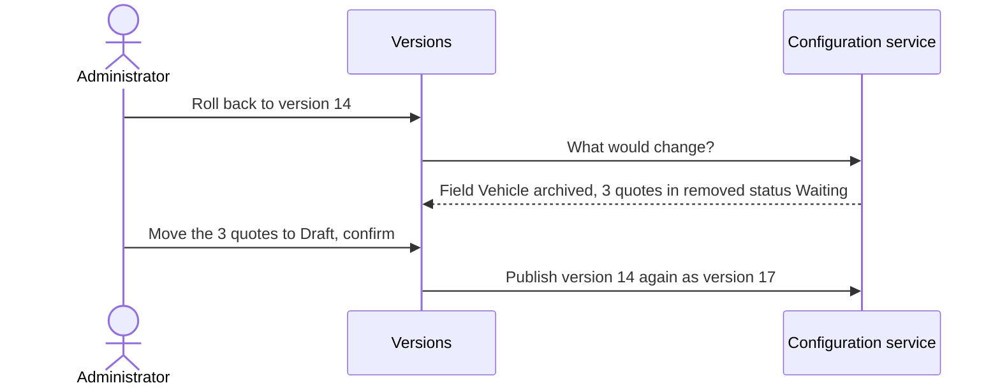

🏠 [Specs](../../../../README.md) › 🧩 [Functional capabilities](../../../README.md) ›
🔧 [F2 No-code configuration](../../README.md) › 📝 [Use cases](../README.md) ›
📝 [Use cases: FL-F2-05 Publish and roll back](README.md) › 📝 UC-F2-10 Roll a configuration back

# 📝 UC-F2-10 Roll a configuration back

**Status:** ✅ specified

## Summary

The administrator brings the configuration back to an earlier version; data is kept.

## Personas

- [U07 Administrator](../../../../01-users/personas/u07-administrator.md)

## Goal

A bad change is undone quickly, without losing data.

## Trigger

A published change causes problems.

## Frequency

Rarely.

## Preconditions

At least one earlier version exists.

## Postconditions

The chosen version is live again as a new version; data is kept
([D132](../../../../06-decisions/f02-no-code-configuration/d132-roll-back-configuration-only.md)).

## Main flow

1. The administrator opens Versions.
2. They pick an earlier version and see what would change, in plain words.
3. simple-ERP lists the effects on data: fields that disappear are archived (BR-F2-01), records in statuses that no
   longer exist must be moved.
4. They move those records (or choose the target status for all) and confirm.
5. The earlier configuration is published as a new version.

## Alternative flows

None.

## Error flows

- Records in removed statuses not moved: the roll-back is refused, with the list.

## Business rules

- [BR-F2-01 Archive, never delete](../../business-rules/br-f02-01-archive-never-delete.md)
- [BR-F2-06 Move records before removing a status](../../business-rules/br-f02-06-move-records-before-removing-a-status.md)

## Entities

- [E-F2-10 Configuration version](../../data/e-f02-10-configuration-version.md)

## Permissions

The administrator only.

## Notifications

The configurators are told of the roll-back.

## Audit events

Roll-back: from which version to which, by whom, records moved.

## AI involvement

None.

## API, MCP and A2A exposure

None.

## Screens

- [S-F2-10 Publish and versions](../../screens/05-publish-and-roll-back/s-f02-10-publish-and-versions.md)

## Flowchart

See [FL-F2-05 Publish and roll back](../../flows/fl-f02-05-publish-and-roll-back.md#flowchart).

## Sequence diagram

## Acceptance criteria

1. **Given** version 16 live **when** rolled back to 14 **then** version 17 equals 14 and no data is lost.
2. **Given** records in a status that 14 does not have **when** rolling back **then** they must be moved first.

## Non-functional notes

None.

## Regulatory references

None.

## Related use cases

UC-F2-09.

- [UC-F2-26 Find unused configuration](../10-change-safely/uc-f02-26-find-unused-configuration.md)

## Open questions

None.

---

⬅️ [UC-F2-09 Draft, preview and publish a change](uc-f02-09-draft-preview-and-publish-a-change.md) ·
⬆️ [Up](README.md) ·
➡️ [UC-F2-11](../06-share-a-configuration/uc-f02-11-export-or-import-a-configuration-as-a-pack.md)
