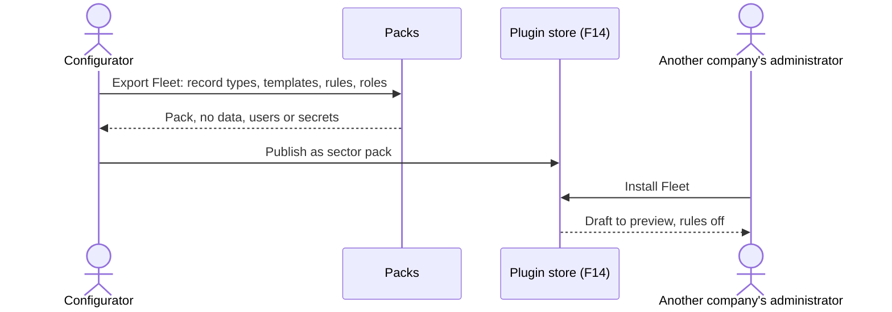

🏠 [Specs](../../../../README.md) › 🧩 [Functional capabilities](../../../README.md) ›
🔧 [F2 No-code configuration](../../README.md) › 📝 [Use cases](../README.md) ›
📝 [Use cases: FL-F2-06 Share a configuration](README.md) › 📝 UC-F2-11 Export or import a configuration as a pack

# 📝 UC-F2-11 Export or import a configuration as a pack

**Status:** ✅ specified

## Summary

A configurator exports part of the configuration as a pack; an administrator imports a pack, or publishes one to the
plugin store as a sector pack.

## Personas

- [U07 Administrator](../../../../01-users/personas/u07-administrator.md)
- Users with the Configurator role (D96, D98)
- [U11 IT provider administrator](../../../../01-users/personas/u11-provider-admin.md), sharing a configuration across
  clients

## Goal

A good configuration is reused across companies, and sector packs are built and shared.

## Trigger

A configuration worth sharing; a new company that needs it.

## Frequency

Rarely.

## Preconditions

For import: the administrator role.

## Postconditions

- **Export:** a pack file, or a pack published in the store.
- **Import:** a draft with the pack's configuration, previewed and published (UC-F2-09); its automations inactive.

## Main flow

1. The configurator opens Packs and chooses "Export".
2. They tick what goes in ([D134](../../../../06-decisions/f02-no-code-configuration/d134-pack-content.md)): record
   types and fields, templates, automations, roles.
3. simple-ERP builds the pack and shows what it holds, with no data, users or secrets (BR-F2-15).
4. They download it, or publish it to the plugin store as a sector pack
   ([D135](../../../../06-decisions/f02-no-code-configuration/d135-pack-sharing.md)).

## Alternative flows

- **Import:** an administrator uploads a pack or picks one in the store; simple-ERP shows what it adds and what it
  changes; it becomes a draft to preview and publish; its automations stay off until turned on.
- **Conflicts:** a field or role with the same name exists: the administrator chooses to keep theirs, take
  the pack's, or keep both under a new name.

## Error flows

- The pack was made by a newer simple-ERP version: refused, with the version needed.
- The pack needs a plugin the company does not have: the plugin is named, with a link to install it.

## Business rules

- [BR-F2-15 Packs carry no data](../../business-rules/br-f02-15-packs-carry-no-data.md)

## Entities

- [E-F2-11 Configuration pack](../../data/e-f02-11-configuration-pack.md)
- [E-F2-26 Configuration draft](../../data/e-f02-26-configuration-draft.md)

## Permissions

Export: the administrator and the Configurator role. Import and store publishing: the administrator.

## Notifications

The configurators are told when a pack is imported.

## Audit events

Pack exported, published, imported; what it added and changed.

## AI involvement

The AI assistant describes a pack in plain words before import.

## API, MCP and A2A exposure

The IT provider can import a pack into several client companies through its platform API.

## Screens

- [S-F2-11 Packs](../../screens/06-share-a-configuration/s-f02-11-packs.md)

## Flowchart

See [FL-F2-06 Share a configuration](../../flows/fl-f02-06-share-a-configuration.md#flowchart).

## Sequence diagram

## Acceptance criteria

1. **Given** an export **when** the pack is opened **then** it holds no record, user or secret.
2. **Given** an import **when** done **then** it is a draft, and its automations are off.
3. **Given** a name conflict **when** importing **then** the administrator chooses how to resolve it.
4. **Given** a pack published to the store **when** another company installs it **then** it gets the same configuration.

## Non-functional notes

None.

## Regulatory references

AGPL-3.0 (D9): packs published in the store follow the store's licence rules (F14).

## Related use cases

UC-F2-09; UC-F1-10 (templates copy configuration); F14.

- [UC-F2-25 Merge a sector pack upgrade with local changes](../10-change-safely/uc-f02-25-merge-a-sector-pack-upgrade-with-local-changes.md)

## Open questions

None.

---

⬅️ [UC-F2-10 Roll a configuration back](../05-publish-and-roll-back/uc-f02-10-roll-a-configuration-back.md) ·
⬆️ [Up](README.md) · ➡️ [UC-F2-12](../07-benchmark-additions/uc-f02-12-build-live-spreadsheets-and-dashboards.md)
