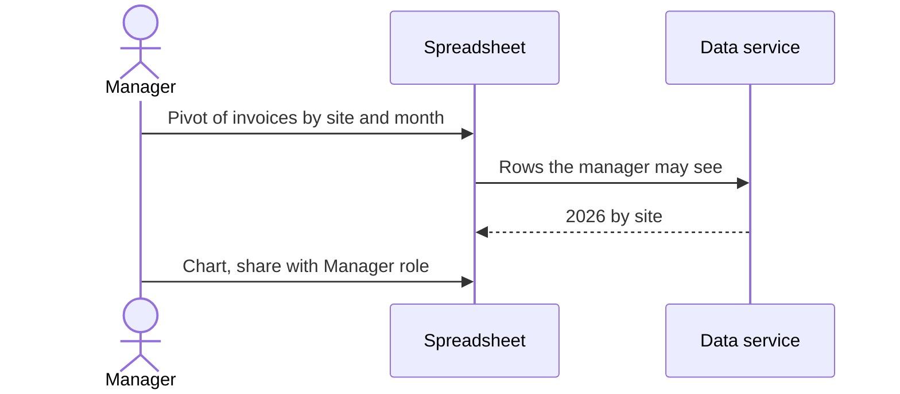

🏠 [Specs](../../../../README.md) › 🧩 [Functional capabilities](../../../README.md) ›
🔧 [F2 No-code configuration](../../README.md) › 📝 [Use cases](../README.md) ›
📝 [Use cases: FL-F2-07 Benchmark additions](README.md) › 📝 UC-F2-12 Build live spreadsheets and dashboards

# 📝 UC-F2-12 Build live spreadsheets and dashboards

**Status:** ✅ specified

## Summary

Spreadsheets and dashboards fed live by ERP data, with pivots, filters, charts and conditional formats, shared by role.

## Personas

- [U02 Manager](../../../../01-users/personas/u02-manager.md)
- [U13 Owner](../../../../01-users/personas/u13-owner.md)
- [U05 Accounting](../../../../01-users/personas/u05-accounting.md)

## Goal

Live figures in the form each manager wants, without exporting to another tool.

## Trigger

A manager needs a recurring view of figures.

## Frequency

Weekly per manager.

## Preconditions

F2 set up for the company.

## Postconditions

- **Succeeded:** the sheet or dashboard is saved and shared by role, refreshed live.
- **Failed:** nothing is shared.

## Main flow

1. The manager opens Spreadsheet ([S-F2-12](../../screens/07-benchmark-additions/s-f02-12-spreadsheet.md)) and inserts
   ERP data: a list or a pivot of a record type.
2. They filter, add formulas, a chart and conditional formats.
3. The data refreshes live; each viewer sees only the rows they may see
   ([BR-F2-02](../../business-rules/br-f02-02-custom-data-follows-permissions.md)).
4. They share it with roles or pin it as a dashboard tile on the home screen.

## Alternative flows

- 1a. The AI assistant builds the sheet from a sentence ("margin per site this year").
- 4a. Exported as a spreadsheet file, frozen at that time.

## Error flows

- 3e. A source the viewer may not read is left out, with a notice.
- 2e. A formula in error shows its message in the cell.

## Business rules

- See F2's rules.

## Entities

- [E-F2-12 Spreadsheet](../../data/e-f02-12-spreadsheet.md)

## Permissions

Managers, the owner and accounting create; viewers as shared.

## Notifications

Viewers: a sheet shared with them.

## Audit events

Sheets created, shared, exported.

## AI involvement

The AI assistant prepares it for confirmation
([BR-F3-07](../../../f03-assistant/business-rules/br-f03-07-no-deletes-no-irreversible-acts.md)); it never acts beyond
the user's rights.

## API, MCP and A2A exposure

T5 read of sheets with the caller's rights.

## Screens

- [S-F2-12](../../screens/07-benchmark-additions/s-f02-12-spreadsheet.md)

## Flowchart

See [FL-F2-07 Benchmark additions](../../flows/fl-f02-07-benchmark-additions.md#flowchart).

## Sequence diagram

## Acceptance criteria

1. **Given** Acme Bâtiment's invoices of 2026 **when** the owner pivots them by site and month **then** a live table and
   chart show the 12 months per site.
2. **Given** the sheet shared with Manager **when** the Lyon manager opens it **then** he sees only Lyon's rows.
3. **Given** an invoice posted at 10:00 **when** the sheet is opened at 10:01 **then** it is counted.
4. **Given** a formula dividing by an empty cell **when** it is computed **then** the cell shows its error message.

## Non-functional notes

D408's targets ([Performance](../../../../05-non-functional/performance.md)): 95 % of screens within 1 second; lists
paged on the server, the first page within 1 second; reports within 5 seconds or in the background.

## Regulatory references

Legal values from the country pack (D293).

## Related use cases

See [FL-F2-07](../../flows/fl-f02-07-benchmark-additions.md).

- [UC-F3-16 See the query behind a figure](../../../f03-assistant/use-cases/11-trust-the-answers/uc-f03-16-see-the-query-behind-a-figure.md)

## Open questions

None.

---

⬅️ [UC-F2-11](../06-share-a-configuration/uc-f02-11-export-or-import-a-configuration-as-a-pack.md) ·
⬆️ [Up](README.md) · ➡️ [UC-F2-13 Manage documents in a workspace](uc-f02-13-manage-documents-in-a-workspace.md)
