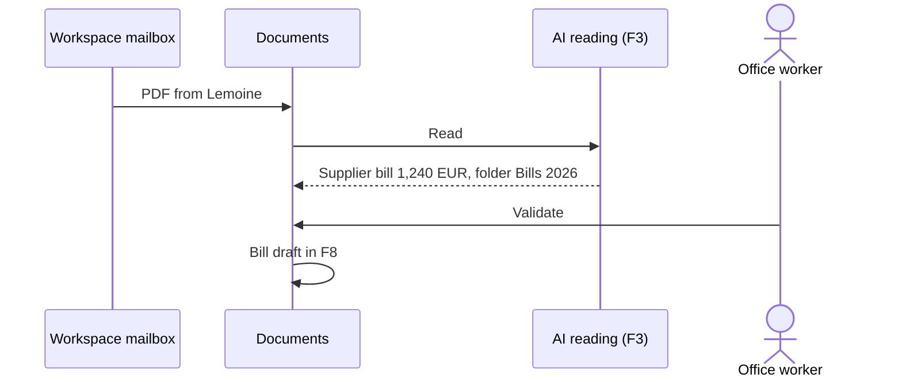

🏠 [Specs](../../../../README.md) › 🧩 [Functional capabilities](../../../README.md) ›
🔧 [F2 No-code configuration](../../README.md) › 📝 [Use cases](../README.md) ›
📝 [Use cases: FL-F2-07 Benchmark additions](README.md) › 📝 UC-F2-13 Manage documents in a workspace

# 📝 UC-F2-13 Manage documents in a workspace

**Status:** ✅ specified

## Summary

Folders, tags and automations for every file; requests for missing documents; scanner mail-in; AI reading turns PDFs
into bills or records.

## Personas

- [U16 Office worker](../../../../01-users/personas/u16-office-worker.md)
- [U05 Accounting](../../../../01-users/personas/u05-accounting.md)
- [U07 Administrator](../../../../01-users/personas/u07-administrator.md)

## Goal

Every document filed, findable and turned into records without typing.

## Trigger

A file arrives by upload, email or scanner.

## Frequency

Daily.

## Preconditions

F2 set up for the company.

## Postconditions

- **Succeeded:** the document is filed, tagged and, when it is a bill or a record, created as a draft.
- **Failed:** an unreadable file waits for a person.

## Main flow

1. Files arrive in Documents ([S-F2-13](../../screens/07-benchmark-additions/s-f02-13-documents-workspace.md)) by
   upload, the workspace's email address or the scanner mail-in.
2. The AI reads each file and proposes its folder, tags and the record it belongs to.
3. Rules tag and route it: a supplier bill becomes a bill draft in F8, a signed contract goes to the employee's folder.
4. A person validates what the AI proposed; the file is filed and the record created.
5. A missing document is requested from a contact, who uploads it from a link.

## Alternative flows

- 5a. Reminders until the requested document arrives (every 3 days).

## Error flows

- 2e. Unreadable file: listed for a person to file by hand.
- 4e. The proposed record already exists: the duplicate is shown.

## Business rules

- See F2's rules.

## Entities

- [E-F2-13 Document](../../data/e-f02-13-document.md)

## Permissions

Office workers, accounting and administrators; folders follow their access rights.

## Notifications

The person concerned: documents to validate; contacts: requests.

## Audit events

Filed, tagged, validated, requested.

## AI involvement

Reads and proposes; a person validates ([BR-F2-17](../../business-rules/br-f02-17-ai-built-items-are-drafts.md)).

## API, MCP and A2A exposure

T5 document operations with the caller's rights.

## Screens

- [S-F2-13](../../screens/07-benchmark-additions/s-f02-13-documents-workspace.md)

## Flowchart

See [FL-F2-07 Benchmark additions](../../flows/fl-f02-07-benchmark-additions.md#flowchart).

## Sequence diagram

## Acceptance criteria

1. **Given** a PDF bill of 1,240 EUR emailed to the workspace **when** it arrives **then** a bill draft is proposed in
   Bills 2026.
2. **Given** the office worker validates it **when** she confirms **then** the bill draft exists in F8 with the PDF.
3. **Given** a scan too blurred to read **when** it arrives **then** it is listed for filing by hand.
4. **Given** a missing certificate requested from a supplier **when** the supplier uploads it **then** it is filed on
   the supplier.

## Non-functional notes

D408's targets ([Performance](../../../../05-non-functional/performance.md)): 95 % of screens within 1 second; lists
paged on the server, the first page within 1 second; reports within 5 seconds or in the background.

## Regulatory references

Legal values from the country pack (D293).

## Related use cases

See [FL-F2-07](../../flows/fl-f02-07-benchmark-additions.md).

## Open questions

None.

---

⬅️ [UC-F2-12 Build live spreadsheets and dashboards](uc-f02-12-build-live-spreadsheets-and-dashboards.md) ·
⬆️ [Up](README.md) · ➡️ [UC-F2-14 Send documents for e-signature](uc-f02-14-send-documents-for-e-signature.md)
