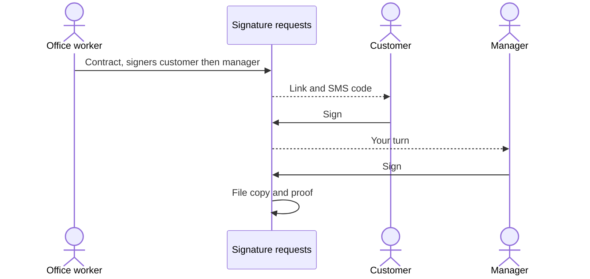

🏠 [Specs](../../../../README.md) › 🧩 [Functional capabilities](../../../README.md) ›
🔧 [F2 No-code configuration](../../README.md) › 📝 [Use cases](../README.md) ›
📝 [Use cases: FL-F2-07 Benchmark additions](README.md) › 📝 UC-F2-14 Send documents for e-signature

# 📝 UC-F2-14 Send documents for e-signature

**Status:** 🔄 waiting for the owner

## Summary

Any document sent for signature with a template, signer roles and order, reminders, an SMS code, an advanced or
qualified signature, and its proof kept.

## Personas

- [U16 Office worker](../../../../01-users/personas/u16-office-worker.md)
- [U03 Sales](../../../../01-users/personas/u03-sales.md)
- [U06 HR](../../../../01-users/personas/u06-hr.md)

## Goal

Documents signed fast, with a proof that holds.

## Trigger

A document needs a signature.

## Frequency

Weekly.

## Preconditions

F2 set up for the company.

## Postconditions

- **Succeeded:** the signed copy and its proof are filed on the record.
- **Failed:** an expired or refused request keeps its reason.

## Main flow

1. The office worker chooses the document and a signature template on Signature requests
   ([S-F2-14](../../screens/07-benchmark-additions/s-f02-14-signature-requests.md)).
2. They set the signers, their roles and order, and the level: simple, advanced or qualified,
   [CR-FR-020](../../../../10-country-packs/france/invoicing/cr-fr-020-electronic-acceptance-and-signature.md).
3. They send; signers get the link and an SMS code; reminders run.
4. Each signer signs in order; the next is told.
5. The signed copy and its proof file are filed on the record.

## Alternative flows

- 4a. A signer refuses with a reason: the request stops and the sender is told.

## Error flows

- 3e. The request expired: the sender resends it.
- 3e. The SMS code fails 3 times: the signer is blocked and the sender told.

## Business rules

- See F2's rules.

## Entities

- [E-F2-14 Signature request](../../data/e-f02-14-signature-request.md)

## Permissions

Office workers, sales and HR for the records they may change.

## Notifications

Signers: link and reminders; sender: each signature.

## Audit events

Sent, viewed, signed, refused, expired, with times.

## AI involvement

The AI assistant prepares the request from the record for confirmation.

## API, MCP and A2A exposure

T5 signature operations; the provider's API (T12).

## Screens

- [S-F2-14](../../screens/07-benchmark-additions/s-f02-14-signature-requests.md)

## Flowchart

See [FL-F2-07 Benchmark additions](../../flows/fl-f02-07-benchmark-additions.md#flowchart).

## Sequence diagram

## Acceptance criteria

1. **Given** a contract for Durand SA with the customer then the manager as signers **when** it is sent **then** Claire
   Durand gets the link and an SMS code.
2. **Given** the customer signed **when** the manager signs **then** the signed copy and the proof are filed on the
   deal.
3. **Given** a request expiring after 14 days (Proposed) **when** it expires unsigned **then** the sender can resend it.
4. **Given** the customer refuses with "price wrong" **when** she refuses **then** the request stops and the sender sees
   the reason.

## Non-functional notes

D408's targets ([Performance](../../../../05-non-functional/performance.md)): 95 % of screens within 1 second; lists
paged on the server, the first page within 1 second; reports within 5 seconds or in the background.

## Regulatory references

Legal values from the country pack (D293).

## Related use cases

See [FL-F2-07](../../flows/fl-f02-07-benchmark-additions.md).

## Open questions

None.

---

⬅️ [UC-F2-13 Manage documents in a workspace](uc-f02-13-manage-documents-in-a-workspace.md) · ⬆️ [Up](README.md) ·
➡️ [UC-F2-15 Build with plain language](uc-f02-15-build-with-plain-language.md)
