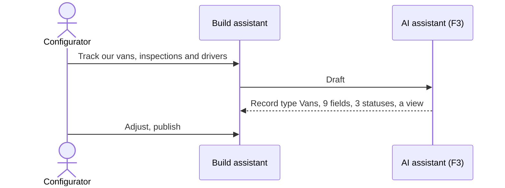

🏠 [Specs](../../../../README.md) › 🧩 [Functional capabilities](../../../README.md) ›
🔧 [F2 No-code configuration](../../README.md) › 📝 [Use cases](../README.md) ›
📝 [Use cases: FL-F2-07 Benchmark additions](README.md) › 📝 UC-F2-15 Build with plain language

# 📝 UC-F2-15 Build with plain language

**Status:** ✅ specified

## Summary

Describe a need and the AI drafts the record types, fields, workflows, small apps or agents to meet it.

## Personas

- [U07 Administrator](../../../../01-users/personas/u07-administrator.md)
- [U02 Manager](../../../../01-users/personas/u02-manager.md)

## Goal

Turn a need into a working configuration without knowing the tools.

## Trigger

A user describes a need.

## Frequency

A few times a month.

## Preconditions

F2 set up for the company.

## Postconditions

- **Succeeded:** drafts are built, reviewed and published by a configurator.
- **Failed:** nothing is published; drafts stay.

## Main flow

1. The configurator describes the need on the Build assistant
   ([S-F2-15](../../screens/07-benchmark-additions/s-f02-15-build-assistant.md)): "track our vans, their inspections and
   who drives them".
2. The AI drafts the record types, fields, statuses, workflows and views
   ([BR-F2-17](../../business-rules/br-f02-17-ai-built-items-are-drafts.md)).
3. The configurator previews them with sample data and adjusts.
4. They test in a sandbox ([UC-F2-16](uc-f02-16-try-a-change-in-a-sandbox.md)) if wanted, then publish
   ([UC-F2-09](../05-publish-and-roll-back/uc-f02-09-draft-preview-and-publish-a-change.md)).

## Alternative flows

- 2a. The AI asks questions when the need is unclear.

## Error flows

- 2e. A request beyond the user's rights: refused, with who can.
- 3e. A draft that breaks a rule check: shown before publishing.

## Business rules

- [BR-F2-17 What the AI builds is a draft](../../business-rules/br-f02-17-ai-built-items-are-drafts.md)

## Entities

- [E-F2-15 Sandbox](../../data/e-f02-15-sandbox.md)

## Permissions

The Configurator role ([D96](../../../../06-decisions/f02-no-code-configuration/d96-configurator-role.md)) and
administrators; record rules apply to the data shown.

## Notifications

Administrators: published changes.

## Audit events

Drafts built, changed, published.

## AI involvement

Drafts only; a configurator publishes ([BR-F2-17](../../business-rules/br-f02-17-ai-built-items-are-drafts.md)).

## API, MCP and A2A exposure

The MCP tool of F2 with the caller's rights.

## Screens

- [S-F2-15](../../screens/07-benchmark-additions/s-f02-15-build-assistant.md)

## Flowchart

See [FL-F2-07 Benchmark additions](../../flows/fl-f02-07-benchmark-additions.md#flowchart).

## Sequence diagram

## Acceptance criteria

1. **Given** the need "track our vans, inspections and drivers" **when** it is described **then** a record type Vans
   with its fields and statuses is drafted.
2. **Given** the drafts **when** nothing is published **then** no user sees them.
3. **Given** a user without the Configurator role **when** she asks to build **then** it is refused with who can.
4. **Given** a draft with a broken formula **when** publish is asked **then** the problem shows first.

## Non-functional notes

D408's targets ([Performance](../../../../05-non-functional/performance.md)): 95 % of screens within 1 second; lists
paged on the server, the first page within 1 second; reports within 5 seconds or in the background.

## Regulatory references

Legal values from the country pack (D293).

## Related use cases

See [FL-F2-07](../../flows/fl-f02-07-benchmark-additions.md).

## Open questions

None.

---

⬅️ [UC-F2-14 Send documents for e-signature](uc-f02-14-send-documents-for-e-signature.md) · ⬆️ [Up](README.md) ·
➡️ [UC-F2-16 Try a change in a sandbox](uc-f02-16-try-a-change-in-a-sandbox.md)
