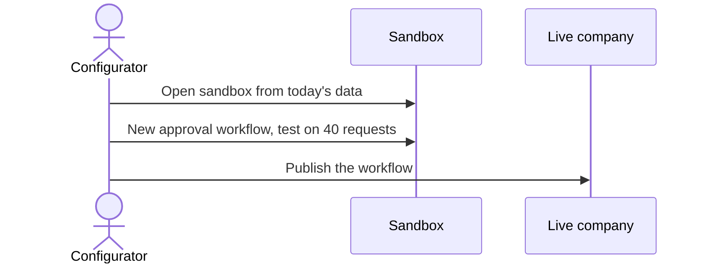

🏠 [Specs](../../../../README.md) › 🧩 [Functional capabilities](../../../README.md) ›
🔧 [F2 No-code configuration](../../README.md) › 📝 [Use cases](../README.md) ›
📝 [Use cases: FL-F2-07 Benchmark additions](README.md) › 📝 UC-F2-16 Try a change in a sandbox

# 📝 UC-F2-16 Try a change in a sandbox

**Status:** ✅ specified

## Summary

Open a full copy of the company to try changes, new workflows or AI-built items on real data, then publish what works.

## Personas

- [U07 Administrator](../../../../01-users/personas/u07-administrator.md)
- [U02 Manager](../../../../01-users/personas/u02-manager.md)

## Goal

Try changes on real data without risk.

## Trigger

A change to try before publishing.

## Frequency

Monthly.

## Preconditions

F2 set up for the company.

## Postconditions

- **Succeeded:** chosen changes are published; the sandbox expires.
- **Failed:** the live company is untouched.

## Main flow

1. The configurator opens a sandbox ([S-F2-16](../../screens/07-benchmark-additions/s-f02-16-sandbox.md)): a full copy
   of the company, marked as a sandbox.
2. They try changes, new workflows or AI-built items on the copied data
   ([BR-F2-16](../../business-rules/br-f02-16-sandbox-never-touches-live-data.md)).
3. They compare results with the live company.
4. They publish the chosen changes to the live company
   ([UC-F2-09](../05-publish-and-roll-back/uc-f02-09-draft-preview-and-publish-a-change.md)); the sandbox expires on its
   date.

## Alternative flows

- 1a. Several sandboxes at once.

## Error flows

- 1e. Disk space short: the oldest sandbox closes first.
- 2e. An email sent from the sandbox: blocked.

## Business rules

- [BR-F2-16 A sandbox never touches live data](../../business-rules/br-f02-16-sandbox-never-touches-live-data.md)

## Entities

- [E-F2-15 Sandbox](../../data/e-f02-15-sandbox.md)

## Permissions

The Configurator role ([D96](../../../../06-decisions/f02-no-code-configuration/d96-configurator-role.md)) and
administrators; record rules apply to the data shown.

## Notifications

The configurator: sandbox expiring.

## Audit events

Opened, published from, expired.

## AI involvement

AI-built items can be tried here first.

## API, MCP and A2A exposure

None.

## Screens

- [S-F2-16](../../screens/07-benchmark-additions/s-f02-16-sandbox.md)

## Flowchart

See [FL-F2-07 Benchmark additions](../../flows/fl-f02-07-benchmark-additions.md#flowchart).

## Sequence diagram

## Acceptance criteria

1. **Given** a sandbox opened on 2026-11-12 **when** a workflow is changed in it **then** the live company is unchanged.
2. **Given** an email action in the sandbox **when** it runs **then** it is blocked.
3. **Given** the workflow published from the sandbox **when** it is published **then** the live company uses it.

## Non-functional notes

D408's targets ([Performance](../../../../05-non-functional/performance.md)): 95 % of screens within 1 second; lists
paged on the server, the first page within 1 second; reports within 5 seconds or in the background.

## Regulatory references

Legal values from the country pack (D293).

## Related use cases

See [FL-F2-07](../../flows/fl-f02-07-benchmark-additions.md).

## Open questions

None.

---

⬅️ [UC-F2-15 Build with plain language](uc-f02-15-build-with-plain-language.md) · ⬆️ [Up](README.md) ·
➡️ [UC-F2-17](../08-views-and-bookings/uc-f02-17-add-a-kanban-calendar-map-gantt-or-timeline-view.md)
