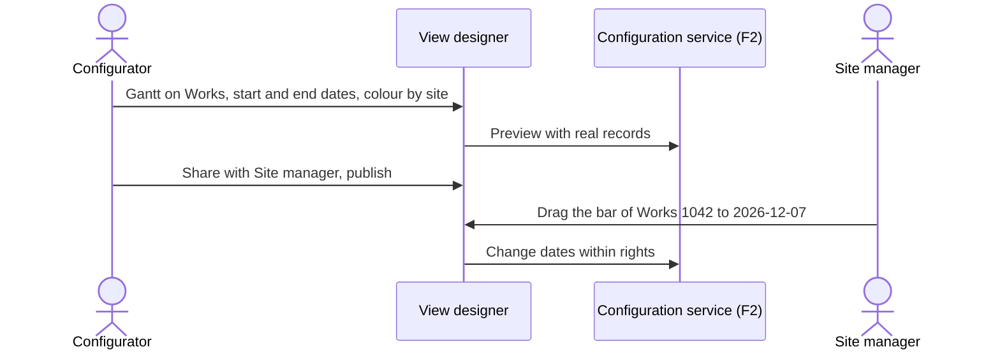

🏠 [Specs](../../../../README.md) › 🧩 [Functional capabilities](../../../README.md) ›
🔧 [F2 No-code configuration](../../README.md) › 📝 [Use cases](../README.md) ›
📝 [Use cases: FL-F2-08 Views and bookings](README.md) › 📝 UC-F2-17 Add a kanban, calendar, map, Gantt or timeline view

# 📝 UC-F2-17 Add a kanban, calendar, map, Gantt or timeline view

**Status:** 🔄 waiting for the owner

## Summary

A configurator adds a view to a record type: a kanban board by status, a calendar on a date, a map on an address, a
Gantt chart on start and end dates, or a timeline; users switch between views.

## Personas

- [U07 Administrator](../../../../01-users/personas/u07-administrator.md)
- [U02 Manager](../../../../01-users/personas/u02-manager.md)
- [U22 Site manager](../../../../01-users/personas/u22-site-manager.md)

## Goal

Each record type is seen the way its work is done: rounds on a map, housekeeping on a board, site planning on a Gantt
chart.

## Trigger

A team asks to see its records differently, or a sector pack brings a view.

## Frequency

A few times per record type, at setup and when work changes.

## Preconditions

- The record type has the field the view needs: a status, a date, an address, start and end dates.

## Postconditions

- **Succeeded:** the view is shared with the chosen roles and shows the records each user may see.
- **Failed:** the draft view is kept unpublished; users keep the list.

## Main flow

1. The configurator opens a record type and chooses Views › Add a view
   ([S-F2-17](../../screens/08-views-and-bookings/s-f02-17-view-designer.md)).
2. They pick the type (kanban, calendar, map, Gantt, timeline) and the fields it uses: the column field, the date or
   dates, the address, the colour and the card's fields.
3. simple-ERP previews the view with real records
   ([UC-F2-09](../05-publish-and-roll-back/uc-f02-09-draft-preview-and-publish-a-change.md)).
4. They share it with roles, as a personal or shared view
   ([D109](../../../../06-decisions/f02-no-code-configuration/d109-list-views.md)), and publish.
5. Users switch views from the list; moving a card or a bar changes the record, within their rights.

## Alternative flows

- 2a. The kanban's columns are the statuses: moving a card follows the transitions
  ([BR-F2-05](../../business-rules/br-f02-05-core-statuses-are-locked.md)).
- 5a. On a phone, the map and the calendar show; the Gantt chart shows as a list of dates (Proposed).

## Error flows

- 2e. The record type has no date field: the calendar, Gantt and timeline are not offered, with the reason.
- 5e. A move the transition rules forbid: the card goes back with the reason.
- 5e. A record without an address: listed beside the map as "not placed".

## Business rules

- [BR-F2-02 Custom data follows permissions](../../business-rules/br-f02-02-custom-data-follows-permissions.md)
- [BR-F2-05 Core statuses are locked](../../business-rules/br-f02-05-core-statuses-are-locked.md)
- [BR-F2-07 Layout is not security](../../business-rules/br-f02-07-layout-is-not-security.md)
- [BR-F1-32 Records on a map only for roles with the map right](../../../f01-administration/business-rules/br-f01-32-map-right-for-planners-and-managers.md)

## Entities

- [E-F2-16 Visual view](../../data/e-f02-16-visual-view.md)
- [E-F2-04 List view](../../data/e-f02-04-list-view.md)

## Permissions

The Configurator role ([D96](../../../../06-decisions/f02-no-code-configuration/d96-configurator-role.md));
administrators. Record rules of the record type apply to the data shown.

## Notifications

Users of the roles get the new view in their record type's menu.

## Audit events

View created, changed, shared, archived; record changes made from a view as in the record's own audit.

## AI involvement

The build assistant can draft it from a plain description
([UC-F2-15](../07-benchmark-additions/uc-f02-15-build-with-plain-language.md)); what it builds is a draft for the
configurator to check and publish ([BR-F2-17](../../business-rules/br-f02-17-ai-built-items-are-drafts.md)).

## API, MCP and A2A exposure

T5 configuration operations with the Configurator rights; the MCP tool of F2 reads it; no A2A skill.

## Screens

- [S-F2-17 View designer](../../screens/08-views-and-bookings/s-f02-17-view-designer.md)
- [S-F2-04 List view settings](../../screens/01-configure-a-record-type/s-f02-04-list-view-settings.md)

## Flowchart

See [FL-F2-08 Views and bookings](../../flows/fl-f02-08-views-and-bookings.md#flowchart).

## Sequence diagram

## Acceptance criteria

1. **Given** the record type Works with start and end dates **when** a Gantt view is added and shared with Site manager
   **then** Acme Bâtiment's site managers see each work as a bar.
2. **Given** a kanban on Rooms by status **when** a housekeeper moves room 204 from Dirty to Clean **then** room 204's
   status changes and the move is in its history.
3. **Given** Interventions without a date field **when** a calendar is asked **then** it is not offered, with the
   reason.
4. **Given** a map of Visits with 3 visits without an address **when** it opens **then** the 3 visits are listed as not
   placed.

## Non-functional notes

A view of 2,000 records opens within 2 seconds (Proposed).

## Regulatory references

None.

## Related use cases

- [UC-F2-03 Arrange a form](../01-configure-a-record-type/uc-f02-03-arrange-a-form.md)
- [UC-F2-18 Make a record type bookable](uc-f02-18-make-a-record-type-bookable.md)

## Open questions

None.

---

⬅️ [UC-F2-16 Try a change in a sandbox](../07-benchmark-additions/uc-f02-16-try-a-change-in-a-sandbox.md) ·
⬆️ [Up](README.md) · ➡️ [UC-F2-18 Make a record type bookable](uc-f02-18-make-a-record-type-bookable.md)
