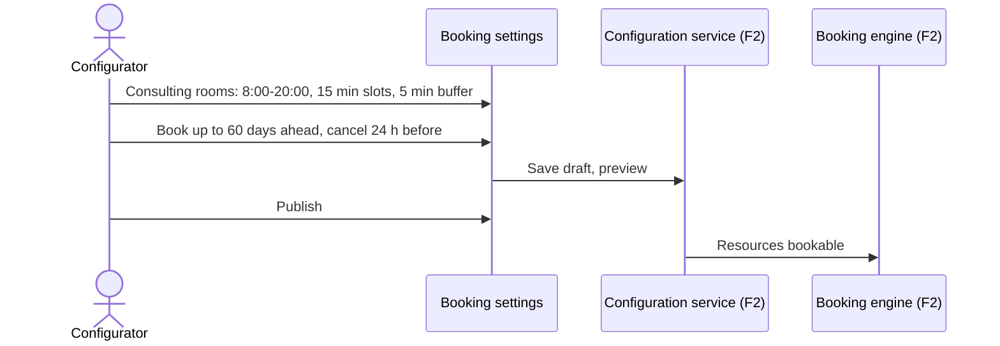

🏠 [Specs](../../../../README.md) › 🧩 [Functional capabilities](../../../README.md) ›
🔧 [F2 No-code configuration](../../README.md) › 📝 [Use cases](../README.md) ›
📝 [Use cases: FL-F2-08 Views and bookings](README.md) › 📝 UC-F2-18 Make a record type bookable

# 📝 UC-F2-18 Make a record type bookable

**Status:** 🔄 waiting for the owner

## Summary

A configurator turns any record type into bookable resources (rooms, equipment, vehicles, venues, practitioners) with
opening hours, slot length, capacity and booking rules: the shared booking engine of D457.

## Personas

- [U07 Administrator](../../../../01-users/personas/u07-administrator.md)
- [U28 Hotel receptionist](../../../../01-users/personas/u28-hotel-receptionist.md)
- [U33 Medical secretary](../../../../01-users/personas/u33-medical-secretary.md)
- [U38 Training coordinator](../../../../01-users/personas/u38-training-coordinator.md)
- [U43 Event producer](../../../../01-users/personas/u43-event-producer.md)

## Goal

One booking engine for every sector: hotel rooms, consulting rooms, training rooms, venues, meeting rooms.

## Trigger

A company needs to book something it manages as records.

## Frequency

Once per bookable record type, then when the rules change.

## Preconditions

- The record type exists ([UC-F2-04](../01-configure-a-record-type/uc-f02-04-create-a-new-record-type.md)) or comes from
  a sector pack.

## Postconditions

- **Succeeded:** the record type's records are bookable on the booking calendar and, if chosen, on a portal.
- **Failed:** the record type stays as it was.

## Main flow

1. The configurator opens a record type and chooses Make bookable
   ([S-F2-18](../../screens/08-views-and-bookings/s-f02-18-booking-settings.md)).
2. They set the opening hours, the slot length or nights, the capacity per resource, the buffer between bookings, and
   who may book: users, portal users or the public booking page.
3. They set the rules: how early and how late one may book or cancel, the maximum length, the approvals needed, and what
   a booking creates (an invoice line, a task)
   ([BR-F2-19](../../business-rules/br-f02-19-booking-rules-decide-who-books-what-and-when.md)).
4. They preview the booking calendar with real resources and publish.
5. Bookings are made on the booking calendar ([UC-F2-19](uc-f02-19-book-a-resource.md)) and from other blocks: F4
   meeting rooms, F6 rentals, the sector packs.

## Alternative flows

- 2a. Resources need each other (a room and a projector): a booking can hold several resources.
- 3a. Booking costs money: the price comes from a price list,
  [UC-F6-12](../../../f06-customers-and-sales/use-cases/01-lead-to-quote/uc-f06-12-manage-price-lists-and-discounts.md),
  and a deposit can be asked.

## Error flows

- 2e. Opening hours that never open: refused, with the reason.
- 3e. A rule that refuses every booking (book at least 30 days ahead, at most 7): refused, with the reason.

## Business rules

- [BR-F2-18 One booking per resource and slot](../../business-rules/br-f02-18-one-booking-per-resource-and-slot.md)
- [BR-F2-19 Booking rules decide who books what and when](../../business-rules/br-f02-19-booking-rules-decide-who-books-what-and-when.md)

## Entities

- [E-F2-17 Bookable resource setting](../../data/e-f02-17-bookable-resource-setting.md)
- [E-F2-05 Record type](../../data/e-f02-05-record-type.md)

## Permissions

The Configurator role ([D96](../../../../06-decisions/f02-no-code-configuration/d96-configurator-role.md));
administrators. Record rules of the record type apply to the data shown.

## Notifications

Users who may book are told the record type is bookable.

## Audit events

Bookable settings created and changed, with before and after.

## AI involvement

The build assistant can draft it from a plain description
([UC-F2-15](../07-benchmark-additions/uc-f02-15-build-with-plain-language.md)); what it builds is a draft for the
configurator to check and publish ([BR-F2-17](../../business-rules/br-f02-17-ai-built-items-are-drafts.md)).

## API, MCP and A2A exposure

T5 configuration operations with the Configurator rights; the MCP tool of F2 reads it; no A2A skill.

## Screens

- [S-F2-18 Booking settings](../../screens/08-views-and-bookings/s-f02-18-booking-settings.md)

## Flowchart

See [FL-F2-08 Views and bookings](../../flows/fl-f02-08-views-and-bookings.md#flowchart).

## Sequence diagram

## Acceptance criteria

1. **Given** the record type Consulting rooms with 8 rooms at the Maison de santé des Coteaux **when** it is made
   bookable 8:00 to 20:00 in 15-minute slots **then** the 8 rooms show on the booking calendar.
2. **Given** a 5-minute buffer **when** a booking ends at 10:15 **then** the next one in that room starts at 10:20 at
   the earliest.
3. **Given** a rule "at least 30 days ahead and at most 7" **when** it is saved **then** it is refused as impossible.
4. **Given** Training rooms priced at 120 EUR a day **when** a room is booked for 2 days **then** an invoice line of 240
   EUR is prepared.

## Non-functional notes

Up to 500 resources per record type (Proposed).

## Regulatory references

None.

## Related use cases

- [UC-F2-19 Book a resource](uc-f02-19-book-a-resource.md)
- [UC-F4-21 Book a meeting room and equipment](../../../f04-meetings/use-cases/12-rooms-and-client-video/uc-f04-21-book-a-meeting-room-and-equipment.md)
- [UC-F6-15 Rent out equipment](../../../f06-customers-and-sales/use-cases/05-benchmark-additions/uc-f06-15-rent-out-equipment.md)

## Open questions

None.

---

⬅️ [UC-F2-17](uc-f02-17-add-a-kanban-calendar-map-gantt-or-timeline-view.md) · ⬆️ [Up](README.md) ·
➡️ [UC-F2-19 Book a resource](uc-f02-19-book-a-resource.md)
